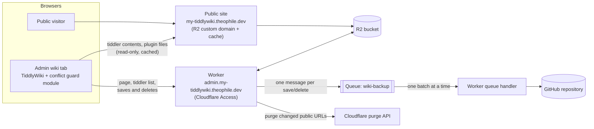
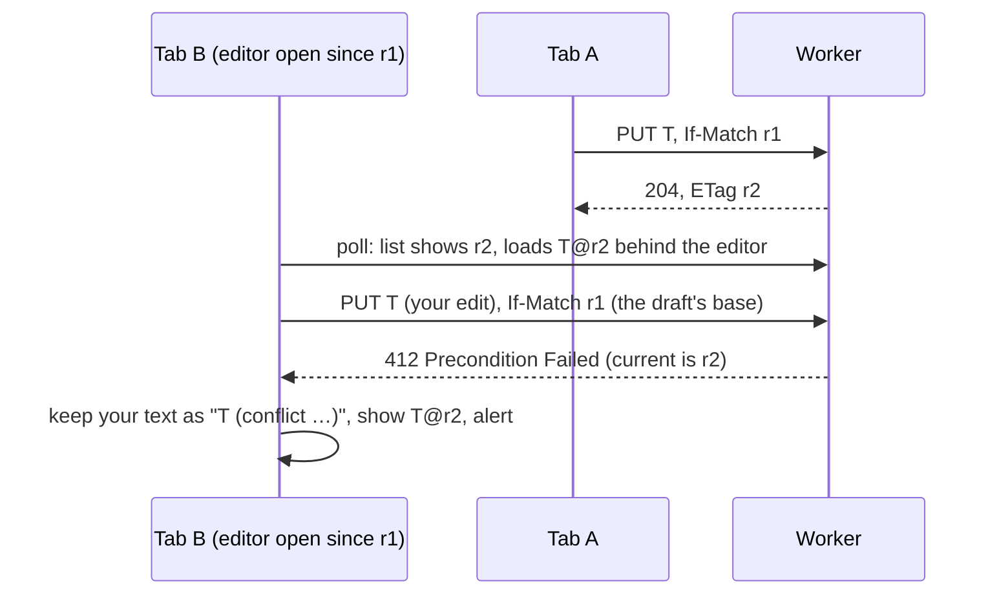
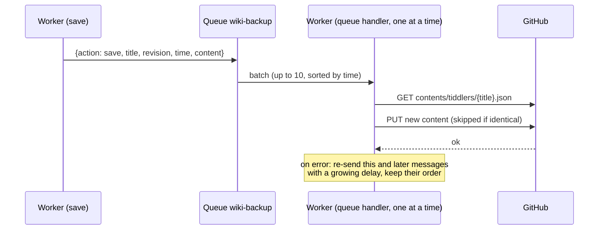
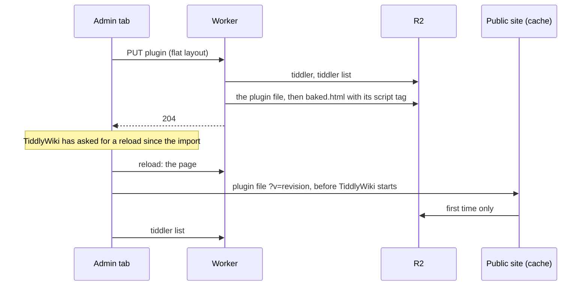

# TiddlyWiki on Cloudflare (Worker + R2 + Queue + GitHub)

A personal [TiddlyWiki](https://tiddlywiki.com) with two faces:

- **Admin wiki:** `https://admin.my-tiddlywiki.theophile.dev`, editable, behind Cloudflare Access. A Cloudflare Worker speaks TiddlyWiki's TiddlyWeb sync protocol and stores every tiddler in an R2 bucket.
- **Public wiki:** `https://my-tiddlywiki.theophile.dev`, read-only. It's the same R2 bucket served directly through R2's custom domain and Cloudflare's cache, with no worker involved.

Every save is backed up to a GitHub repository as its own commit, through a Cloudflare Queue.

The worker also does the following:
- **Protects against edit conflicts:** two tabs or devices editing the same tiddler can no longer silently overwrite each other.
- **Keeps the public copy fresh:** it purges exactly the cached URLs that changed.
- **Runs plugins installed from the wiki:** each plugin gets its own file, which the page loads from the public site before TiddlyWiki starts, on both sites.
- **Uses as few worker requests as it can.**

This document covers the setup, how each part works, and why it was built this way.

---

## Contents

1. [Architecture](#1-architecture)
2. [Repository layout](#2-repository-layout)
3. [Setup](#3-setup)
4. [How it works](#4-how-it-works)
5. [Why it is built this way](#5-why-it-is-built-this-way)
6. [Operating it](#6-operating-it)
7. [Troubleshooting](#7-troubleshooting)
8. [Known limits](#8-known-limits)
9. [Development and tests](#9-development-and-tests)
10. [Reference](#10-reference)

---

## 1. Architecture



| Piece | Role |
|---|---|
| **Worker** (`worker.js`) | Serves the admin wiki: the HTML page, TiddlyWeb endpoints, saves and deletes, conflict checks, cache purges. It writes a file for each plugin, and consumes the backup queue. |
| **Conflict guard** (`src/conflict-guard.js`) | A TiddlyWiki startup module that the worker builds into the page. It makes the browser send the version each edit is based on, handles conflicts, cuts unneeded requests, and sends saves in the layout the worker stores. |
| **R2 bucket** | Holds everything: the wiki HTML, the tiddler list, one JSON file per tiddler and one script per plugin. |
| **Public site** | The bucket's custom domain. Cloudflare caches it, and nothing on it runs the worker. |
| **Queue** `wiki-backup` | Holds one message per save or delete until it has been committed to GitHub. |
| **GitHub repository** | Version history: one commit per save, in `tiddlers/<title>.json`. |

---

## 2. Repository layout

```
├── README.md                 this document
├── worker.js                 GENERATED: the file you deploy (npm run build)
├── docs/
│   └── external-plugins.md   design notes for plugin files (4.8)
├── tiddlers/                 the GitHub backup (4.7): one JSON file per tiddler, committed by the worker
├── src/
│   ├── worker.src.js         the worker's source
│   └── conflict-guard.js     the browser module, embedded into worker.js by the build
├── build.mjs                 inserts src/conflict-guard.js into src/worker.src.js → worker.js
├── wrangler.example.toml     all bindings and settings, for deploying with wrangler
├── package.json              build and test scripts
└── test/
    ├── make-fixture.mjs      builds a test TiddlyWiki (test/fixtures/index.html)
    ├── two-tabs.test.mjs     real TiddlyWiki in Chromium, several tabs (63 checks)
    ├── plugins.test.mjs      real plugins on the admin and public sites (65 checks)
    ├── queue-backup.test.mjs queue backup against an imitation of GitHub (17 checks)
    ├── integrity.test.mjs    the tiddler list's integrity, draft-like titles, .gitignore (47 checks)
    ├── r2-ops.test.mjs       R2 calls per kind of request, against a budget (13 checks)
    ├── r2-counter.mjs        test-only wrapper that counts the worker's R2 calls
    └── bake.test.mjs         page serving and rebuilding (15 checks)
```

The browser module lives in its own file so it can be read and edited as normal JavaScript. The build embeds it in `worker.js` as a string (`CONFLICT_GUARD_SOURCE`), so only one file is deployed, which you can paste into the dashboard. The string is written as JSON, so the module can contain any character, backticks and `${` included.

---

## 3. Setup

Everything below can be done in the Cloudflare dashboard. `wrangler.example.toml` has the same settings for `npx wrangler deploy`.

### 3.1 R2 bucket

1. **Create a bucket** and upload:
   - **`index.html`:** a TiddlyWiki file that includes the TiddlyWeb plugin (`$:/plugins/tiddlywiki/tiddlyweb`). This is the wiki "engine"; your content lives in the tiddler files.
   - **`status`**, with this content. It's the TiddlyWeb status for the public site, which serves R2 directly: without it, public tabs don't know the recipe and can't load the tiddler list. (The admin site gets its own from the worker.)

     ```json
     {
       "username": "GUEST",
       "read_only": true,
       "anonymous": true,
       "logout_is_available": false,
       "space": {
         "recipe": "default"
       }
     }
     ```

   The tiddler list (`recipes/default/tiddlers.json`) isn't needed: if it's missing, the worker creates it from the stored tiddlers, an empty list for a new wiki (4.2).
2. **Turn on public access:**
   - **Custom Domains:** connect `my-tiddlywiki.theophile.dev`.
   - **Public Development URL (`r2.dev`):** keep it disabled. It's a second public address that skips the zone's cache and rules.
   - **CORS Policy:** leave it empty. A transform rule handles CORS instead (see 3.5 and 5.9).

Everything in the bucket is public through the custom domain, including tiddlers, the tiddler list and the HTML. That's intended: nothing private belongs in this bucket. Secrets live in the worker's settings, not in R2.

### 3.2 Worker

1. **Deploy `worker.js`** (ES module format).
2. **Attach it to `admin.my-tiddlywiki.theophile.dev`**, as a Custom Domain or a route covering every path.
3. **Bindings:**

   | Binding | Type | Required |
   |---|---|---|
   | `WIKI_BUCKET` | R2 bucket | yes |
   | `BACKUP_QUEUE` | Queue (producer) → `wiki-backup` | for queued backups (see 3.4) |

4. **Variables and secrets:**

   | Name | Kind | Purpose |
   |---|---|---|
   | `GITHUB_REPO` | variable | `owner/repo` of the backup repository |
   | `GITHUB_BRANCH` | variable | branch to commit to (default `main`) |
   | `GITHUB_TOKEN` | **secret** | fine-grained token, *Contents: read and write* on that repository |
   | `CF_ZONE_ID` | variable | zone id of `theophile.dev`, for cache purges |
   | `CF_API_TOKEN` | **secret** | API token with *Zone → Cache Purge* on that zone |
   | `PUBLIC_WIKI_URL` | variable, optional | public address (default `https://my-tiddlywiki.theophile.dev`) |
   | `CONFLICT_GUARD` | variable, optional | `off` stops building the browser module into the page |
   | `BACKUP_RETRY_SECONDS` | variable, optional | first retry delay for failed backups (default 60) |

   The worker doesn't check who's saving: Cloudflare Access protects the admin host (3.3).

   Purges are skipped without `CF_ZONE_ID`/`CF_API_TOKEN`, and backups without `GITHUB_REPO`/`GITHUB_TOKEN`.

### 3.3 Cloudflare Access

Protect the worker with **Worker Access → All traffic** (production and preview URLs) and a policy allowing your Cloudflare account members. This covers the custom domain, the worker's `workers.dev` address and its preview URLs. Requests Access blocks never reach the worker, so they cost no quota.

### 3.4 Backup queue

1. **Create the queue** under Storage & Databases → Queues: `wiki-backup`.
2. **Producer:** in the worker's Settings → Bindings, add a Queue binding named `BACKUP_QUEUE` that points to `wiki-backup`.
3. **Consumer:** in the queue's settings, add a consumer with these settings:

   | Setting | Value | Why |
   |---|---|---|
   | Worker | this worker | |
   | Batch size | 10 | one run stays within the free plan's 50-subrequest limit |
   | Batch wait time | 5 seconds | commits appear a few seconds after a save |
   | Maximum concurrency | **1** | backups run one at a time, so commits never collide |
   | Retries / dead letter queue | leave as they are | the code re-queues failures itself (see 4.7) |

Until `BACKUP_QUEUE` is bound, the worker runs the same backup directly after each save, with a couple of quick retries but no long-term waiting. So the deploy order doesn't matter.

### 3.5 Zone rules (`theophile.dev`)

**URL rewrite**, so the public site opens on the baked page:
- **When:** `http.host eq "my-tiddlywiki.theophile.dev"` and `http.request.uri.path eq "/"`
- **Then:** rewrite the path to `/baked.html`

Include the hostname condition, so `/` on other hostnames in the zone isn't rewritten too.

**Cache rule "Cache Public Wiki":**
- **When:** `http.host eq "my-tiddlywiki.theophile.dev"`
- **Cache eligibility:** eligible for cache
- **Edge TTL:** ignore the cache-control header and use a TTL. R2 sends none, and every change made through the worker is purged right away. One day is a safe default. Longer works too, but a missed purge or a file uploaded to R2 by hand then stays stale that long.
- **Browser TTL:** override with something short, for example 5 minutes. Purges can't reach visitors' browsers, and without this Cloudflare's default of 4 hours applies.
- **Serve stale content while revalidating:** off.
- **Cache key:** the defaults. The query string must stay in the key, because purges target exact URLs (see 4.6).

**Cache rule "Cache plugin files"**, placed *after* "Cache Public Wiki" (when several rules match, the last one wins):
- **When:** `http.host eq "my-tiddlywiki.theophile.dev"` and `starts_with(http.request.uri.path, "/_plugins/")`
- **Cache eligibility:** eligible for cache
- **Edge TTL:** use cache-control header if present, use default Cloudflare caching behavior if not. Plugin files carry `Cache-Control: public, max-age=31536000, immutable`.
- **Browser TTL:** respect origin
- **Cache key:** the defaults. The query string (`?v=<revision>`) must stay in the key: it's what makes each version a new URL.

Plugin files are never purged: each version has its own URL (4.8). Without this rule they follow "Cache Public Wiki", which still works, but browsers re-check them every few minutes.

A "Bypass cache" rule for the admin host is optional. Cloudflare never caches responses a worker generates itself, so it changes nothing; it only matters if part of that host were ever served by something else.

**Response header transform rule "CORS for admin wiki":**
- **When:** `http.host eq "my-tiddlywiki.theophile.dev"` and `starts_with(http.request.uri.path, "/recipes/")`
- **Then:** set the static header `Access-Control-Allow-Origin` to `https://admin.my-tiddlywiki.theophile.dev` (no trailing slash)

This lets the admin wiki read tiddler contents from the public site (see 4.5 and 5.9). Without it, everything still works, but every tiddler is fetched through the worker.

**Configuration rule "Admin page as is":**
- **When:** `http.host eq "admin.my-tiddlywiki.theophile.dev"`
- **Then:** Automatic HTTPS Rewrites off, Email Obfuscation off, Rocket Loader off, Fonts off, Disable Real User Monitoring (RUM), Disable Zaraz.

Cloudflare features that rewrite HTML remove the page's `ETag`, and without it the browser downloads the whole page at every load instead of getting a `304` (4.3). None of them does anything useful for the admin page. Only the HTML is affected: the JSON responses keep their ETags either way.

### 3.6 GitHub

- **A repository** for the backup. Files go in `tiddlers/`.
- **A fine-grained personal access token** limited to that repository, with *Contents: read and write*. Store it as the `GITHUB_TOKEN` secret.

---

## 4. How it works

### 4.1 Requests the worker answers

| Request | What happens |
|---|---|
| `OPTIONS *` | CORS headers (allows `If-Match`, `If-None-Match`, `X-Tiddler-Layout`, exposes `ETag`, `X-Tiddler-List` and `Retry-After`). |
| `GET /status` | TiddlyWeb status: user `admin`, writable, recipe `default`. The same answer is baked into the page, so admin pages don't ask (4.5). |
| `GET /`, `/index.html`, `/baked.html` | The wiki page, rebuilt first if outdated, or `304 Not Modified` when the browser has it (4.3). |
| `GET recipes/default/tiddlers.json` | The tiddler list, or `304 Not Modified` when unchanged (4.5), or `503` while it's being rebuilt (4.2). |
| `GET recipes/default/tiddlers/<title>` | One tiddler as JSON (a flat one exactly as stored, see 4.2), with its revision in the body and the `ETag`. |
| `GET <any other key>` | That R2 object as is. |
| `PUT recipes/default/tiddlers/<title>` | Save (4.4): precondition check, conditional write, list update, purge, backup; for a plugin, its file and the page (4.8). Stored flat, whatever layout it arrives in (4.2). A body that isn't a tiddler (a JSON object whose `title` is text, the same as in the URL), or with a value that isn't text, gets `400`. |
| `DELETE bags/<bag>/tiddlers/<title>` (or `recipes/<recipe>/…`) | Delete (4.4): same checks, then removal, purge, backup. |
| queue messages | Backup to GitHub (4.7). |

**Ephemeral titles.** These are never stored or backed up: `$:/StoryList`, `$:/HistoryList`, anything under `$:/state/`, `$:/temp/` or `$:/status/`, and drafts, recognised by their `draft.of` field. A title alone doesn't make a draft: a tiddler called `Draft of 'Chapter 1'` is saved like any other. A `PUT` of one answers `204` with a throwaway ETag, and a `DELETE` answers `204`. In practice the browser doesn't send them: TiddlyWiki's own sync filter leaves out `$:/HistoryList`, `$:/state/`, `$:/temp/` and `$:/status/`, and the conflict guard also leaves out drafts and `$:/StoryList` (4.5).

### 4.2 Storage, revisions and ETags

R2 layout:

| Key | Content |
|---|---|
| `index.html` | The wiki engine you uploaded. |
| `status` | The public site's TiddlyWeb status, uploaded once (3.1). |
| `baked.html` | Generated: `index.html` plus the tiddlers needed at startup (4.3). |
| `recipes/default/tiddlers.json` | The "skinny" tiddler list, as compact JSON: title, tags, type, dates, custom fields and revision for every tiddler, but no text. If it's ever missing or damaged, the worker rebuilds it from the stored tiddlers (below). |
| `recipes/default/tiddlers/<title>` | One tiddler as JSON, flat (below), under its raw title. |
| `_plugins/<title>.js` | Generated: the script that loads a plugin or JavaScript module into the page (4.8). |
| `_backup/versions/…` | Temporary copies of large versions waiting to be backed up (4.7). |
| `_repair/…` | Left by a rebuild of the tiddler list: the damaged copy, and the progress of a rebuild that takes several requests (below). |

**Revisions.** Each save gets a new revision, `Date.now()` in milliseconds. It's stored in three places that always agree: the object's custom metadata, the `revision` field inside the tiddler JSON, and the tiddler list. `GET`, `PUT` and `DELETE` all read it from the metadata, which avoids false conflicts.

**One layout.** Every tiddler is stored *flat*: every field at the top level, compact JSON, `text` last, then `revision`, `bag` and `recipe`, with `layout: flat` and the revision in the object's metadata. The conflict guard sends saves that way, with the header `X-Tiddler-Layout: flat` and without `revision`, `bag` or `recipe`. The worker then parses only the few hundred bytes before `"text"` and appends its `revision`, `bag` and `recipe`, working on the raw bytes: it never decodes, parses or re-encodes the text itself, which for a plugin is the whole plugin. Anything else is parsed and turned into that layout first: a body sent with the header but not in the layout (pretty-printed, or with `revision` before `text`), or TiddlyWeb's layout, with custom fields nested under `fields`, which TiddlyWiki sends without the guard. Field values must be text or lists of text, as TiddlyWiki's are; a value that's an object (only a script could send one) is refused with `400`. One field is the exception: a field called `fields` stays nested, as `"fields":{"fields":"…"}`, the way TiddlyWeb's layout has it, because a flat `fields` is where TiddlyWiki's loader looks for nested custom fields. A rebuilt list only includes objects in this layout: anything else in R2, left by an older version or uploaded by hand, is left out, with a line in the logs (6, 7). To convert a bucket filled by an older version, see 6.

| Plugin size | Worker CPU to handle the body, parsed (TiddlyWeb's layout) | Flat layout |
|---|---|---|
| 240 KB (markdown) | about 2.6 ms | about 0.1 ms |
| 735 KB (KaTeX) | about 6.5 ms | about 0.3 ms |
| 945 KB (geospatial) | about 10 ms | about 0.4 ms |

Measured in Node.js (the same JavaScript engine as Workers) on a development machine, so only the proportions matter.

**A damaged or missing tiddler list rebuilds itself.** The list is only an index: every tiddler is also stored on its own, with all its fields. If the list can't be read (a bad upload or a hand edit) or is missing, the worker rebuilds it from the stored tiddlers wherever it needs it (serving it, a save, a delete, a page build) and carries on. Nothing needs doing by hand, and nothing runs in the background: the requests do the work.
- **It reads as little as it can.** A tiddler's fields come before `"text"`, so it reads only the first 16 KB of each object (more only for fields bigger than that). Each tiddler is listed under the title it's stored under. Objects not in the stored layout (an older version's, or uploaded by hand) are left out, with a line in the logs.
- **A big wiki takes several requests.** A request may make 1,000 R2 calls and use about 10 ms of CPU, so each request reads up to 100 tiddlers and keeps its progress in `_repair/`. Meanwhile the list, saves and deletes answer `503` with `X-Tiddler-List: rebuilding`, before changing anything (unless the list is damaged in the middle of that very request). The open tab sends them again at once, quietly (the conflict guard does this; roughly a second per 100 tiddlers), and each of those requests takes the next step. The damaged list is replaced only when the new one is complete. That last step writes the list as the steps built it, without parsing it, so it costs no more than the others.
- **Public tabs keep their tiddlers.** They read the list straight from R2. A missing list is replaced by a short text while it's rebuilt (each rebuild has its own, so it can't be mistaken for another one's). It isn't JSON, because TiddlyWiki removes every tiddler that isn't in the list it gets, and would take any JSON for one. The conflict guard recognises that text and fetches the list again every few seconds, at a URL no cache holds, and turns a list it can't read (a damaged upload) into an ordinary sync error, after asking once more past any cached copy, instead of TiddlyWiki's "Internal JavaScript Error". A tab without the guard (`CONFLICT_GUARD=off`, or a page opened before this version) stops syncing with that error, but still keeps its tiddlers.
- **Nothing is lost.** The damaged copy is kept in `_repair/` in case it held a hand edit you want to redo; delete it when you no longer need it. The new list holds exactly what is stored, so a hand edit to the list itself is gone, but no tiddler is.
- **The page is rebuilt on the next admin page load**, as the rebuilt list may differ from the one it was built from (a plugin saved by a tab closed before its list update was retried, say).
- **Progress is deleted when the rebuild completes.** If you repair the list yourself in the middle of one, its progress file stays in `_repair/` and does nothing; the next rebuild replaces it.

Deleting `recipes/default/tiddlers.json` in R2 has the same effect, which makes a rebuild easy to force.

**ETags** follow TiddlyWeb's format: `"default/<url-encoded title>/<revision>:auto"`. TiddlyWiki reads the revision from the ETag of each save response.

### 4.3 The wiki page (`baked.html`)

TiddlyWiki only runs JavaScript modules, plugins and startup actions that are present when the page boots. Tiddlers loaded later through sync arrive too late. So the worker builds `baked.html`: `index.html` with, right after `<head>`, a `<script>` that preloads these tiddlers (`$tw.preloadTiddlers`):

- `$:/DefaultTiddlers`, `$:/SiteTitle`, `$:/SiteSubtitle`
- `$:/theme`, `$:/language`, `$:/palette`: TiddlyWiki reads them at boot to choose the theme, language and palette
- plugin disable flags, `$:/config/Plugins/Disabled/…`: read at boot too
- every tiddler tagged `$:/tags/StartupAction` or one of its variants (`$:/tags/StartupAction/Browser`, `…/PostRender`)
- the conflict guard module `$:/cfworker/conflict-guard.js`
- `$:/cfworker/public-url`: the public address, read by the module
- `$:/cfworker/status`: the worker's `/status` answer, which the module gives TiddlyWiki on admin pages instead of asking (4.5)

followed by one `<script src="…">` per plugin and JavaScript module (4.8). The conflict guard, the public address and the status are left out when `CONFLICT_GUARD` is `off`.

**The browser keeps the page.** The page goes out with an ETag, `"<baked.html's R2 etag>-page"`, and `Cache-Control: no-cache`, so the browser asks at each load whether it changed. If it hasn't, the worker answers `304 Not Modified` without even reading the page's body from R2, and nothing is downloaded. A page that has to be rebuilt is sent in full, with the ETag of the page it stored, so the load after a rebuild (after a deploy, say) is already a `304`. Cloudflare features that rewrite HTML remove the ETag; the configuration rule in 3.5 keeps them off for the admin host.

Stored tiddlers are baked as they're stored: flat, already the form `preloadTiddlers` expects. (A field called `fields` is unpacked first: TiddlyWiki does that itself only for tiddlers it loads through sync, 4.2.) The page is edited as bytes, without decoding `index.html` (a few MB) into a string and back, which costs about ten times more CPU. Text containing `$&`, `$1` and the like is copied literally.

**When it's rebuilt:**
- **On a page request,** if `baked.html` is missing, or was built by a different version of the guard module or of the page format, or for a different public address (`bakeVersion` in its metadata), or from a different `index.html` (`sourceEtag`). Deploying a new worker or uploading a new `index.html` therefore takes effect on the next admin page load.
- **After saving or deleting a tiddler the page needs at boot:** one of those listed above, a plugin or a JavaScript module. That includes a tiddler that *stops* being needed, such as a startup action losing its tag. The save waits for the rebuild, so a reload right after it already gets the new page.

Two builds can overlap (two tabs saving at once, or a save during the first load after a deploy). Each page records when the tiddler list it was built from was stored in R2 (`listVersion`), and a build doesn't replace a page built from a newer list. This is best effort: after two lost races, the last attempt writes anyway.

After each rebuild that saves the page, the worker purges `/` and `/baked.html` on the public site.

### 4.4 Edit-conflict protection

**The problem.** TiddlyWiki's TiddlyWeb adaptor never says which version an edit is based on: no `If-Match` header. The server therefore can't tell a normal save from one that overwrites someone else's newer edit. The original worker's logs show this: not one request carried `If-Match`.

It's worse than "two tabs saving at once". Each tab checks the server every minute and quietly loads newer versions, including behind an editor you have open. So the tab "knows" the latest revision even though your edit started from an older text. A naive `If-Match` using that latest revision would approve the overwrite.



**In the browser (the conflict guard module):**

- **Every save says what it's based on.** It sends `If-Match` with the base revision, or `If-None-Match: *` for a tiddler the server shouldn't have yet. If the revision is unknown, nothing is sent and the save is unconditional.
- **Drafts remember their starting point.** When an editor opens, the module records the revision the draft was copied from. When you confirm the edit, that becomes the base of the save, even if the tab has synced newer versions since. After the tab's own successful save, anything based on the old revision moves to the new one, so quick consecutive edits in one tab never conflict with themselves.
- **Deletes send `If-Match` too.**
- **On `412` for a save:**
  1. The module fetches the server's version.
  2. If it has the same content as yours (ignoring `revision`, `bag`, `recipe`, `permissions`, `modified` and `modifier`), it simply adopts it: no copy, no alert.
  3. Otherwise it saves your version as a new tiddler, `Title (conflict YYYY-MM-DD hh.mm.ss)`. That copy gets a `conflict-of: Title` field. Tags starting with `$:/tags/` are moved into `conflict-removed-tags`, so the copy stays inert instead of acting as a second stylesheet, macro set or startup action.
  4. The copy opens in the story river, the original shows the server version (or disappears, if it was deleted elsewhere), and an alert explains what happened, with links.
- **On `412` for a delete:** the newer server version is restored and an alert says it wasn't deleted.
- **A background reload never overwrites unsaved local changes.** If a tiddler has changes waiting to upload, the reload is skipped, and the pending save detects any conflict instead.

**On the server:**

- **`PUT` and `DELETE` check `If-Match` and `If-None-Match`** against the current revision. They accept full ETags, bare revisions, weak (`W/`) forms and `*`, and answer `412` with the current `ETag` on a mismatch.
- **For a save that carries a precondition, the R2 write itself is conditional.** It uses `etagMatches` on the object that was checked, or `If-None-Match: *` for a new tiddler. Two saves arriving at the same instant therefore can't both succeed: exactly one wins and the other gets `412`.
- **Requests without precondition headers are still accepted**, as before. These come from tabs opened before the module existed, and from scripts.
- **A retried save that's already stored is finished, not refused.** The worker stores the tiddler, then updates the tiddler list. If the list update fails, the browser retries the save with the same precondition, which no longer matches. When the stored tiddler is byte for byte what that save would store, the worker completes the list update and answers as if it had just saved it. Without this, the conflict guard would adopt the identical copy, the list would never be fixed, and the tiddler would vanish from every tab at the next poll. Different content still gets `412`.

To find conflict copies later, use the filter `[has[conflict-of]]`.

### 4.5 Keeping worker requests down

On an admin page load the worker sees only two requests: the page (usually a `304`, 4.3) and the tiddler list (often a `304` too). TiddlyWiki also asks for `/status` before it fetches the list; the module answers that from the page (`$:/cfworker/status`, the worker's own answer), which saves a round trip before your tiddlers appear. Public tabs still read their `status` file (3.1). While a tab is visible the worker sees one list request a minute, plus your saves.

| Change | Effect |
|---|---|
| **Tiddler contents come from the public site.** After reading the list, TiddlyWiki fetches every tiddler's full text one by one. The module fetches each from the public site instead (same R2 object, served by cache or R2). | Removes one worker request per tiddler per page load. |
| **Each public copy is checked.** It's used only if its `revision` equals the one in the worker's list. Otherwise, or on any error (including a missing CORS header), the module falls back to the worker. | A stale cached copy can never be loaded into the admin wiki. |
| **The tiddler list stays on the worker.** | It's the up-to-date source of truth that the checks above rely on (5.8). |
| **`304` for the tiddler list.** The browser revalidates with its ETag, and when nothing changed the worker answers `304` without reading and rewriting the list. Weak `W/"…"` ETags, which Cloudflare's compression produces, are accepted. | Cheaper polls (still one request each). |
| **Drafts and `$:/StoryList` aren't synced.** | No request per navigation or per draft autosave. It also fixes a real bug (5.7). |
| **The "put" saver is switched off.** It probed the page URL with `OPTIONS` and `HEAD` on every load, but can't save to this worker. | Two fewer requests per page load. |
| **Hidden tabs don't poll.** While a tab is in the background, the minute-by-minute check is postponed. When it becomes visible again, it checks right away if the last check is more than 10 seconds old. Saves from a hidden tab still go out. | No polling from forgotten tabs. A visible tab still polls every minute. |

### 4.6 Public cache purges

After a change, the worker asks Cloudflare to purge exactly these public URLs. It's a single-file purge, never "purge everything".

- **After a save or delete:**
  - the tiddler's URL, `/recipes/default/tiddlers/<title encoded with encodeURIComponent>`, the same way TiddlyWiki requests it;
  - the same URL again, with the header `Origin: <the admin site>`. The admin page reads tiddlers from the public site cross-origin (5.8), so its requests carry that header, and Cloudflare keeps the `Origin` header in the cache key: the admin page's copy is a separate cache entry, which a purge of the bare URL leaves in place;
  - `/recipes/default/tiddlers.json` without a query string;
  - the same URL with the `?filter=…` query TiddlyWiki adds, for both the 5.4 filter and the filter of earlier versions (`SKINNY_LIST_FILTERS` in the source). The cache key includes the query string, so it has to match exactly.
- **After `baked.html` is rebuilt:** `/` and `/baked.html`.
- **After the tiddler list is rebuilt (4.2):** the list URLs above, at once and again 5 seconds later, in case a public request that read the damaged list or the stand-in was still under way.

Purges aren't awaited: they run while the response goes out, and failures are logged (`Cache purge failed`). A save purges the tiddler list only once the new list is stored, so a request in between can't put the old list back in the cache.

### 4.7 GitHub backup



1. **A save or delete adds a message** after it has been stored: `{action, title, revision, time, tries, content}`.
   - Messages are limited to 128 KB, so a version over 100,000 bytes is stored in R2 under `_backup/versions/` and the message points to it.
   - If the queue isn't bound or can't be reached, the worker runs the same backup routine (steps 3–5) directly, trying up to 3 times (two retries, 1 and 2 seconds apart).
2. **The queue handler takes up to 10 messages per run, in save order.** With *maximum concurrency 1* there's only ever one run, so commits never collide.
3. **For a save,** it reads the file's current state on GitHub and commits the new content. If GitHub already has exactly that content, it skips the commit, so a message delivered twice makes no duplicate. The comparison uses git's blob hash.
4. **Late arrivals keep both history and the right final state.** If a version reaches GitHub after a newer one of the same tiddler (because it had to be retried), it's still committed, so it's in the history. Then the newer version is committed back on top, with the message `(newer version restored)`. If the tiddler was deleted in the meantime, the late version is committed and then deleted again. For files over 1 MB, GitHub's API doesn't return the current content, so the restore step is skipped: the late version stays on top until the next save.
5. **For a delete,** the file is removed if present. If the tiddler has been recreated since, the delete is skipped, because the recreation's own message updates GitHub.
6. **On any GitHub error** (rate limit, outage, bad token, conflict), the failing message and every later one in the batch are sent to the queue again as fresh messages, with a delay. The delay starts at `BACKUP_RETRY_SECONDS` (60), doubles each time up to 6 hours, and honours GitHub's `retry-after` / `x-ratelimit-reset` when given. Re-sending, instead of using the queue's own retry, means neither the queue's retry limit nor its message lifetime (24 hours on the free plan) can drop a backup: a failure only delays it. Only if re-sending itself fails does the worker fall back to the queue's own retry, where the retry limit applies.

Commit messages: `✏️ Save: <title>`, `🗑️ Delete: <title>`, and `✏️ Save: <title> (newer version restored)` for the case in point 4.

File paths are the ones the original worker used: the Contents API URL `…/contents/tiddlers/<encodeURIComponent(title)>.json`. History therefore continues in the same files.

### 4.8 Plugins and JavaScript modules

Plugins have to be in the page when TiddlyWiki boots, and the public site can't run the worker. So each plugin gets a file in R2, and the page loads it with a `<script>` tag from the public site, on both sites.



**What gets a file:** tiddlers with `plugin-type` `plugin`, `theme` or `language` (except `$:/core`, which comes with `index.html`, and plugins marked `platform: server`), and modules: tiddlers with a `module-type` whose type is `application/javascript`, `application/json` or `application/x-tiddler-dictionary`, the types TiddlyWiki defines modules from at boot.

**The file**, `_plugins/<title>.js`, is the stored tiddler, untouched, inside the code the external-plugins export template produces:

```js
{
const tw = globalThis.$tw ??= Object.create(null);
tw.preloadTiddlers = (tw.preloadTiddlers ?? []).concat([<the stored tiddler JSON>]);
}
```

For a tiddler with a field called `fields`, stored nested (4.2), the file has one more line that unpacks it, since TiddlyWiki doesn't for preloaded tiddlers. The file keeps the tiddler's `revision`, so after boot TiddlyWiki finds the same revision in the tiddler list and doesn't download the plugin again.

**The URL** is `https://my-tiddlywiki.theophile.dev/_plugins/<encodeURIComponent(title)>.js?v=<revision>`, on the public site even in the admin page. The file name never changes, and `?v=` changes with every version, so caches never serve an old version and plugin files are never purged. No plugin code ever goes through the worker: it costs no worker request, and the public site's cache serves it (3.5).

**When files are written:** while building the page, which checks each plugin's file against the tiddler list (one `HEAD` each) and writes the ones that are missing or out of date from the stored tiddler. So saving a plugin updates its file before the save is confirmed, and the first page load after deploying writes files for plugins already in the wiki. Deleting a plugin, or turning it into an ordinary tiddler, deletes its file. When two builds overlap, a file is only written if it's still the one the build looked at, and not replaced by an older version (best effort, see 4.3); each script tag uses the revision the file actually holds.

**Disabled plugins keep their tag.** Their disable flag is in the page, so TiddlyWiki skips them at boot. Leaving their file out would be worse: the sync would fetch the plugin after boot, and TiddlyWiki would ask for a reload on every load.

**Themes and languages** work at boot, since both the plugin and `$:/theme` or `$:/language` are in the page.

---

## 5. Why it is built this way

### 5.1 The original failure was a missing header, not compression

The first suspicion was Cloudflare compression turning strong ETags into weak ones (`W/"…"`). That does happen, but only on downloads, where browsers use the ETag to re-check their cache. It has nothing to do with saves. The logs showed no save ever carried `If-Match`, because TiddlyWiki's TiddlyWeb adaptor doesn't send one. The previous version then rejected every save of an existing tiddler with `428 Precondition Required`, which is why saving broke. Turning compression off couldn't change that.

### 5.2 Return `412` on real conflicts, and accept saves without the header

A "strict" server that requires the header blocks every client that doesn't send it, which is exactly how saving broke. It can also stall TiddlyWiki's sync: a save that keeps failing is retried forever and blocks everything after it. So the server only refuses a save when it can prove a conflict, and the browser module makes sure the proof is available.

### 5.3 The browser module is built into the page by the worker

TiddlyWiki only runs JavaScript modules that exist when the page boots, so the module can't simply be another synced tiddler. Building it into `baked.html` gives three things:
- **One deploy:** the worker and the browser half always change together.
- **Nothing to install** in the wiki.
- **Automatic updates:** a page built with an older module is rebuilt on the next load.

### 5.4 Drafts carry their own base revision

Each tab silently loads newer versions every minute. So "the latest revision this tab knows" is not "the version this edit started from". Without per-draft tracking, the most common conflict — an editor left open while another tab saves — would still overwrite silently.

### 5.5 A conflict copy instead of overwriting or a merge dialog

- **The version already on the server stays.** Whoever saves second gets their text kept as a copy, plus an alert.
- **Both versions survive and are visible,** which is the property that matters.
- **No modal dialog** that could interrupt typing or be dismissed by mistake.
- **No automatic text merge,** which could silently produce nonsense.

The copy is made inert (`$:/tags/…` tags removed) because a duplicate stylesheet, macro or startup action would change how the wiki behaves. Identical edits from two tabs are recognised and accepted without a copy.

### 5.6 The R2 write is conditional, not just checked

Checking the revision and then writing leaves a small window where two saves both pass the check. R2's conditional put closes it: the second write fails and gets `412`.

### 5.7 Drafts and the story list aren't synced

The worker never stored them; it answered "OK" and threw them away. That caused a real bug. After the next minute's poll, TiddlyWiki saw the draft "missing from the server" and deleted it locally, closing any editor left open longer than a poll interval. Not sending them at all fixes this and saves requests.

The story list wasn't stored either. The Control Panel's "retain story ordering" button sets Default tiddlers to `[list[$:/StoryList]]`, which only works when the story list is saved, so it never worked with this worker. To use your current story as the default, this button stores a snapshot of the titles:

```
<$button set="$:/DefaultTiddlers" setTo={{{ [list[$:/StoryList]format:titlelist[]join[ ]] }}}>Use current story as default</$button>
```

### 5.8 Tiddler contents come from the public site, the list from the worker

The public site already serves the same R2 objects through Cloudflare's cache, so reading tiddler contents from there costs no worker requests. Cached data can lag behind: a purge can fail, and browsers keep their own copies. That's why each copy is checked against the worker's list and only used if its revision matches. The list itself must be current: it detects changes from other tabs and checks the copies, and conflict protection depends on it. So it always comes from the worker.

### 5.9 CORS through a transform rule, not R2's CORS policy

The admin page and the public site are different hostnames, so the browser only lets the page read public responses that carry `Access-Control-Allow-Origin`. R2's CORS policy adds that header only to requests that announce another origin. A public visitor's request doesn't, so the cached copy has no header. Cloudflare's cache keeps one copy per URL, so it can hand that header-less copy to the admin page. A response header transform rule adds the header at the edge to every response, cached or not.

### 5.10 Targeted purges, not "purge everything"

The previous version purged the whole zone after every save and delete:
- **Too often:** on the free plan, "purge everything" is limited to 5 requests a minute (bursts of 25), so after a quick series of saves the purges failed and the public site stayed stale.
- **Too broad:** it also cleared every other site in the zone.

Single-URL purges allow 800 URLs a second on the free plan and touch only what changed. Their one requirement is exact URLs, query strings included.

### 5.11 Backups through a queue

Three alternatives were considered:

| Option | Why not |
|---|---|
| **Commit directly after each save** (the original) | Commits running in parallel collide on the branch. The code retried 3 times, then silently dropped the backup. This happened in any burst: imports, renames that update links, retagging several tiddlers, two tabs. GitHub also limits commits to about 80 a minute and 500 an hour. |
| **A scheduled job committing everything changed every few minutes** | Keeps only the last version of each tiddler per interval, so one bad edit could lose the good version. It also runs forever, even when the wiki is untouched for years. |
| **Retrying in place, plus a "pending" store in R2** | Would work, but it's a home-made queue: more custom code, and leftover backups only move when you use the wiki again. |

The queue solves the cause instead of working around it:
- **Commits run one at a time,** so they can't collide.
- **Every save keeps its own commit,** in order.
- **Failed backups wait** as long as needed and are sent again.
- **Nothing runs while the queue is empty.**

### 5.12 Things deliberately not done

- **Capping what's built into `baked.html`:** it holds only startup-related tiddlers and the module, so it doesn't grow with the wiki. A cap would silently drop a startup action.
- **Serving the tiddler list from the public cache:** see 5.8.
- **Requiring `If-Match` (strict mode):** see 5.2.

### 5.13 Plugins as files the page loads

- **Files, not plugins baked into the page:** the page stays small and changes only when a plugin does, and each plugin is cached on its own.
- **Loaded from the public site, even by the admin page:** the public wiki can't use the worker anyway, and this way plugin code costs no worker request on either site.
- **One stable file name, `?v=<revision>` in the URL:** nothing to clean up, and no purges, which would make the next visitor's request read from R2 again.
- **One `<script>` tag per plugin, not a loader script:** scripts added by a loader would run after TiddlyWiki boots, and the browser fetches tags it sees in the HTML in parallel.
- **The browser sends saves in the stored layout,** so the worker's CPU per save barely grows with the plugin's size (4.2), as long as the backup queue is bound: without it, the backup runs inside the save.
- **No switch in the worker to turn plugins off:** a broken plugin is fixed by deleting its file (6). TiddlyWiki's safe mode isn't an option: it also turns off the TiddlyWeb plugin, so nothing could be saved.

[`docs/external-plugins.md`](docs/external-plugins.md) has the full reasoning and the alternatives that were considered.

---

## 6. Operating it

**Deploying a change:** edit `src/`, run `npm run build` and `npm test`, then deploy `worker.js`, either by pasting it into the dashboard editor or with `npx wrangler deploy`. If the browser module changed, the next admin page load rebuilds `baked.html`. If you changed how the page itself is built, also bump the `4-` prefix in `bakeVersion`, or existing pages keep the old format until something else rebuilds them; plugin files are only rewritten when their plugin changes, so after changing their format, delete `_plugins/` and open the admin wiki. Reload any open admin tabs: tabs opened before a change keep the old module, and tabs older than the module have no conflict protection.

**Converting a bucket filled by an older version:** the worker reads only the flat layout (4.2), and versions before it stored tiddlers in TiddlyWeb's layout, some under their URL-encoded title or with the revision only in the file. Convert them once, *before* deploying this version, while the older one is still in place (one that already stores plugins as files: the script checks, and stops if not). Close any other admin tab, open the admin wiki, wait until it has loaded, and don't edit anything until you've deployed. Paste `tools/convert-stored-tiddlers.js` into the browser's console and press Enter. It re-saves every tiddler in the list exactly as it's stored, in the flat layout (each gets a new revision and one commit in the backup), and prints a table of what it did. A tiddler with a value that isn't text (only a script could have stored one) is skipped. Then deploy right away, and reload the admin wiki. Any object left under a URL-encoded key (a `%20` or `%24` in its name in R2) is no longer used, and can be deleted. Don't deploy first: until they're converted, tiddlers whose revision is only in the file would get false conflicts, plugins stored the old way would stop working, and a rebuilt list would leave them out.

**Updating the wiki engine:** upload the new `index.html` to R2. The next admin page load rebuilds `baked.html` and purges the public page. If a TiddlyWiki upgrade changes the filter in `tiddlers.json?filter=…`, add the new filter to `SKINNY_LIST_FILTERS`, or the public tiddler list won't be purged after saves. You'll see the exact URL in the browser's Network tab. Plugins installed through the wiki override the copies in `index.html`: after an upgrade, update the version in the plugin library's URL (`$:/config/OfficialPluginLibrary`) and update your plugins from its Updates tab.

**Plugins:** install, update, disable or delete them from the wiki (drag and drop, the plugin library, the Control Panel). When TiddlyWiki asks you to reload, wait until the save has finished, then reload. The public site gets the same plugins.

**If a plugin breaks the page** (the wiki doesn't start), on both sites:
1. In R2, delete `_plugins/<plugin title>.js`.
2. Purge it from Cloudflare's cache: Caching → Configuration → Purge Cache, either the exact URL with its `?v=` (in the page's source) or everything.
3. Hard-reload the admin wiki (Ctrl+Shift+R). It starts without the plugin. TiddlyWiki may ask for a reload; ignore it.
4. Delete or disable the plugin in the Control Panel and wait for the save. The page is rebuilt without it, or with it disabled.

If the page is rebuilt before step 4 (by a deploy, or by saving another plugin, a startup action, `$:/theme` or a disable flag), the file is written again; delete it again.

**Checking the module is active:** in the admin wiki's browser console, `$tw.syncadaptor.conflictGuardInstalled` should be `true`.

**Log lines** (worker logs):

| Line | Meaning |
|---|---|
| `[Backup] '<title>' not backed up yet (<reason>); retrying in Ns` | A GitHub call failed. It will be retried, and nothing is lost. |
| `[Backup] Could not queue '<title>', backing up directly` | The queue was unavailable, so the backup ran directly. |
| `[Backup] '<title>' could not be backed up` | A direct backup (no queue bound, or the queue unavailable) failed 3 times. That version isn't on GitHub. |
| `Cache purge failed (<status>)` | The purge API refused; check the `CF_API_TOKEN` permission. |
| `[Manifest] Write conflict detected, retrying` | Two saves updated the tiddler list at once. This is normal and retried automatically. |
| `The tiddler list can't be read: rebuilding it from the stored tiddlers` | The list was damaged, and the worker is rebuilding it (4.2). The damaged copy is in `_repair/`. |
| `Tiddler list rebuilt: <n> tiddlers` | The rebuild is complete. |
| `Rebuilding the tiddler list: <key> is not a readable tiddler, left out` | That object in R2 isn't valid JSON. It was already unreadable for the wiki. |
| `Rebuilding the tiddler list: <key> isn't stored the way the worker stores tiddlers, left out` | An object in an older layout, under a URL-encoded key, or uploaded by hand (4.2). Save the tiddler from the wiki instead, or convert the bucket (6); an object under a URL-encoded key can be deleted. |
| `Failed to rebake HTML` | Building `baked.html` failed; the last page built is served instead (or `index.html` if there is none). A list being rebuilt over several requests also shows this line until it's done. |

**Manual purge:** Cloudflare dashboard → Caching → Configuration → Purge Cache. Use it if something on the public site looks stuck, for example after uploading files to R2 by hand.

**Turning the browser module off:** set `CONFLICT_GUARD` to `off`. The next page load rebuilds `baked.html` without it. Saves then go back to TiddlyWiki's default behaviour, without protection or request savings.

---

## 7. Troubleshooting

| Symptom | Likely cause | What to do |
|---|---|---|
| Every save fails with 428 | The previous ("strict") worker is still deployed | Deploy this `worker.js`. |
| Alert "Edit conflict: … was changed in another tab or browser" | Another tab, device or script saved that tiddler after you started editing | Compare the tiddler with its `(conflict …)` copy, keep what you want and delete the copy. |
| Console shows "blocked by CORS policy" for `my-tiddlywiki…` | The transform rule is missing or scoped wrong | Add or fix it (3.5). Until then, tiddlers simply load through the worker. |
| The public site shows an old version | Browser TTL, or a failed purge | Check the cache rule's Browser TTL; look for `Cache purge failed` in the logs; purge manually. |
| The admin page downloads in full at every load (no `ETag` on the page's response) | A Cloudflare feature that rewrites HTML is on for the admin host | Add the configuration rule "Admin page as is" (3.5). |
| The admin page reads a tiddler from the public site and then again from the worker | The public copy is out of date, often one cached before a worker that purges the admin page's copy (4.6) | Nothing breaks, only a request more. It clears up when that tiddler is saved, or when the cached copy expires (Edge TTL). To clear everything at once: Purge Cache → Custom Purge → Hostname `my-tiddlywiki.theophile.dev`. |
| No commits on GitHub | `GITHUB_REPO` or `GITHUB_TOKEN` not set (backups are then skipped without a log line), no queue consumer, or a GitHub token problem | Check 3.2 and 3.4, and look for `[Backup]` lines in the logs. Queued backups go through once fixed, if that's within the queue's retention (24 hours on the free plan). A direct backup logged as "could not be backed up" isn't retried. |
| The editor closes by itself after about a minute | The module isn't loaded (`CONFLICT_GUARD=off`, or an old tab) | Reload; check `$tw.syncadaptor.conflictGuardInstalled`. |
| Changes to `index.html` don't show | You haven't opened the admin wiki since uploading | Open the admin wiki once; it rebuilds `baked.html` and purges the public page. |
| A plugin is still inactive after the reload | You reloaded before the save finished, or the page build failed | Reload once the save has finished. If the logs show `Failed to rebake HTML`, delete `baked.html` in R2 and open the admin wiki: the page is rebuilt. |
| The wiki doesn't start after installing a plugin | The plugin breaks at boot | Follow "If a plugin breaks the page" (6). |
| A tiddler that is in R2 doesn't show in the wiki | It's missing from the tiddler list: a save whose list update failed and was never retried (the tab was closed) | Delete `recipes/default/tiddlers.json` in R2: the worker rebuilds it from the stored tiddlers (4.2). A rebuild lists only tiddlers in the flat layout. |
| Console shows a failed `_plugins/…` request | The file is missing from R2 | Delete `baked.html` in R2 and open the admin wiki: the rebuild writes missing files. |

---

## 8. Known limits

- **A plugin that breaks at boot breaks both sites** until you remove it (6).
- **A damaged or missing list is rebuilt only while the admin wiki is open** (4.2): the worker's requests do the work, and public visitors don't use the worker. Until then the public site keeps what its cache holds; a visitor who gets the damaged list or the stand-in sees no tiddlers until it's done.
- **A rebuild step's CPU** stays around a normal save's, but a single stored tiddler with several megabytes in fields other than its text (rare: plugins keep their content in the text) is read in one step, and could take that step over the limit each time.
- **`$:/tags/RawMarkup…` tiddlers do nothing.** TiddlyWiki only inserts them when it saves a single-file wiki; here they work only if they're in `index.html`.
- **Conflict copies are merged by hand.** That's by design: you get both versions and decide.
- **Old tabs aren't protected.** A tab opened before the module was deployed saves without conflict protection until reloaded.
- **A short window at page load.** A tiddler that's part of `index.html` itself, edited before the first sync finishes, is saved without a version check.
- **Big imports take a while to back up.** GitHub allows about 500 commits an hour, so 1,000 tiddlers take a little over two hours. Nothing is lost while they wait.
- **Free-plan quotas** (October 2026, see 10): 100,000 worker requests a day; 10,000 queue operations a day, about 3 per backup or retry, so roughly 3,300 saves a day; 10 ms of CPU per request, with some flexibility for occasional overruns. Each save reads and rewrites the whole tiddler list, about 1 ms of CPU per 400–500 tiddlers, which is now the largest cost of a save. At several thousand tiddlers, saves could start hitting that limit. Saving a plugin also rebuilds the page, from the list the save has just written.
- **A tab closed right after a failed list update.** The worker stores a tiddler, then updates the tiddler list. If that update fails, the browser's retry completes it (4.4), but if the tab is closed first, the tiddler stays out of the list until the list is rebuilt (7).
- **Waiting backup copies are public.** Versions over 100,000 bytes wait in `_backup/versions/` until committed, which is usually seconds, and that path is public like the rest of the bucket.
- **Files over 1 MB on GitHub:** they're backed up like any other, but the "newer version restored" step (4.7) can't run for them.
- **Retries cost queue operations.** If the GitHub token stays broken, backups keep retrying (at most every 6 hours each), each retry using a few queue operations, until it's fixed.

---

## 9. Development and tests

Requirements: Node.js 20 or newer and a Chromium for the browser tests.

```bash
npm install
npx playwright install chromium      # or: export CHROMIUM_PATH=/path/to/chrome
npm test                             # build, make the test wiki, run all six suites
```

| Command | What it runs |
|---|---|
| `npm run build` | Writes `worker.js`. |
| `npm run fixture` | Builds `test/fixtures/index.html`, an empty TiddlyWiki with the TiddlyWeb plugin. It skips an existing file: after upgrading the `tiddlywiki` package, run `npm run fixture -- --force`. |
| `npm run test:bake` | Page serving: rebuild on an outdated bake or a new `index.html`, the `304` for an unchanged page (also with a weakened ETag), a byte order mark; CORS, a bad `PUT` path, and `/status`, also baked into the page. |
| `npm run test:integrity` | The tiddler list's integrity, draft-like titles and `.gitignore` (see below). |
| `npm run test:r2` | R2 calls per kind of request, against a budget (see below). |
| `npm run test:backup` | Queue backup against an imitation of GitHub's Contents API (see below). |
| `npm run test:tabs` | Real TiddlyWiki in Chromium with several tabs (see below). |
| `npm run test:plugins` | Real plugins in Chromium, on the admin site and a stand-in for the public site (see below). |

The tests run the real worker in Cloudflare's local runtime (workerd, through Miniflare) with a local R2 bucket and queue. Outgoing calls to GitHub and Cloudflare's API are answered by imitations, so nothing touches your accounts. They use local ports 8790–8800.

`test:integrity` covers:
- a save whose list update failed: its retry completes it, for a new and an existing tiddler, while real conflicts are still refused;
- a damaged or missing tiddler list: rebuilt from the stored tiddlers when it's served, saved to, deleted from or used for a page, with every field but the text, a save in TiddlyWeb's layout among them stored flat, leaving out the story list, drafts and objects not in the stored layout (an older layout, a URL-encoded key, no metadata), the damaged copy kept;
- a list too big for one request (400 tiddlers): `503` until it's complete (with `X-Tiddler-List` readable from another origin), the damaged list untouched meanwhile, two tabs driving it at once, a save and a delete in the middle retried successfully, a later damage or deletion starting over rather than resuming old progress, no progress left behind;
- a missing list: each rebuild with its own stand-in in R2, which isn't JSON;
- a title listed twice by hand, listed once after its next save;
- titles: a save whose title isn't text, or isn't the one in its URL, is refused (`400`), and such tiddlers stored by hand are listed under their key instead of stopping the rebuild or being listed under the wrong title;
- a field called `fields` stored nested, as TiddlyWeb's layout has it; a value that's an object refused (`400`); custom fields named like built-in properties (`constructor`) kept, and a `text` among the custom fields doesn't move the text;
- tiddlers titled `Draft of '…'` saved and deleted like any other, while real drafts still aren't stored;
- `.gitignore` covering `wrangler.toml`, `.dev.vars` and `.wrangler/`.

`test:r2` runs the worker unchanged behind `test/r2-counter.mjs`, which counts every R2 call it makes, including work left running after the answer. Each kind of request has a budget, and a change that makes more calls fails. It also checks that a save reads the stored tiddler and the list at the same time. These are the counts now:

| Request | R2 calls |
|---|---|
| Admin page load, page up to date | 2: read `baked.html`, check `index.html` |
| Admin page load, the browser has the page (`304`) | 2: check `baked.html` (its body isn't read), check `index.html` |
| Tiddler list, first fetch or unchanged (`304`) | 1 |
| Save a new tiddler, or an update | 4: look it up and read the list (both at once), write the tiddler, write the list |
| Save refused (`412`) | 2: look it up and read the list, both at once (the stored tiddler itself is read only if it's the same size as the save, to recognise a save sent again) |
| Save sent again, already stored | 4: look it up, read it to compare, read and write the list |
| Delete | 4: read the list, look it up, delete it, write the list |
| Save a plugin | 10: the save's 4, and the page build: read `index.html`, check and write the plugin file, read the stored plugin, check and write `baked.html`. The page build reuses the list the save wrote. |
| Delete a plugin | 8 |

Backups don't appear here: with the queue bound, as deployed, they run later in the queue consumer.

`test:backup` covers:
- a 150-tiddler import (one commit each, never two at once, byte-identical content);
- quick successive edits;
- a rate limit and an outage;
- a version delivered late;
- delete then recreate;
- a 200 KB tiddler;
- saves in the flat layout, small and large;
- a tiddler over 1 MB saved twice, with a later backup behind it;
- non-ASCII text;
- a duplicate delivery;
- the fallback without a queue.

`test:tabs` covers:
- **Conflicts:** an editor open while another tab saves, a stale tab, a new title created in two tabs, a stale delete, identical edits, rename, simultaneous saves.
- **Baking:** startup tiddlers with their custom fields.
- **Public cache:** exact purge URLs (also the admin page's copy, purged with its `Origin` header, on a save and a delete) and the `304`.
- **Request savings:** a 2-request page load (the module answers `/status`, and TiddlyWiki still knows it's logged in), a reload that downloads none of the page (`304`), the stale-public-copy fallback, a missing CORS header, the hidden-tab pause.
- **A damaged tiddler list** rebuilt over several requests while a tab is open: the tab keeps its tiddlers and shows no error; a save answered "rebuilding" is sent again quietly, and any other `503` is reported as before.

`test:plugins` uses the markdown and KaTeX plugins shipped with TiddlyWiki and covers:
- **Install** through the import messages a drop sends: the flat save, the stored tiddler, the file (byte for byte the template format), the script tag, no purge of plugin files.
- **After the reload:** the plugin works, no reload loop, plugin code never comes through the worker, at most two worker requests per page load, the browser cache on the next load.
- **The public site:** the plugin works, with no worker request.
- **Update, disable and re-enable, a theme, a standalone module, delete,** and a plugin turned back into an ordinary tiddler.
- **Edge cases:** a body containing `,"text":` in a field and in the text, a tiddler without text, a field called `fields` (stored nested, and read back after a reload, on an ordinary tiddler and on a startup tiddler and a module loaded at boot), "flat" bodies that aren't and a save in TiddlyWeb's layout (both stored flat), a title with spaces, `#` and non-ASCII, a stored plugin whose file is missing, the order of a save's purge, overlapping page builds, a tiddler list replaced by hand, and the recovery steps.
- **A public tab while the tiddler list is missing or damaged:** it keeps its tiddlers and doesn't crash, asks again at a URL no cache holds, and catches up by itself once the worker has rebuilt the list; after a damaged list, its next sync bypasses caches too, and a damaged copy its browser kept is passed over quietly.

To run the browser tests against your own wiki file, download `index.html` from the bucket and run `WIKI_HTML=/path/to/index.html npm run test:tabs` (or `test:plugins`).

---

## 10. Reference

Limits and behaviours this design relies on (checked October 2026):

- **Workers:** [platform limits](https://developers.cloudflare.com/workers/platform/limits/) (requests per day, CPU and its flexibility for occasional overruns, subrequests); [how the cache works with Workers](https://developers.cloudflare.com/workers/reference/how-the-cache-works/) (worker-generated responses aren't cached).
- **R2:** [Workers API](https://developers.cloudflare.com/r2/api/workers/workers-api-reference/), including conditional `put` with `onlyIf`.
- **Queues:** [limits](https://developers.cloudflare.com/queues/platform/limits/) (128 KB messages, 24-hour retention on free, 100 retries, delays up to 24 hours) and [pricing](https://developers.cloudflare.com/queues/platform/pricing/) (10,000 operations a day on free).
- **Cache:** [cache rule settings](https://developers.cloudflare.com/cache/how-to/cache-rules/settings/) and [their order](https://developers.cloudflare.com/cache/how-to/cache-rules/order/) (the last matching rule wins); [purge methods and rate limits](https://developers.cloudflare.com/cache/how-to/purge-cache/); [single-file purge](https://developers.cloudflare.com/cache/how-to/purge-cache/purge-by-single-file/); [browser cache TTL](https://developers.cloudflare.com/cache/how-to/edge-browser-cache-ttl/) (4-hour default).
- **GitHub:** [REST API rate limits](https://docs.github.com/en/rest/using-the-rest-api/rate-limits-for-the-rest-api), including the secondary limits of 80 content-creating requests a minute and 500 an hour.
- **TiddlyWiki:** the TiddlyWeb adaptor (`$:/plugins/tiddlywiki/tiddlyweb/tiddlywebadaptor.js`), the syncer (`$:/core/modules/syncer.js`), plugin handling (`$:/core/modules/startup/plugins.js`) and the boot sequence (`boot/boot.js`).
