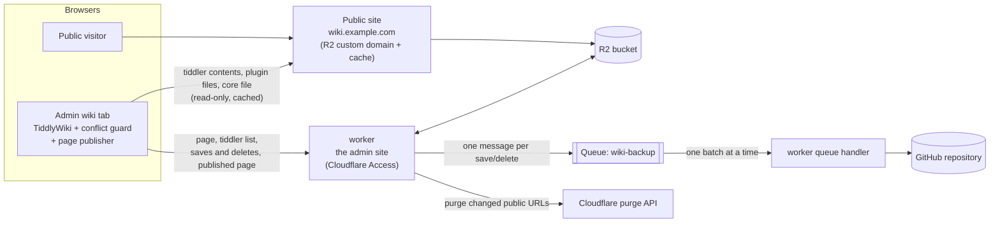

# TiddlyWiki on Cloudflare

 

Host your own [TiddlyWiki](https://tiddlywiki.com) on Cloudflare's free plan: a worker for editing, R2 for storage, a public read-only site served from the cache if you want one, and every save backed up to GitHub as its own commit.

- **The admin wiki,** at the worker's own address (`https://wiki-admin.<your subdomain>.workers.dev`, or a custom domain such as `admin.wiki.example.com`), is yours to edit, behind Cloudflare Access. A Cloudflare Worker speaks TiddlyWiki's own sync protocol (TiddlyWeb) and stores every tiddler in an R2 bucket.
- **The public wiki,** `https://wiki.example.com`, if you want one, is the same bucket served directly through its custom domain and Cloudflare's cache: read-only, and no worker involved, so visitors cost no worker requests. Without it, the wiki is private.

What the worker adds to a plain TiddlyWeb server:
- **Edit-conflict protection:** two tabs or devices editing the same tiddler can't silently overwrite each other; the later one gets a conflict copy and an alert.
- **A public copy that stays fresh:** after each change, exactly the cached URLs that changed are purged.
- **Plugins installed from the wiki work on both sites:** each gets its own file, which the page loads before TiddlyWiki starts.
- **A page TiddlyWiki writes itself:** the admin wiki renders the page with TiddlyWiki's own template and publishes it, so the title, the language and `$:/tags/RawMarkup…` tiddlers (link previews, a splash screen) work as in a single-file wiki. The core is a separate file cached for a year, which makes the page about 300 KB instead of 2.8 MB.
- **As few worker requests as it can:** a page load is 2 requests, tiddler contents come from the public site, and background tabs stop polling.
- **Backups through a Cloudflare Queue:** one commit per save, retried through outages and rate limits, with an alert in the admin wiki if they keep failing.

A new wiki starts by itself: the first time you open the admin site, the worker puts an empty TiddlyWiki in the bucket. To move an existing wiki in, drag its file onto the admin wiki.

**Private, or public.** Without a public site, the wiki is private: the admin site is the only one, behind Cloudflare Access, at the worker's own `workers.dev` address — no domain needed, and nothing in the bucket is reachable by anyone else. With a public site (the bucket's custom domain, one setting), every tiddler you save is readable there by anyone the moment it's saved (drafts are never saved, so they aren't): for a wiki you publish — a blog, documentation, notes you share. A private wiki can be made public later by adding that one setting; nothing moves.

## Quick start

**What you need:** a Cloudflare account (the free plan is enough) and a GitHub account (the worker is deployed from your copy of this repository; the backup goes to a repository too). For a public site, also a domain on that account (both sites are then hostnames of it).

About ten minutes, in this order. Section 2 has each step in full, and the wiki's own setup check (the last step) names the section for anything missing.

1. **Make your copy of this repository** — a fork, or a copy from the template (2.1). Nothing in it is edited: the worker is deployed as it is, and your settings go in the dashboard.
2. **The bucket,** `wiki`, in R2; for a public site, its custom domain (2.2).
3. **The queue,** `wiki-backup` (2.3).
4. **A backup repository and a token for it,** if you want every save committed to GitHub (2.4, optional).
5. **The worker,** `wiki-admin`, built from your copy by Workers Builds, with the settings and the two secrets in its dashboard (2.5).
6. **Cloudflare Access** in front of it (2.6).
7. **The zone's rules** — the rewrite, the cache rules, the CORS header — for a public site only (2.7).
8. **Open the admin site:** the wiki starts by itself, and *Check the setup* in its Cloudflare tab tells you what's missing (2.8).

*The admin wiki: TiddlyWiki as it is, with the Cloudflare tab the worker adds, after* Check the setup. *(Taken from the test setup by* `npm run screenshot`*, so the addresses are local ones.)*

This README covers the setup, operating the wiki, troubleshooting, the limits and the tests. How the worker works, and why it's built this way, are in [docs/design.md](docs/design.md); what each test suite covers, in [docs/tests.md](docs/tests.md).

---

## Contents

[Quick start](#quick-start), above.

1. [How it fits together](#1-how-it-fits-together), below
2. [Setting up](docs/setup.md)
3. [Operating it](docs/operating.md)
4. [Troubleshooting](docs/troubleshooting.md)
5. [Known limits](docs/limits.md)
6. [Development and tests](docs/development.md)
7. [Reference](docs/reference.md)

---

## 1. How it fits together

| Piece | Role |
|---|---|
| **The worker** (`worker.js`, built from `src/worker/`) | Serves the admin wiki: the page, the TiddlyWeb endpoints, saves and deletes with their conflict checks, cache purges. Writes a file for each plugin, and consumes the backup queue. |
| **Browser modules** (`src/browser/`) | TiddlyWiki modules the worker builds into the page. The conflict guard makes the browser say which version each edit is based on, handles conflicts, and sends saves in the layout the worker stores; the list sync keeps the tiddler list, loads what's shown first and keeps loaded tiddlers on the device, reads from the public site and cuts unneeded requests; the backup alert shows backups that keep failing; the page publisher, in the admin wiki, renders the page with TiddlyWiki's own template and sends it to the worker whenever it changes; the restore import turns the backup's files, dropped onto the wiki, back into tiddlers; the control panel's Cloudflare tab shows how backups go and starts a full backup; the outbox keeps every change on the device until the worker has it, so editing offline loses nothing, and hands the browser's other tabs what it saved and the draft being typed, so they follow each other; the cold start registers a service worker, so the wiki opens with no network; the device tab measures what this browser keeps of the wiki, asks it to keep that, or forgets it. |
| **R2 bucket** | Holds everything: the wiki engine (`index.html`), the page both sites serve, the tiddler list, one JSON file per tiddler, one script per plugin, and TiddlyWiki's core file. |
| **Public site** | The bucket's custom domain. Cloudflare caches it, and nothing on it runs the worker. A private wiki has none: the worker serves the tiddler contents, the plugin files and the core file itself, and the device copy keeps a reload from asking for them again. |
| **Queue** `wiki-backup` | Holds one message per save or delete until it has been committed to GitHub. |
| **GitHub repository** | Version history: one commit per save, in `tiddlers/<title>.json`. |

