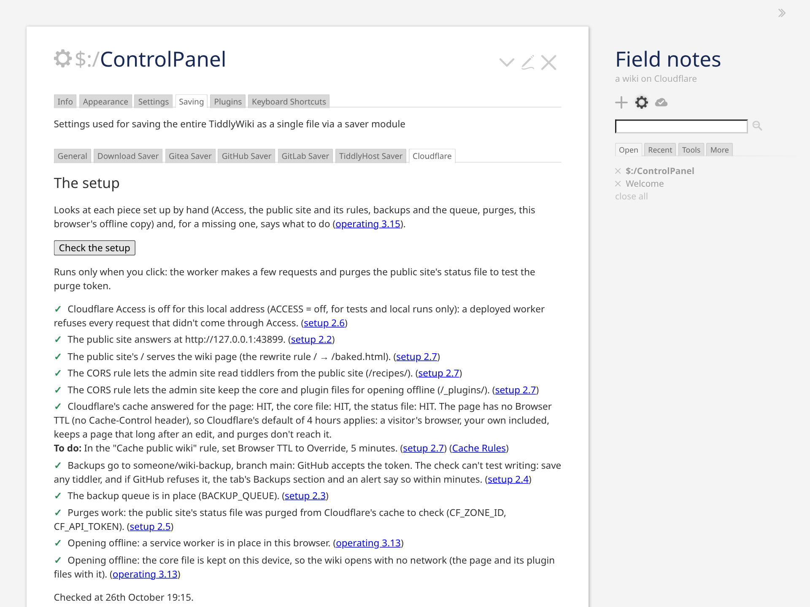
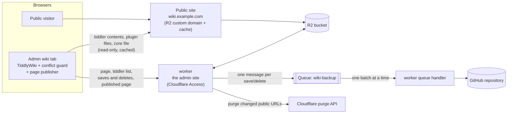

# TiddlyWiki on Cloudflare

Host your own [TiddlyWiki](https://tiddlywiki.com) on Cloudflare's free plan: a worker for editing, R2 for storage, a public read-only site served from the cache if you want one, and every save backed up to GitHub as its own commit.

- **The admin wiki,** at the worker's own address (`https://wiki-admin.<your subdomain>.workers.dev`, or a custom domain such as `admin.wiki.example.com`), is yours to edit, behind Cloudflare Access. A Cloudflare Worker speaks TiddlyWiki's own sync protocol (TiddlyWeb) and stores every tiddler in an R2 bucket.
- **The public wiki,** `https://wiki.example.com`, if you want one, is the same bucket served directly through its custom domain and Cloudflare's cache: read-only, and no worker involved, so visitors cost no worker requests. Without it, the wiki is private.

What the worker adds to a plain TiddlyWeb server:
- **Edit-conflict protection:** two tabs or devices editing the same tiddler can't silently overwrite each other; the later one gets a conflict copy and an alert.
- **A public copy that stays fresh:** after each change, exactly the cached URLs that changed are purged.
- **Plugins installed from the wiki work on both sites:** each gets its own file, which the page loads before TiddlyWiki starts.
- **A page TiddlyWiki writes itself:** the admin wiki renders the page with TiddlyWiki's own template and publishes it, so the title, the language and `$:/tags/RawMarkup…` tiddlers (link previews, a splash screen) work as in a single-file wiki. The core is a separate file cached for a year, which makes the page about 300 KB instead of 2.8 MB.
- **As few worker requests as it can:** a page load is 2 requests, tiddler contents come from the public site, and background tabs stop polling.
- **Backups through a Cloudflare Queue:** one commit per save, retried through outages and rate limits, with an alert in the admin wiki if they keep failing.

A new wiki starts by itself: the first time you open the admin site, the worker puts an empty TiddlyWiki in the bucket. To move an existing wiki in, drag its file onto the admin wiki.

**Private, or public.** Without a public site, the wiki is private: the admin site is the only one, behind Cloudflare Access, at the worker's own `workers.dev` address — no domain needed, and nothing in the bucket is reachable by anyone else. With a public site (the bucket's custom domain, one setting), every tiddler you save is readable there by anyone the moment it's saved (drafts are never saved, so they aren't): for a wiki you publish — a blog, documentation, notes you share. A private wiki can be made public later by adding that one setting; nothing moves.

## Quick start

**What you need:** a Cloudflare account (the free plan is enough) and a GitHub account (the worker is deployed from your copy of this repository; the backup goes to a repository too). For a public site, also a domain on that account (both sites are then hostnames of it).

About ten minutes, in this order. Section 2 has each step in full, and the wiki's own setup check (the last step) names the section for anything missing.

1. **Make your copy of this repository** — a fork, or a copy from the template (2.1). Nothing in it is edited: the worker is deployed as it is, and your settings go in the dashboard.
2. **The bucket,** `wiki`, in R2; for a public site, its custom domain (2.2).
3. **The queue,** `wiki-backup` (2.3).
4. **A backup repository and a token for it,** if you want every save committed to GitHub (2.4, optional).
5. **The worker,** `wiki-admin`, built from your copy by Workers Builds, with the settings and the two secrets in its dashboard (2.5).
6. **Cloudflare Access** in front of it (2.6).
7. **The zone's rules** — the rewrite, the cache rules, the CORS header — for a public site only (2.7).
8. **Open the admin site:** the wiki starts by itself, and *Check the setup* in its Cloudflare tab tells you what's missing (2.8).



*The admin wiki: TiddlyWiki as it is, with the Cloudflare tab the worker adds, after* Check the setup. *(Taken from the test setup by* `npm run screenshot`*, so the addresses are local ones.)*

This README covers the setup, operating the wiki, troubleshooting, the limits and the tests. How the worker works, and why it's built this way, are in [docs/design.md](docs/design.md); what each test suite covers, in [docs/tests.md](docs/tests.md).

---

## Contents

[Quick start](#quick-start), above.

1. [How it fits together](#1-how-it-fits-together)
2. [Setting up](#2-setting-up)
3. [Operating it](#3-operating-it)
4. [Troubleshooting](#4-troubleshooting)
5. [Known limits](#5-known-limits)
6. [Development and tests](#6-development-and-tests)
7. [Reference](#7-reference)

---

## 1. How it fits together



| Piece | Role |
|---|---|
| **The worker** (`worker.js`, built from `src/worker/`) | Serves the admin wiki: the page, the TiddlyWeb endpoints, saves and deletes with their conflict checks, cache purges. Writes a file for each plugin, and consumes the backup queue. |
| **Browser modules** (`src/browser/`) | TiddlyWiki modules the worker builds into the page. The conflict guard makes the browser say which version each edit is based on, handles conflicts, and sends saves in the layout the worker stores; the list sync keeps the tiddler list, loads what's shown first and keeps loaded tiddlers on the device, reads from the public site and cuts unneeded requests; the backup alert shows backups that keep failing; the page publisher, in the admin wiki, renders the page with TiddlyWiki's own template and sends it to the worker whenever it changes; the restore import turns the backup's files, dropped onto the wiki, back into tiddlers; the control panel's Cloudflare tab shows how backups go and starts a full backup; the outbox keeps every change on the device until the worker has it, so editing offline loses nothing, and hands the browser's other tabs what it saved and the draft being typed, so they follow each other; the cold start registers a service worker, so the wiki opens with no network; the device tab measures what this browser keeps of the wiki, asks it to keep that, or forgets it. |
| **R2 bucket** | Holds everything: the wiki engine (`index.html`), the page both sites serve, the tiddler list, one JSON file per tiddler, one script per plugin, and TiddlyWiki's core file. |
| **Public site** | The bucket's custom domain. Cloudflare caches it, and nothing on it runs the worker. A private wiki has none: the worker serves the tiddler contents, the plugin files and the core file itself, and the device copy keeps a reload from asking for them again. |
| **Queue** `wiki-backup` | Holds one message per save or delete until it has been committed to GitHub. |
| **GitHub repository** | Version history: one commit per save, in `tiddlers/<title>.json`. |

---

## 2. Setting up

About ten minutes, in this order. Each step names what the next ones need.

### 2.1 Before you start

**A private wiki, or a public one.** A private wiki skips the public site: in 2.2 only the bucket, no custom domain; no zone rules (2.7); in 2.5 no `PUBLIC_WIKI_URL`, `CF_ZONE_ID` or `CF_API_TOKEN`. About five minutes. The steps marked *(public site only)* don't apply. Its first load on a new device reads every tiddler from the worker (5); after that, only what changed. To make it public later, do those steps then: the next page load takes the setting, and nothing moves.

The names, and where each goes. With the defaults, nothing in the repository needs editing: the worker is deployed as it is, and your settings are entered in the dashboard (2.5).

| Name | Default or example | Where it goes |
|---|---|---|
| the public site *(public site only)* | `wiki.example.com`, yours | the bucket's custom domain (2.2), the setting `PUBLIC_WIKI_URL` (2.5) and the zone rules (2.7) |
| the admin site | `wiki-admin.<your subdomain>.workers.dev` | the worker's own address, behind Access (2.6), allowed by the CORS rule (2.7); a custom domain instead, if you like (2.5) |
| the bucket | `wiki` | 2.2; `wrangler.toml` if you name it otherwise |
| the queue | `wiki-backup` | 2.3; `wrangler.toml` if you name it otherwise |
| the worker | `wiki-admin` | the name you give it in 2.5; `wrangler.toml` if you name it otherwise |

Make your own copy of this repository (a fork, or a copy from the template): Cloudflare deploys the worker from its `main` branch (2.5). `wrangler.toml` holds the bindings and the defaults above; its comments say what each is for. No secret goes in it, ever: the two secrets are entered in 2.5, with the settings.

### 2.2 The bucket and the public site

1. In the Cloudflare dashboard, under **R2**, create the bucket (`wiki`). Nothing to upload: the worker fills it on the first visit (2.8). For a private wiki, that's all: leave public access off, and **Public Development URL (`r2.dev`)** disabled.
2. *(public site only)* In the bucket's settings, turn on public access:
   - **Custom Domains:** connect `wiki.example.com`.
   - **Public Development URL (`r2.dev`):** keep it disabled. It's a second public address that skips the zone's cache and rules.
   - **CORS Policy:** leave it empty. A transform rule handles CORS instead (2.7).

With a custom domain, everything in the bucket is public through it, including every tiddler, the tiddler list and the page. That's intended: nothing private belongs in a public wiki's bucket. Secrets live in the worker's settings.

### 2.3 The backup queue

Under **Storage & Databases → Queues**, create the queue (`wiki-backup`). That's all: the deploy (2.5) binds the worker to it as its producer and consumer, with the settings in `wrangler.toml` (batches of 10, 5 seconds, one at a time, 3 retries). Don't lower the retries: the worker counts on them for its waits (design 1.7).

Create the queue before the worker's first deploy (2.5): Wrangler refuses to deploy while a queue named in `wrangler.toml` doesn't exist. A worker without the queue binding (pasted into the dashboard without it, 2.5) runs the same backup directly after each save, with a couple of quick retries but no long-term waiting.

### 2.4 The backup repository (optional)

- **A repository of its own** for the backup, one per wiki, private if you like. Files go in `tiddlers/`. Never use the repository the worker is deployed from: its token would let anyone who got it change the worker's code.
- **A fine-grained personal access token** limited to that repository, with *Contents: read and write*. [This link](https://github.com/settings/personal-access-tokens/new?name=wiki+backup&description=One+commit+per+save+into+the+backup+repository+%28tiddlywiki-cloudflare%2C+README+2.4%29&expires_in=366&contents=write) opens GitHub's form with the name, the permission and the longest expiry the form allows (a year) filled in; what's left is *Repository access → Only select repositories* → the backup repository, then *Generate token*. You'll store it as the `GITHUB_TOKEN` secret (2.5). When it expires, the admin wiki shows the backup alert (`Bad credentials`): make a new one the same way and replace the secret.

Without a repository and a token, the worker skips backups.

**A wiki that already has content** when backups are set up — an imported wiki, say — has nothing on GitHub until a **full backup** runs: the admin wiki reminds you once, and the button is in the Control Panel → Saving → **Cloudflare** tab, *Back up everything to GitHub*. It makes GitHub mirror the wiki: every stored tiddler GitHub doesn't have, or has differently, is committed, and files of tiddlers no longer in the wiki are removed; run again, it changes nothing. It runs in the backup queue, without the tab, at GitHub's pace (about 500 commits an hour), and the tab shows its progress (as of its last minute's refresh, or *Refresh*). Run it once after setting backups up, after a restore (below), after putting a tiddler in the bucket by hand, or in any doubt.

**Restoring from the backup:** the backup is the wiki, one file per tiddler, so a wiki can be rebuilt from it in a new bucket or a new account: do 2.2 to 2.8 with an empty bucket, clone the backup, and drag its files onto the admin wiki, like an existing wiki's file (2.8). The admin wiki knows these files: TiddlyWiki's own JSON import keeps only text fields, and a stored tiddler has its tags as a list, so dropped onto any other TiddlyWiki they would lose every tag; the admin wiki's restore-import module turns them back into tiddlers, tags included, without the old revision, bag and recipe. Every tiddler is then saved again, plugins included, each created anew and backed up. A thousand tiddlers take a few minutes to save and, at GitHub's pace, a couple of hours to commit (5). For a whole clone, rather than dropping a thousand files, `node tools/restore.mjs <the clone>` (from a clone of this repository, Node 22) merges them into one `restore.json`, which you drag instead; it also makes a file any TiddlyWiki imports, and a single-file wiki out of a backup, for reading it anywhere: `npx tiddlywiki@5.4.1 wiki --init empty && npx tiddlywiki@5.4.1 wiki --load restore.json --build index` makes `wiki/output/index.html`. To get back one tiddler, or one of its past versions: download its file from GitHub (its history has every version) and drop it onto the admin wiki.

### 2.5 The worker

The worker is deployed from your repository by Cloudflare's **Workers Builds**: every push to `main` builds `worker.js` and deploys it, with the bindings and settings from `wrangler.toml`.

1. Under **Workers & Pages**, create the worker from your repository (**Create → Import a repository**, or for a worker that already exists, its **Settings → Builds → Connect**). Cloudflare's GitHub app needs access to that repository. Name the worker `wiki-admin`: the name must be the `name` in `wrangler.toml`.
2. The build settings:
   - **Production branch:** `main`.
   - **Build command:** `npm run build`. It writes `worker.js` and `seed/empty.html`, the empty wiki a new bucket starts from, which the deploy uploads with the worker (as a text module of it: `wrangler.toml`).
   - **Deploy command:** the default, `npx wrangler deploy`.
   - **Builds for non-production branches:** off. A branch's preview would use the real bucket and queue.
   - **Build watch paths:** include only `src/*`, `build.mjs`, `tools/*`, `package.json`, `package-lock.json` and `wrangler.toml`, so a change to the README, or anything else, doesn't deploy.
3. **The settings and the secrets,** under the worker's **Settings → Variables and Secrets**. A deploy keeps them all (`keep_vars` in `wrangler.toml`), so nothing of yours is in the repository. The settings can be plain variables or secrets, as you prefer; the two tokens must be secrets — in the dialog, choose the type *Secret*: its default, *Text*, shows the value to anyone who opens the settings.

   | Name | What |
   |---|---|
   | `PUBLIC_WIKI_URL` | *(public site only)* the public site's address, `https://` and the bucket's custom domain (2.2), nothing after the hostname. The page loads its plugin files and TiddlyWiki's core from it, and the admin wiki reads tiddlers from it. **Leave it out for a private wiki:** the worker then serves all of that itself. Set wrongly — an address that isn't a site's, or the worker's own — every request answers `500` saying so. Changed later, or removed, it works the same way as setting it: the next page load rebuilds the page from the engine, and the admin wiki publishes it again for the new address. |
   | `CF_ZONE_ID` | *(public site only)* the zone ID of the public site's domain (on the domain's overview page), for the public site's purges |
   | `CF_API_TOKEN` | *(public site only) secret:* an API token (**My Profile → API Tokens**) with *Zone → Cache Purge* on that zone. Without it and `CF_ZONE_ID`, no purges. |
   | `GITHUB_REPO`, `GITHUB_BRANCH` | `owner/repo` of the backup repository (2.4), and its branch (default `main`) |
   | `GITHUB_TOKEN` | *secret:* the token of 2.4. Without it and `GITHUB_REPO`, no backups. |
   | `CONFLICT_GUARD` | `off` builds the page without the browser modules (3). (The wiki's own settings for those modules live in the plugin's settings tab, 3.) |
   | `BACKUP_RETRY_SECONDS` | the first wait before a failed backup is tried again (default 60). |
   | `BACKUP_ALERT_MINUTES` | how long backups have to keep failing before the admin wiki shows it (default 60, design 1.7). |
   | `ACCESS` | `off` lets requests through that didn't come through Cloudflare Access (2.6), for the tests and local runs: only requests to a local address (`localhost`, `127.0.0.1`), so on a deployed worker it changes nothing. |

   Saving a variable deploys it at once; the first page load after that uses it.
4. The first deploy runs when you push, or at once if the dashboard offers it. The worker then answers at `https://wiki-admin.<your subdomain>.workers.dev` (your account's `workers.dev` subdomain is shown under Workers & Pages); that's the admin site, once Access protects it (2.6).

**A custom domain for the admin site** (`admin.wiki.example.com`, say) instead of the `workers.dev` address, if you have a domain: add it under the worker's **Settings → Domains & Routes** (Cloudflare creates the DNS record), and use it in the CORS rule (2.7) and in Access (2.6). Or put it in `wrangler.toml` (the `routes` block in comments) if you'd rather have it in the repository; then set `workers_dev = false` there, so the worker has one address.

**Without Workers Builds,** two other ways work: `npx wrangler deploy` from your computer, after `npm install` and `npm run build`, with the same `wrangler.toml` and the settings in the dashboard; or pasting `worker.js` into the dashboard's editor, in which case you add the bindings of `wrangler.toml` by hand in the worker's settings too, and the empty wiki (2.8), since a pasted worker carries no asset.

### 2.6 Cloudflare Access

Protect the worker with **Worker Access → All traffic** (production and preview URLs) and a policy allowing you (your Cloudflare account's e-mail, say). This covers the worker's `workers.dev` address, a custom domain, and its preview URLs, which `wrangler.toml` turns off anyway. Requests Access blocks never reach the worker, so they cost no quota.

The worker has no login of its own, so it relies on this, and checks it: Cloudflare marks a request that came through Access (`ctx.access`), and the worker answers `403` to any request without that mark, before reading or building anything. (That mark never reaches a worker deployed with static assets, which run behind a router of Cloudflare's; this worker has none, which is why the empty wiki travels as a module of it, 2.5.) So if the Access application is missing, or covers another hostname than the one a request came to, the wiki is closed rather than open; the `403` says what to do. Only the tests and local runs, where there is no Access, switch the check off with `ACCESS = off`, and the switch counts only for a request to a local address (`localhost`, `127.0.0.1`): left on by mistake on a deployed worker, it opens nothing.

**Logging out:** *Logout* in the cloud icon's dropdown (the "Server status" button in the sidebar) goes to Access's own logout page, `/cdn-cgi/access/logout` on the admin site, which ends the session and shows the login page again; the worker has no session of its own to end.

**The session's length** is the application's *Session duration* (a day by default, up to a month). A tab left open past it is told, in the cloud icon's dropdown, that the login has expired and how to log in again, with every change kept on the device meanwhile (3, "When your login expires").

### 2.7 The zone's rules *(public site only)*

Under your domain, in the dashboard. Each rule names the public hostname, so `/` on other hostnames of the zone isn't rewritten, and nothing else is cached by these rules.

**A URL rewrite** (Rules → Transform Rules → Rewrite URL), so the public site opens on the built page:
- **When:** `http.host eq "wiki.example.com"` and `http.request.uri.path eq "/"`
- **Then:** rewrite the path to `/baked.html`

**Cache rule "Cache public wiki":**
- **When:** `http.host eq "wiki.example.com"`
- **Cache eligibility:** eligible for cache
- **Edge TTL:** ignore the cache-control header and use a TTL. R2 sends none, and every change made through the worker is purged right away. One day is a safe default; longer works too, but a missed purge or a file uploaded to R2 by hand then stays stale that long.
- **Browser TTL:** override with something short, for example 5 minutes. Purges can't reach visitors' browsers, and without this Cloudflare's default of 4 hours applies.
- **Serve stale content while revalidating:** off.
- **Cache key:** the defaults. The query string must stay in the key, because purges target exact URLs (design 1.6).

**Cache rule "Cache plugin files"**, placed *after* the one above (when several rules match, the last one wins):
- **When:** `http.host eq "wiki.example.com"` and `starts_with(http.request.uri.path, "/_plugins/")`
- **Cache eligibility:** eligible for cache
- **Edge TTL:** use the cache-control header if present, Cloudflare's default if not. Plugin files carry `Cache-Control: public, max-age=31536000, immutable`.
- **Browser TTL:** respect origin
- **Cache key:** the defaults. The query string (`?v=<revision>`) must stay in the key: it's what makes each version a new URL.

Plugin files are never purged: each version has its own URL (design 1.8). Without this rule they follow "Cache public wiki", which still works, but browsers re-check them every few minutes. TiddlyWiki's core file, `_plugins/tiddlywikicore.js`, is under the same path, with the same caching.

**Cache rule "Cache status file"** (optional), also placed after "Cache public wiki":
- **When:** `http.host eq "wiki.example.com"` and `http.request.uri.path eq "/status"`
- **Cache eligibility:** eligible for cache
- **Edge TTL:** ignore the cache-control header and use a TTL of 7 days (the file never changes)
- **Browser TTL:** override with 7 days

Public tabs ask for `/status` at every page load, before the tiddler list. With this rule a visitor's browser asks once a week; without it, "Cache public wiki" applies and it asks again after a few minutes.

**Response header transform rule "CORS for the admin wiki"** (Rules → Transform Rules → Modify Response Header):
- **When:** `http.host eq "wiki.example.com" and (starts_with(http.request.uri.path, "/recipes/") or starts_with(http.request.uri.path, "/_plugins/"))`
- **Then:** set the static header `Access-Control-Allow-Origin` to the admin site's origin, `https://wiki-admin.<your subdomain>.workers.dev` (or `https://admin.wiki.example.com` with a custom domain; no trailing slash)

This lets the admin wiki read tiddler contents from the public site (design 1.5, 2.9), and keep the core and plugin files for opening offline (section 3). Without it everything still works online, but every tiddler is fetched through the worker, and the files aren't kept: a rule set before the `/_plugins/` path was part of it needs that path added.

A "Bypass cache" rule for the admin hostname is optional: Cloudflare never caches responses a worker generates itself.

### 2.8 The first visit

Open the admin site (`https://wiki-admin.<your subdomain>.workers.dev`, or your custom domain). Access asks you to log in, then the worker puts an empty TiddlyWiki in the bucket as `index.html` (the engine; your content lives in the tiddler files) with the public site's `status` file (written for a private wiki too, for the day it gets a public site), builds the page, and the wiki opens. That first load also publishes TiddlyWiki's core file and the page, for both sites. With a public site, open `https://wiki.example.com` to see it. Then Control Panel → Saving → Cloudflare → *Check the setup* looks at each piece (Access, the public site's rules, backups, the queue, purges) and names the README section for one that's missing (3, "Checking the setup").

**An existing wiki:** drag its `.html` file onto the admin wiki. TiddlyWiki's import saves every tiddler, plugins included, and each goes to R2 and to the backup. Don't upload your wiki as `index.html` instead: TiddlyWiki deletes, at the first sync, every tiddler the page came with that the server doesn't list, so the content would vanish from view, and the file itself would be public.

**A pasted worker** (`worker.js` alone, without the empty wiki, 2.5): upload `seed/empty.html` (made by `npm run build`) to the bucket as `index.html`, and a file `status` with this content, the TiddlyWeb status for the public site (without it, public tabs don't know the recipe and can't load the tiddler list):

```json
{
  "username": "GUEST",
  "read_only": true,
  "anonymous": true,
  "logout_is_available": false,
  "space": {
    "recipe": "default"
  }
}
```

### 2.9 A second wiki

A second wiki is a second worker with its own bucket, queue, settings and, if public, its own public site: steps 2.2 to 2.8 again with other names. From one repository, Wrangler environments do it: an `[env.notes]` section in `wrangler.toml` with that wiki's `name`, bucket and queue (and route, with a custom domain), deployed with `npx wrangler deploy --env notes` (as the deploy command of a second Workers Builds project, or from your computer); its settings go in that worker's dashboard like the first one's. The zone rules are per hostname, so each wiki gets its own set, and `CF_ZONE_ID` and `CF_API_TOKEN` can be shared. The free plan's limits (5) are per account, whichever way the wikis are deployed.

---

## 3. Operating it

**Deploying a change:** edit `src/`, run `npm run build`, `npm run lint` and `npm test`, and push to `main` (through a pull request, so CI runs the tests too): Workers Builds deploys it (2.5). Without it, `npx wrangler deploy`, or paste `worker.js` into the dashboard's editor. If anything in the plugin changed — a browser module, the service worker, a tab's text, a field, `package.json`'s version — the next admin page load rebuilds `baked.html`; a change to the worker's own code doesn't. If you changed how the page itself is built, also bump the number in front of `bakeVersion` (now `9-`), or existing pages keep the old format until something else rebuilds them; plugin files are only rewritten when their plugin changes, so after changing their format, delete `_plugins/` and open the admin wiki. Reload any open admin tabs: tabs opened before a change keep the old modules, and tabs older than the modules have no conflict protection.

**Updating your copy:** your worker is deployed from your copy of this repository, which this one keeps changing. To take an update: on GitHub, *Sync fork* on your fork (or `git pull` from this repository, added as a remote, for a copy made from the template); Workers Builds redeploys, and the next admin page load rebuilds the page. Nothing in the repository holds your values (`wrangler.toml` is deployed as it is, the settings live in the dashboard, 2.5), so an update never conflicts with them. [CHANGELOG.md](CHANGELOG.md) lists, for each change, anything to do by hand — a new setting, a new zone rule; unless it says so, nothing is.

**A full backup** (Control Panel → Saving → Cloudflare): whenever GitHub might not mirror the wiki — backups set up after content existed, a restore, a tiddler put in R2 by hand, a backup that failed for good and was fixed. It commits only what differs and removes files of tiddlers that are gone, so running it in doubt costs little: a step of about 20 tiddlers every few seconds, 3 queue operations a step, and GitHub calls only for what's missing (design 1.7). If the tab says the last one stopped without finishing, start it again.

**Updating the wiki engine:** a new TiddlyWiki version comes with the repository: `package.json` pins the `tiddlywiki` package (bumped by hand, in a pull request of its own, not by Dependabot: a new engine is checked against the browser modules and the list filter first), and the worker ships the empty wiki built from it. To move your wiki to it, update your copy (*Sync fork*, or the pull request that bumps the version, so the tests run on it), let Workers Builds deploy, then open the admin wiki: Control Panel → Saving → Cloudflare shows *Engine: TiddlyWiki 5.4.1 — the worker ships 5.4.2* and a button, *Update the engine*. It asks once more, in the tab, saying what goes with the old engine; then the worker replaces `index.html` with the one it ships, and the next page load builds the page from it, publishes the core file and the page for the new version and purges the public copy (design 1.15). Your tiddlers, the plugins you installed and the published page aren't touched. What goes: a plugin that came with the current engine and wasn't installed from the wiki — one you baked into an `index.html` you uploaded yourself, say. A plugin that came with the engine and that you updated from the library keeps your version, which may now be older than the new engine's: delete yours to take the engine's ("Plugins", below). When the versions match, the tab says so and shows no button. Deleting `index.html` in R2 and opening the admin wiki does the same, and uploading an `index.html` of your own (an empty TiddlyWiki with the TiddlyWeb plugin) still works: the tab then shows its version. If a TiddlyWiki upgrade changes the filter in `tiddlers.json?filter=…`, add the new filter to `SKINNY_LIST_FILTERS`, or the public tiddler list won't be purged after saves (the tests show it). Plugins installed through the wiki override the copies in `index.html`: after an upgrade, update the version in the plugin library's URL (`$:/config/OfficialPluginLibrary`) and update your plugins from its Updates tab.

**Plugins:** install, update, disable or delete them from the wiki (drag and drop, the plugin library, the Control Panel). When TiddlyWiki asks you to reload, wait until the save has finished, then reload. The public site gets the same plugins. As in a single-file wiki, updating a plugin that came with `index.html` (a theme from the plugin library, say) replaces it, and deleting it afterwards removes it. To get `index.html`'s version back: in R2, delete `_page/shell.html` and `baked.html`, then open the admin wiki. The page is built from `index.html` again, and that load publishes it. Any other plugin from `index.html` you deleted comes back too.

**The published page:** nothing to do. After this version is deployed, the first admin page load publishes the core file and the page; after that, every save that changes the page publishes it (design 1.9). If a raw markup tiddler stops the wiki from starting:
1. In R2, delete `_page/shell.html` and `baked.html`.
2. Open the admin wiki: the page is built from `index.html` again.
3. Fix or delete the tiddler in that tab before reloading. The tab publishes the broken page again once loaded, but it keeps running the page it has, and saving the fix publishes the fixed one.

**If a plugin breaks the page** (the wiki doesn't start), on both sites:
1. In R2, delete `_plugins/<plugin title>.js`.
2. Purge it from Cloudflare's cache: Caching → Configuration → Purge Cache, either the exact URL with its `?v=` (in the page's source) or everything.
3. Hard-reload the admin wiki (Ctrl+Shift+R). It starts without the plugin. TiddlyWiki may ask for a reload; ignore it.
4. Delete or disable the plugin in the Control Panel and wait for the save. The page is rebuilt without it, or with it disabled.

If the page is rebuilt before step 4 (by a deploy, or by saving another plugin, a startup action, `$:/theme` or a disable flag), the file is written again; delete it again.

**A plugin with raw markup** (one with a tiddler tagged `$:/tags/RawMarkup…`) is in the page as well as in its file (design 1.9), so deleting the file isn't enough, and a page built again writes the file again while the plugin is stored. Remove the plugin itself, in R2:
1. Delete `recipes/default/tiddlers/<plugin title>` and `_plugins/<plugin title>.js`, then `recipes/default/tiddlers.json`, `_page/shell.html` and `baked.html`.
2. Purge everything from Cloudflare's cache.
3. Open the admin wiki. The worker rebuilds the tiddler list from the stored tiddlers (design 1.2) and the page from `index.html`, both without the plugin, and the admin wiki then publishes its page. The GitHub backup still has the plugin (`tiddlers/<plugin title>.json`), to install again once fixed.

**Checking the modules are active:** in the admin wiki's browser console, `$tw.syncadaptor.conflictGuardInstalled` should be `true` (the conflict guard), and `$tw.syncadaptor.cfworkerBackupAlert` too (the backup alert, which runs after the list sync).

**Log lines** (the worker's logs, under its Logs tab in the dashboard):

| Line | Meaning |
|---|---|
| `[Backup] '<title>' not backed up yet (<reason>); retrying in Ns` | A GitHub call failed. It will be retried, and nothing is lost. |
| `[Backup] Could not queue '<title>', backing up directly` | The queue was unavailable, so the backup ran directly. |
| `[Backup] '<title>' could not be backed up` | A direct backup (no queue bound, or the queue unavailable) failed 3 times. That version isn't on GitHub. |
| `Cache purge failed (<status>)` | The purge API refused; check the `CF_API_TOKEN` permission. |
| `[Manifest] Write conflict detected, retrying` | Two saves updated the tiddler list at once. This is normal and retried automatically. |
| `The tiddler list can't be read: rebuilding it from the stored tiddlers` | The list was damaged, and the worker is rebuilding it (design 1.2). The damaged copy is in `_repair/`. |
| `Tiddler list rebuilt: <n> tiddlers` | The rebuild is complete. |
| `Rebuilding the tiddler list: <key> is not a readable tiddler, left out` | That object in R2 isn't valid JSON. It was already unreadable for the wiki. |
| `Rebuilding the tiddler list: <key> isn't stored the way the worker stores tiddlers, left out` | An object in an older layout, under a URL-encoded key, or uploaded by hand (design 1.2). Save the tiddler again from a wiki that has it, or upload it in the flat layout with its metadata (design 1.2); an object under a URL-encoded key can be deleted. |
| `Failed to rebake HTML` | Building `baked.html` failed; the last page built is served instead (or `index.html` if there is none). A list being rebuilt over several requests also shows this line until it's done. |

**Manual purge:** Cloudflare dashboard → Caching → Configuration → Purge Cache. Use it if something on the public site looks stuck, for example after uploading files to R2 by hand.

**Loading a big wiki:** a tab gets the tiddler list (every field but the text) and loads the tiddler it shows first; the rest fills in in the background, several at a time, only while the tab is visible, so that search and backlinks work on everything. Loaded tiddlers are kept in the browser (IndexedDB, like its cache: clearing the site's data removes them), so the next page load fetches only what changed since, on any device. To skip the fill, untick it in the plugin's settings (below; it takes effect at the next page load): each tiddler then loads the moment it's shown, and nothing else is fetched, but the sidebar's text search, backlinks and the Missing and Orphans lists only see tiddlers the tab has loaded (titles, tags and fields are always searched). Design 1.5.

**Editing offline:** with the admin wiki open, keep editing without a network. TiddlyWiki retries every few seconds; the moment the connection is back, everything reaches the worker, each save checked for conflicts as usual. Its *Network Error* alert isn't shown on the admin wiki (it would be back at every retry): the cloud icon turning red and its dropdown say it, below. TiddlyWiki's other alerts — a save the worker refuses, say — show as always. What this setup adds is that nothing is lost in between: every change is written to this device at once (the same store that keeps your tiddlers for reading), so a reload, a crash or a closed tab while offline keeps it, and the next time the wiki opens on this device it sends it — a tiddler changed elsewhere meanwhile gets a conflict copy, as online. If the browser refuses to store a change — no room left, or storage unavailable in that window — the dropdown says so instead of promising: the change then lives only in that tab until it's sent, so keep the tab open. A draft is kept there too, never sent to the worker: after a reload, TiddlyWiki lists it at the top of the page, with the text as you left it. (The other tabs of the same browser follow this one — what you save, the draft you're typing: "Tabs following each other", below.) The cloud icon in the sidebar turns red while something is unsaved, as it always has; click it for how many changes are waiting, since when, and whether you're offline or your login has expired (below). What waits on a device is sent from that device: another device doesn't see it until then. Opening the wiki *with no network at all* still needs the page from a server. Design 1.10.

**Tabs following each other:** the admin wiki's tabs in one browser share your work, without the worker. A tiddler changed, created or deleted in one tab shows so in the others at once, online or offline, not at their next poll, and they make no request for it: they take the change from the tab that made it, and the worker's revision once the save is confirmed. A tiddler you're editing is one draft for the browser: while you type in one tab, the draft is listed at the top of the others, and any tab that opens it, from that list or with *Edit*, shows the same text and follows your typing as you go (a moment behind, at TiddlyWiki's own pace for drafts); type in that tab instead and the first follows, in the editor you had typed in too. Save or cancel in any tab and it's saved or cancelled in all of them, once. A reload of any tab brings the draft back. Across devices nothing changes: another device sees a save at its next poll and never sees your drafts; a change you hadn't saved when another tab saved the same tiddler still gets a conflict copy, as today. Design 1.16, 2.27.

**Opening the wiki offline:** after one visit online, the admin wiki opens without a network. A service worker the admin site registers keeps the page, TiddlyWiki's core file, the plugin files, the status file and the last tiddler list; the tiddlers come from the device copy. It fills its cache as soon as it's installed, at that first visit (two requests to the worker, once per device), and at every page load online it keeps the files the page refers to, so a file missing from the cache — a browser clearing space, a copy that didn't finish — is back at the next load online. Online, nothing changes: the page is always asked from the worker first, so an update's new page, or Cloudflare Access asking you to log in again, shows as before — the cache only answers when the network doesn't. Offline, only what this device has loaded is there: a tiddler never opened on it stays empty. The tiddler list is the last one this device kept, which can be older than its last saves, so a list from the cache can only add: the wiki completes it with what the device holds and removes nothing while offline — not from the tab, not from the device copy, not from the outbox; what was deleted elsewhere meanwhile goes at the network's return, when a real list comes. A change made then waits in the outbox like any other. If your Access session expires while you're offline, the dropdown says offline until the network is back, then that the login has expired (below). For a public wiki, the core and plugin files are kept for offline use only with the CORS rule (2.7) in place, its `/_plugins/` path included; without it they load as before, online only, and with no network and no copy of the core file on the device the page says so in a line. The admin wiki asks the browser to keep this site's storage (the service worker's cache, the device copy, the outbox) rather than clear it when short of space; browsers grant that by their own rules (Chrome to a site used often, installed or bookmarked; Firefox asks you), and the cloud icon's dropdown says when it isn't granted and a change waits. Design 1.11.

**When your login expires:** Cloudflare Access ends a session after a set time (a day by default: the application's *Session duration*, 2.6), and a tab left open past it can't reach the worker any more. A save, and on a private wiki a tiddler load, gets Access's login page in place of an answer, while the tiddler list goes on from the copy the service worker keeps, so nothing looks wrong until you edit. The tab tells this from a lost network by asking Access itself (one request, answered at Cloudflare's edge, never a worker request, and only after something has failed or a list came from the cache), and the cloud icon's dropdown then says the login has expired, not "offline", whether or not a change waits: *Log in again* opens the login in a new tab, after which this tab sends what's waiting by itself; or reload this page, which shows the login and comes back with the kept changes sent. Nothing is lost in between: every change is kept on this device, as when offline (above). Design 1.10, 2.26.

**Checking the setup:** Control Panel → Saving → Cloudflare → *Check the setup* asks the worker to look at each piece and lists what it found, one line each, a missing or wrong one saying what was found and naming the README section that fixes it. The pieces: Access protecting the admin site; the public site answering at `PUBLIC_WIKI_URL` with the page (the rewrite rule; an earlier build of the page, Cloudflare's cached copy, passes and is named), allowing the admin site to read tiddlers from it and to keep the core and plugin files for offline use (the CORS rule, each of its two paths checked), and cached (the cache rules, optional: reported, never a failure); backups set up, GitHub accepting the token for the repository and its branch, and the backup queue bound; purges allowed, tested by purging the public site's `status` file (optional, like the zone settings); and, in this browser, the service worker in place with the core file kept, so the wiki opens offline. A private wiki's public-site lines say there's nothing to check. It runs only when you click — one request to the worker, which makes a few of its own to the public site, GitHub and Cloudflare — so it costs nothing at page load. Nothing says these things otherwise: the page's own requests work without the CORS header, and a missing rewrite rule shows only to visitors. If the check itself gets no answer, the tab says which it is: no network, or your login has expired (it asks Access, as the dropdown does: "When your login expires", above). Design 1.13.

**Installing the wiki as an app:** the admin wiki is a web app the browser can install — Chrome shows an install button in the address bar, Android offers "Add to Home screen", on iOS use Safari's share menu — and it then opens in its own window, without the browser's bars, under its own icon and the wiki's title. Installed, Chrome also keeps the site's storage persistent (the device copy, the outbox, the service worker's cache) without being asked. The icon is a plain one; to use your own, upload `_app/icon-192.png` and `_app/icon-512.png` to the bucket, square PNGs of those sizes (the worker puts the defaults there at the first page build, so you'll find them). Nothing to set up: the page carries the app's manifest, which the worker serves, with the wiki's title as the app's name. The public site can be installed too, as a read-only app; it has no service worker, so it needs the network to open. Design 1.12.

**The plugin and its settings:** the admin wiki's modules travel as a plugin, `$:/plugins/cfworker/admin`, listed in Control Panel → Plugins with the worker's version: the worker puts it in every page it builds, so it always matches the worker, and never stores it. Its parts are shadow tiddlers, out of search and out of syncing; a part you edit is an override, as with any plugin — it stays through the worker's updates, the dialog marks it, delete it to get the worker's part back. The plugin's *settings* tab holds the wiki's own settings (tiddlers under `$:/config/cfworker/`, saved like any other, so they hold on every device): the fill of the device copy (above) and TiddlyWiki's polling interval with its cost in worker requests — both read once, when a tab starts, so a change applies to tabs opened after it, as the tab says — and, under a warning, the advanced ones: the pause before a draft is written to the device (300 ms; lower is more writes, higher is more typing lost if the tab crashes), how many tiddlers the fill fetches at once (6; more is a faster fill with more requests in flight — on a private wiki they're worker requests either way, the same number), the pause after a save before the page is published (1 s; a burst of saves is published once), how often the worker is asked how backups go (60 minutes, with a list request; one R2 read each, and the alert when backups fail comes that much later), and how long the service worker waits for the network before answering with the page it kept (8 s; longer suits a slow connection, shorter a dead one; the page tells the service worker at each load, so that one applies at the next). The defaults fit the free plan and are what the tests run; an empty field is the default. The worker's own settings stay in the dashboard (2.5). Design 2.21.

**This device:** the plugin's *device* tab (Control Panel → Plugins → TiddlyWiki on Cloudflare) is about what this browser keeps of the wiki. *Measure* counts the tiddlers kept on this device of those the worker lists, with their size (the few the page itself carries — the site title, the default tiddlers, the settings — and any not loaded yet are counted apart); the changes and drafts waiting in the outbox; the files the service worker keeps, each with its size; then what the browser says — how much this site uses of what it allows (the browser's own count, more than the files' bytes) and whether it has promised to keep it. *Ask the browser to keep this site's data* asks for that promise: Firefox asks you; Chrome and Safari decide by their own rules — a site used often, installed or bookmarked — and answer at once (ask again later, or install the wiki as an app). Without it, a browser short of space may clear the site's storage, a change waiting in the outbox with it, which is why the cloud icon's dropdown says so while something waits, with a link to the tab; the page no longer asks at every load (in Firefox that was a prompt at every load). *Forget this device's copy* removes the device copy, the outbox and the service worker's files from this browser and reloads: the wiki comes back from the worker and the copy fills again, as on a new device; it's refused while a change or a draft waits, naming how many, and offline (the page comes back from the worker once the copy is gone). Nothing in the tab asks the worker anything. Design 1.14, 2.22.

**Turning the browser modules off:** set `CONFLICT_GUARD` to `off`. The next page load rebuilds `baked.html` without them. Saves then go back to TiddlyWiki's default behaviour, without protection or request savings, and the page is no longer published.

---

## 4. Troubleshooting

| Symptom | Likely cause | What to do |
|---|---|---|
| Every request answers 403 "didn't come through Cloudflare Access" | No Access application covers the hostname you're using (2.6): Access isn't set up yet, or it's set up on the custom domain only and you're on `workers.dev` or a preview URL | Set Access up as **Worker Access → All traffic**, or use the hostname it covers. For a local run without Access, set `ACCESS = off` (2.5); it only works for a local address. |
| The admin page says "There's no wiki yet" (404) | The bucket has no `index.html`, and the worker was deployed without the empty wiki (pasted into the dashboard alone, or `seed/` wasn't built) | Deploy with Wrangler or Workers Builds after `npm run build`, or upload `index.html` and `status` yourself (2.8). |
| Every request answers 500 naming `PUBLIC_WIKI_URL` | The variable isn't the public site's address (2.5) | Set it to `https://` + the bucket's custom domain (2.2), nothing after the hostname; or remove it, for a private wiki. |
| A Workers Builds run fails in the deploy step, before `Uploaded`, with `Received a malformed response from the API` or a `504 Gateway Timeout` on a `GET` | Cloudflare's API didn't answer one of Wrangler's reads of the worker (its secrets, its deployments) before the upload; the build itself passed ("Build command completed" is in the log) | Retry the build, or deploy from a machine: `npx wrangler deploy` in a clone (Node 22, 2.5). The site keeps serving the previous deployment meanwhile. If it keeps failing for an hour, report it to Cloudflare with the Ray ID from the log. |
| A private wiki's first load on a new device takes a while, with one worker request per tiddler | There's no public site to read from, so each tiddler comes from the worker, once per device (5) | Nothing: the device keeps a copy, and later loads fetch only what changed. |
| Alert "Edit conflict: … was changed in another tab or browser" | Another tab, device or script saved that tiddler after you started editing | Compare the tiddler with its `(conflict …)` copy, keep what you want and delete the copy. |
| Console shows "blocked by CORS policy" for the public site | The transform rule is missing or scoped wrong | Add or fix it (2.7). Until then, tiddlers simply load through the worker. |
| Offline, the page says it has no copy of the core file; or *Check the setup* (3) marks the files line ✗ | The CORS rule (2.7) doesn't cover `/_plugins/` (a rule set before that path was part of it) | Add the path to the rule's "When" (2.7), then open the admin wiki once online. Nothing but the check says so: the page's own request for a file works without the header. |
| The cloud icon's dropdown says your login has expired | Cloudflare Access ended the session: its *Session duration*, a day by default (2.6) | *Log in again* in the dropdown (a new tab), or reload the page; what you changed meanwhile is kept on this device and sent once you're logged in (3, "When your login expires"). |
| The public site shows an old version | Browser TTL, or a failed purge | Check the cache rule's Browser TTL; look for `Cache purge failed` in the logs; purge manually. |
| Link previews or the tab show "My TiddlyWiki", or raw markup (yours or a plugin's) has no effect | The page hasn't been published since the change (design 1.9); for a plugin with JavaScript, the admin wiki hasn't been reloaded since installing it | Open or reload the admin wiki: it publishes once loaded. A notification says if it can't. |
| "GitHub backup: Backups to GitHub have been failing since …" alert | GitHub refuses the backups; the alert gives its answer | `Bad credentials` (`401`): the token has expired or was revoked. Make a new one (2.4) and put it in the `GITHUB_TOKEN` secret; the waiting backups then go through by themselves, and the alert goes. For other answers, the alert says what to check. |
| "GitHub backup: The backup of … was cut short 4 times and dropped" alert | The backup of a tiddler of several MB took more CPU than the free plan gives a run (5) | Split the tiddler, or move the worker to a paid plan; the next save of it is backed up again. GitHub keeps the last version that went through. |
| "Page not published: …" notification | The worker refused the page, or couldn't be reached | The message says why. It's tried again at the next save or load (a refused page once it changes); "index.html has changed" means reload the admin wiki. |
| "Page not published: The core file still switches the save template…" | A new TiddlyWiki version (a new `index.html`) writes the line the publisher takes out of the core file differently. | The site keeps working, built from `index.html` (heavier). Update the worker to a version that knows that TiddlyWiki, or go back to the previous `index.html`. |
| "Page not published: The page doesn't contain the TiddlyWeb plugin…" | TiddlyWeb was installed or updated from the wiki (the library, or a file dropped in), separately from `index.html`. It's then loaded as a file and left out of the page, and a page without it couldn't sync. TiddlyWeb is meant to match the core's version. | Delete it in the wiki and reload: the page still holds the one from `index.html`, and that load publishes. To move to a newer TiddlyWeb, upload an `index.html` of that TiddlyWiki version instead. |
| Console shows a failed `_plugins/tiddlywikicore.js` request | The core file is missing from R2 | Delete `baked.html` in R2 and open the admin wiki: the page is built from the engine, and that load publishes the core file and the page again. |
| The admin page downloads in full at every load | Neither `ETag` nor `Last-Modified` reaches the browser (look at the page's response headers), or "Disable cache" is ticked in DevTools | Without `Last-Modified`: check that the deployed worker is current (its pages carry it since `bakeVersion` 5). Cloudflare removing the `ETag` alone is expected (design 1.3). |
| The admin page reads a tiddler from the public site and then again from the worker | The public copy is out of date, often one cached before a worker that purges the admin page's copy (design 1.6) | Nothing breaks, only a request more. It clears up when that tiddler is saved, or when the cached copy expires (Edge TTL). To clear everything at once: Purge Cache → Custom Purge → Hostname `wiki.example.com`. |
| Tiddlers that existed before backups were set up have no commits | The backup covers saves made since; what came before needs a full backup | Control Panel → Saving → Cloudflare → *Back up everything to GitHub* (2.4). |
| The Cloudflare tab says the last full backup stopped without finishing | Its step's queue message was lost, or GitHub refused the token for hours (the alert says) | Fix what the alert says, if anything, and start it again: it skips what's already there. |
| No commits on GitHub | `GITHUB_REPO` or `GITHUB_TOKEN` not set (backups are then skipped without a log line), no queue consumer, or a GitHub token problem | Check 2.5 and 2.3, and look for `[Backup]` lines in the logs. Queued backups go through once fixed, if that's within the queue's retention (24 hours on the free plan). A direct backup logged as "could not be backed up" isn't retried. |
| The editor closes by itself after about a minute | The module isn't loaded (`CONFLICT_GUARD=off`, or an old tab) | Reload; check `$tw.syncadaptor.conflictGuardInstalled`. |
| Changes to `index.html` don't show | You haven't opened the admin wiki since uploading | Open the admin wiki once; it rebuilds `baked.html` and purges the public page. |
| A plugin is still inactive after the reload | You reloaded before the save finished, or the page build failed | Reload once the save has finished. A failed build is done again at the next page load; if the logs keep showing `Failed to rebake HTML`, the error after it says why. |
| The wiki doesn't start after installing a plugin | The plugin breaks at boot | Follow "If a plugin breaks the page" (3). |
| A tiddler that is in R2 doesn't show in the wiki | It's missing from the tiddler list: a save whose list update failed and was never retried (the tab was closed) | Delete `recipes/default/tiddlers.json` in R2: the worker rebuilds it from the stored tiddlers (design 1.2). A rebuild lists only tiddlers in the flat layout. |
| Console shows a failed `_plugins/…` request | The file is missing from R2 | Delete `baked.html` in R2 and open the admin wiki: the rebuild writes missing files. |

---

## 5. Known limits

- **Some titles can't be saved:** `.` and `..` (in a URL, the browser takes them for the folder or its parent, so they'd never reach the worker) and titles over 999 bytes (an R2 key holds 1,024). The admin wiki doesn't send them, which would fail and be retried forever: it keeps them on this device (the outbox, 3 "Editing offline"), unsent, shows an alert asking to rename them, and asks before the tab is closed or reloaded; renamed, the tiddler is saved.
- **A plugin that breaks at boot breaks both sites** until you remove it (3).
- **A damaged or missing list is rebuilt only while the admin wiki is open** (design 1.2): the worker's requests do the work, and public visitors don't use the worker. Until then the public site keeps what its cache holds; a visitor who gets the damaged list or the stand-in sees no tiddlers until it's done.
- **A tiddler too big to back up.** A backup runs in one worker invocation, which the free plan gives about 10 ms of CPU, with some flexibility: a tiddler of several megabytes (a plugin, say; from about 3 MB, by the tests' measure of what a backup costs) can exceed it. Cloudflare then cuts the backup short, the queue tries it three more times the same way and drops it, and nothing had a chance to record why. The worker notes, before it starts on a version over 1 MB, that it's at it, and clears the note once done; a note left behind shows in the admin wiki at the next status check (an hour at most), as an alert naming the tiddler and its size: the backup was cut short that many times and dropped. GitHub keeps the last version of it that went through; the wiki keeps this one. What to do: split the tiddler, or move the worker to a paid plan (30 s of CPU); the next save of it is tried again. A full backup stops on such a tiddler the same way, with the same alert; its progress then shows as lost after 8 hours, and a new one can be started.
- **A rebuild step's CPU** stays around a normal save's, but a single stored tiddler with several megabytes in fields other than its text (rare: plugins keep their content in the text) is read in one step, and could take that step over the limit each time.
- **An installed plugin's raw markup reaches the page after a reload if the plugin has JavaScript** (design 1.9): TiddlyWiki only starts such a plugin then. And plugins with raw markup are in the page as well as in their file, so a big one makes the page bigger (the worker refuses a page over 2 MB).
- **Both sites depend on the core file on the public site,** as they already do on plugin files (a private wiki's, on the worker). If it can't be loaded, the wiki doesn't start (TiddlyWiki shows an alert).
- **Offline, the wiki is what this device has loaded** (3, "Opening the wiki offline"): the page, the core and plugin files, the last tiddler list and the tiddlers read on this device. A tiddler never opened here stays empty until the network is back; so does one changed elsewhere since. Clearing the site's data in the browser removes the copy.
- **A change made offline waits on the device it was made on,** and is sent from there (3, "Editing offline"): another device doesn't see it until that one is back online and open. Clearing the site's data in the browser discards what waits; so would the browser itself, if short of space and not having granted the site persistent storage (3, "Opening the wiki offline"): get back online before that.
- **A private wiki's first load on a device reads every tiddler from the worker,** one request each, then only what changed (the device keeps a copy): a thousand tiddlers is a thousand of the day's 100,000 requests, once per browser. There is no public cache to read from instead.
- **A plugin that came with the engine, deleted in one admin tab while another admin tab is open,** can come back in the page at that other tab's next publish: the worker never stored it, so it has nothing to tell the other tab. Reload the other tab, or delete the plugin there too. One updated from the wiki first, then deleted, stays deleted.
- **The page follows the admin wiki.** A change made elsewhere (a tiddler edited in R2) reaches the page at the next admin page load. Raw markup that depends on being logged in is rendered as the admin sees it.
- **Conflict copies are merged by hand.** That's by design: you get both versions and decide.
- **A short window at page load.** A tiddler that's part of `index.html` itself, edited before the first sync finishes, is saved without a version check.
- **Big imports take a while to back up.** GitHub allows about 500 commits an hour, so 1,000 tiddlers take a little over two hours. Nothing is lost while they wait.
- **Free-plan quotas** (October 2026, see 7): 100,000 worker requests a day; 10,000 queue operations a day, about 3 per backup or retry, so roughly 3,300 saves a day; 10 ms of CPU per request, with some flexibility for occasional overruns. Each save reads and rewrites the whole tiddler list, about 1 ms of CPU per 400–500 tiddlers, which is now the largest cost of a save. At several thousand tiddlers, saves could start hitting that limit. Saving a plugin also rebuilds the page, from the list the save has just written.
- **A tab closed right after a failed list update.** The worker stores a tiddler, then updates the tiddler list. If that update fails, the browser's retry completes it (design 1.4), but if the tab is closed first, the tiddler stays out of the list until the list is rebuilt (4).
- **The backup can't be checked out on Windows.** Its files are named after the titles (`tiddlers/$:/config/….json`), and Windows allows no `:` in a file name. Clone it on Linux, macOS or WSL to restore (2.4); on GitHub itself it reads fine.
- **A full backup takes as long as GitHub allows:** about 500 commits an hour, so a wiki of 1,000 tiddlers none of which were on GitHub takes a couple of hours, in steps of about 20 tiddlers; one already mirrored finishes in minutes, having only read. Its queue operations: 3 a step (design 1.7). Only one runs at a time; a second asked for meanwhile is refused.
- **Waiting backups cost queue operations.** If the GitHub token stays broken, every backup waiting is put back in the queue at the end of each pause (every 6 hours, once the pauses have grown): 1 queue operation for two pauses in three, 3 for the third, until it's fixed (the admin wiki shows an alert after an hour, design 1.7). A rate limit does the same while it lasts: a big import that GitHub slows down costs more than 3 operations a tiddler.

---

## 6. Development and tests

Requirements: Node.js 22 or newer (Wrangler 4 needs it) and a Chromium for the browser tests. (`npm run build` also makes `seed/empty.html`, the empty wiki the browser tests start from.)

```bash
npm install
npx playwright install chromium      # or: export CHROMIUM_PATH=/path/to/chrome
npm test                             # build (worker.js and seed/empty.html), run all seventeen suites
```

`npm test` runs every suite to the end, even after one fails, and ends with a summary naming what failed (`tools/run-suites.mjs`); each suite's output is also in `test-results/<suite>.log`. A suite still running after 15 minutes is stopped and counted as failed (`--timeout <seconds>` changes that), so one that hangs doesn't hold the run. `npm test -- --parallel 2` runs two suites at once (any number; 1, one after the other, is the default and what CI does): every suite takes free ports and its own temporary folder, so what they share is the machine, and a timing check that passes alone can fail with more suites at once than it has CPUs to spare — a failure seen only that way is rerun alone before anything is read into it. With several at once, a suite's output is printed whole when it ends.

The suites run with the waits shortened (design 2.25). The browser modules' fixed waits — the publisher's pause after a save, the time given to a public read before the worker is asked instead, the retries while the list is rebuilt — are multiplied by `$tw.cfworkerTestTimeScale`, which the test harness sets to 0.2 before each test page boots; nothing stored in a wiki can set it, so a deployed wiki has the waits as the modules say. The worker's fixed waits — the second purge after a list rebuild, the outdated mark's retry, a direct backup's retries — are multiplied by the `TEST_WAIT_SCALE` binding, which only the test setups give it. TiddlyWiki's own syncer, in the test pages, looks for work every 50 ms rather than 250 and retries an error after a second rather than five (`test/browser-harness.mjs`). The queue's delays are whole seconds in Cloudflare's API and aren't scaled; `BACKUP_RETRY_SECONDS` is 1 in the tests. A browser suite that fails leaves two more things there: `test-results/<suite>.requests.log`, every request its pages made, in order, with the time, the tab, the path and how it ended (answered, from the browser's cache, or given up on), and `test-results/traces/<suite>/<n>.zip`, a Playwright trace of each browser context — the test's actions and the page's console messages in time — opened with `npx playwright show-trace <file>`. `TRACE=1` keeps both for a passing suite too; `TRACE=full` adds screenshots and DOM snapshots to the traces (they slow the page down, so a timing check can fail with them). A passing suite removes the request log a failed run of it left, so what's in `test-results/` is the last run's.

| Command | What it runs |
|---|---|
| `npm run build` | Writes `worker.js`, and `seed/empty.html`, an empty TiddlyWiki with the TiddlyWeb plugin, from the installed `tiddlywiki` package (kept when it's already of that version; `node tools/build-wiki.mjs --force` rebuilds it). |
| `npm run check:build` | Fails, writing nothing, if `worker.js` isn't what the sources build (run it before committing, so `worker.js` is never out of date). |
| `npm run screenshot` | Writes `docs/admin-wiki.png`, the screenshot at the top of this README, from a wiki run through the test setup in Chromium (`tools/screenshot.mjs`): run it when the Cloudflare tab changes. |
| `npm run lint` | ESLint, with its recommended rules only: a name that doesn't exist (a function moved without its import, say), an unused one, an import assigned to. CI runs it first. |
| `npm run test:fast` | The six suites that need no browser (a few minutes). |
| `npm run test:browser` | The ten suites that run a real TiddlyWiki in Chromium. |
| `npm run test:suite -- <name>…` | Only the suites named, after a build: `npm run test:suite -- page-publish two-tabs`. |
| `npm run test:first` | A new wiki from an empty bucket, in Chromium. |
| `npm run test:bake` | Page serving and rebuilding, the published page, the Access check, the public address, the first visit. |
| `npm run test:integrity` | The tiddler list's integrity, the page after a failed build, draft-like titles and `.gitignore`. |
| `npm run test:r2` | R2 calls per kind of request, against a budget. |
| `npm run test:cpu` | CPU of the heaviest steps, a big plugin's save and backup, against a budget. |
| `npm run test:backup` | Queue backup against an imitation of GitHub's Contents API. |
| `npm run test:tabs` | Real TiddlyWiki in Chromium with several tabs, and a second browser for the conflicts; the tabs following each other. |
| `npm run test:plugins` | Real plugins in Chromium, on the admin site and a stand-in for the public site. |
| `npm run test:publish` | The page published from a real TiddlyWiki in Chromium. |
| `npm run test:lazy` | Loading a big wiki in Chromium, on both sites: what's shown first, the device's copy, the fill. |
| `npm run test:sync` | The full backup started from a real TiddlyWiki in Chromium, GitHub imitated. |
| `npm run test:private` | A private wiki, no public site, in Chromium; then a public site added. |
| `npm run test:offline` | Editing offline in Chromium, the network cut and restored. |
| `npm run test:login` | An expired Access session in Chromium, behind a stand-in for Access, the service worker in place: "log in again", not "offline". |
| `npm run test:cold` | Opening the wiki with no network, in Chromium: the service worker. |
| `npm run test:budget` | What reaches the worker per page load, counted behind a proxy, the service worker in place. |
| `npm run test:setup` | The setup check, against the public stand-in with Cloudflare's headers, GitHub and Cloudflare's API imitated. |

GitHub runs the same two groups, as two jobs side by side, for every pull request and every push to `main` (`.github/workflows/ci.yml`), after the lint and after checking that `worker.js` is what `src/` builds. One run per commit: a re-run of a commit's run never cancels another commit's, and an older commit's run goes on when a newer one is pushed. A job that fails, or is cancelled by its timeout, keeps its `test-results/` for a week (the run's page → *Artifacts*): the logs, and the request log and traces of each browser suite that failed or was stopped. Dependabot proposes the other packages' updates weekly, and the Actions'; the `tiddlywiki` package it leaves alone (3, "Updating the wiki engine").

### 6.1 Repository layout

```
├── README.md                 this document
├── CHANGELOG.md              what shipped, newest first, and what an update asks of you
├── CLAUDE.md                 how work on the repository happens: the principles, the process, where writing goes
├── LICENSE                   MIT
├── worker.js                 GENERATED: the file you deploy (npm run build)
├── seed/empty.html           GENERATED, not committed: an empty TiddlyWiki with TiddlyWeb, what a new wiki starts from (2.8), uploaded with the worker
├── tools/build-wiki.mjs      builds it from the tiddlywiki package (npm run build)
├── tools/restore.mjs         merges a clone of the backup into one file any TiddlyWiki imports (2.4)
├── tools/run-suites.mjs      runs test suites, each to the end, one after the other or several at once (--parallel), with a summary (npm test); their output under test-results/, not committed
├── tools/screenshot.mjs      takes the README's screenshot from a wiki run through the test setup (npm run screenshot)
├── docs/
│   ├── design.md             how the worker works, and why it's built this way
│   ├── roadmap.md            what's ahead, in order, and what's parked and why
│   ├── tests.md              what each test suite covers, the R2 calls per kind of request, the CPU budgets
│   ├── external-plugins.md   design notes for plugin files (design 1.8)
│   └── admin-wiki.png        GENERATED: the screenshot at the top of this README (npm run screenshot)
├── .github/workflows/ci.yml  runs the tests on GitHub for every pull request and push to main, keeping a failed job's test-results/
├── src/
│   ├── worker/               the worker's source, one module per concern (below)
│   │   ├── index.js          the entry point: the Access and settings checks, the route table, the queue consumer
│   │   ├── bytes.js, tiddlers.js, storage.js, settings.js, access.js, http.js
│   │   │                     the shared pieces: UTF-8, what a tiddler is, every bucket key, every variable, Access, HTTP helpers
│   │   ├── layout.js         how a tiddler is stored, and how a save is read (design 1.2)
│   │   ├── cache.js          public-site purges (design 1.6)
│   │   ├── list.js           the tiddler list and its rebuild (design 1.2)
│   │   ├── plugins.js        plugin files (design 1.8)
│   │   ├── build.js          building the page (design 1.3)
│   │   ├── page.js           serving the page, and the page the admin wiki publishes (design 1.9)
│   │   ├── app.js            the wiki as an installable app: the manifest, the icons (design 1.12)
│   │   ├── setup.js          the setup check: each piece looked at from the worker (design 1.13)
│   │   ├── reads.js, saves.js  the handlers: status, list and objects; saves and deletes (design 1.4)
│   │   └── backup/           the GitHub backup: queue.js (the consumer, and the full backup's steps), github.js (the API), status.js (how backups go), sync.js (the full backup's requests)
│   └── browser/              the browser modules, embedded into worker.js by the build (3)
│       ├── lib.js            what they share: the sync adaptor, the public site's address, whether this is the admin site, titles in alerts (a TiddlyWiki library module)
│       ├── conflict-guard.js saves and deletes: the revision each is based on, conflicts, the flat layout
│       ├── list-sync.js      the tiddler list, loading (what's shown first, the device's copy, the fill), what isn't sent
│       ├── backup-alert.js   the alert while backups to GitHub keep failing (design 1.7)
│       ├── page-publisher.js the page published from the admin wiki (design 1.9)
│       ├── restore-import.js the backup's files dropped onto the wiki, imported with their tags (2.4)
│       ├── control-panel.js  the control panel's Cloudflare tab: the setup check (3), how backups go, the full backup (2.4)
│       ├── outbox.js         every change kept on the device until the worker has it: editing offline (3)
│       ├── cold-start.js     registers the service worker on the admin site (3)
│       ├── device.js         the plugin's device tab: what this browser keeps, measured, kept or forgotten (3, "This device")
│       ├── service-worker.js the service worker itself, served at /sw.js: the page, the core and plugin files, the status file and the last list kept for opening offline (3)
│       └── plugin-readme.txt, plugin-settings.txt, plugin-device.txt  the admin plugin's three tabs, wikitext (3, "The plugin and its settings", "This device")
│   └── app/                  the app's default icons (PNG), embedded by the build (3, "Installing the wiki as an app")
├── build.mjs                 inlines the modules into worker.js, in dependency order, with the browser modules embedded
├── eslint.config.js          the lint rules (npm run lint): names that don't exist, unused ones, an import assigned to
├── wrangler.toml             the worker's name, bindings and defaults: what Wrangler deploys, as it is; the settings are in the dashboard (2.5)
├── package.json              build, lint and test scripts
└── test/
    ├── first-visit.test.mjs  a new wiki from an empty bucket, in Chromium; the admin plugin's shadows
    ├── two-tabs.test.mjs     real TiddlyWiki in Chromium, several tabs and a second browser: conflicts between browsers, the tabs of one following each other, a restore
    ├── plugins.test.mjs      real plugins on the admin and public sites
    ├── page-publish.test.mjs the page published from a real TiddlyWiki
    ├── lazy-load.test.mjs    loading a big wiki on both sites: what's shown first, the device's copy, the fill; the fetch-ahead setting
    ├── backup-sync.test.mjs  the full backup from the admin wiki: the Cloudflare tab, the hint, the button, GitHub mirroring the wiki
    ├── private.test.mjs      a private wiki: everything from the worker, nothing purged, then a public site added
    ├── offline.test.mjs      editing offline: changes kept on the device, sent at the network's return or the next load; the draft pause setting
    ├── login-expired.test.mjs an expired Access session behind a stand-in for Access, the service worker in place: the probe, the dropdown, the login in another tab or by a reload
    ├── cold-start.test.mjs   opening the wiki with no network: the service worker, what it keeps and what it never keeps; the setup check from the tab; the network wait setting
    ├── budget.test.mjs       what reaches the worker per page load, behind a counting proxy, the service worker in place; the app's manifest as the browser fetches it
    ├── queue-backup.test.mjs queue backup against an imitation of GitHub, the full backup's steps
    ├── integrity.test.mjs    the tiddler list's integrity, a failed page build, draft-like titles, awkward titles, .gitignore, what a deploy uploads, the restore tool
    ├── r2-ops.test.mjs       R2 calls per kind of request, against a budget
    ├── setup-check.test.mjs  the setup check: each piece in place or missing, the lines naming the README sections
    ├── cpu.test.mjs          CPU of a big plugin's save and backup, against a budget
    ├── r2-counter.mjs        test-only wrapper that counts the worker's R2 calls
    ├── browser-harness.mjs   the browser suites' shared setup (worker, public site stand-in, Chromium, helpers)
    └── bake.test.mjs         page serving and rebuilding, tiddler and file reads, the published page, the Access check, the public address, the first visit, the app, the admin plugin
```

The worker is written as ES modules, each importing only from the ones below it: the entry point, the handlers, the page, the list, the layout, then the shared pieces (`src/worker/index.js` lists the order). The build inlines them into `worker.js` in that order, so one file is deployed, which you can paste into the dashboard, with every comment kept; it refuses two modules that import each other, an import of something not exported, and a name declared twice. The tests run the built `worker.js` in Miniflare, and import a module's functions directly where they test one (`test/cpu.test.mjs`, the checks in `test/bake.test.mjs`).

The browser modules live in their own files so they can be read and edited as normal JavaScript, one per concern, each a TiddlyWiki module, sharing a library (`$:/cfworker/lib.js`) for what the sync modules have in common. The build embeds each file of `src/browser/` in `worker.js` as a string, in place of a placeholder named after it (`"__LIST_SYNC_SOURCE__"` for `list-sync.js`) in `src/worker/build.js`'s table of them, and refuses a file without its placeholder, or the reverse. The strings are written as JSON, so a module can contain any character, backticks and `${` included.

---

### 6.2 The tests

The tests run the real worker in Cloudflare's local runtime (workerd, through Miniflare) with a local R2 bucket and queue. Outgoing calls to GitHub and Cloudflare's API are answered by imitations, so nothing touches your accounts. Every suite takes free local ports, so they can run at the same time (`npm test` runs them one after the other, as CI does: ten Chromium suites at once overload a machine, and a timing check that passes in sequence fails there — rerun such a suite alone before reading anything into it). The ten browser suites share their setup, `test/browser-harness.mjs`: the worker, the stand-in for the public site, Chromium, and the helpers that wait for TiddlyWiki or record each tab's requests (marking the ones the browser answered from its cache, which never reached a server, and the ones it gave up on). Miniflare has no `max_concurrency` for a queue, and starts a second batch while one runs once messages pile up; `test/r2-counter.mjs` runs the batches one at a time, as Cloudflare does with the setting in `wrangler.toml`, so the backup suite's "never overlapped" check holds on a busy machine too.

What each suite covers, check by check — and the R2 calls each kind of request makes, the CPU budgets of the heaviest steps — is in [docs/tests.md](docs/tests.md). To run the browser tests against your own wiki file, download `index.html` from the bucket and run `WIKI_HTML=/path/to/index.html npm run test:tabs` (or `test:plugins`).

---

## 7. Reference

Limits and behaviours this design relies on (checked October 2026):

- **Workers:** [platform limits](https://developers.cloudflare.com/workers/platform/limits/) (requests per day, CPU and its flexibility for occasional overruns, subrequests); [how the cache works with Workers](https://developers.cloudflare.com/workers/reference/how-the-cache-works/) (worker-generated responses aren't cached).
- **Cloudflare Access on Workers:** [`ctx.access`, and why a worker with static assets never gets it](https://developers.cloudflare.com/workers/configuration/cloudflare-access/); [additional modules](https://developers.cloudflare.com/workers/wrangler/configuration/#bundling) (`rules`, how the empty wiki travels with the worker).
- **R2:** [Workers API](https://developers.cloudflare.com/r2/api/workers/workers-api-reference/), including conditional `put` with `onlyIf`.
- **Queues:** [limits](https://developers.cloudflare.com/queues/platform/limits/) (128 KB messages, 24-hour retention on free, 100 retries, delays up to 24 hours) and [pricing](https://developers.cloudflare.com/queues/platform/pricing/) (10,000 operations a day on free).
- **Cache:** [cache rule settings](https://developers.cloudflare.com/cache/how-to/cache-rules/settings/) and [their order](https://developers.cloudflare.com/cache/how-to/cache-rules/order/) (the last matching rule wins); [purge methods and rate limits](https://developers.cloudflare.com/cache/how-to/purge-cache/); [single-file purge](https://developers.cloudflare.com/cache/how-to/purge-cache/purge-by-single-file/); [browser cache TTL](https://developers.cloudflare.com/cache/how-to/edge-browser-cache-ttl/) (4-hour default); [ETag headers](https://developers.cloudflare.com/cache/reference/etag-headers/) and [Replace insecure JavaScript libraries](https://developers.cloudflare.com/waf/tools/replace-insecure-js-libraries/) (removes the ETag of HTML, on by default on Free); [single-file purge with an `Origin` header](https://community.cloudflare.com/t/why-after-purge-cache-the-data-keep-old-when-with-origin/553911) (the header is part of the cache key).
- **GitHub:** [REST API rate limits](https://docs.github.com/en/rest/using-the-rest-api/rate-limits-for-the-rest-api), including the secondary limits of 80 content-creating requests a minute and 500 an hour.
- **TiddlyWiki:** the TiddlyWeb adaptor (`$:/plugins/tiddlywiki/tiddlyweb/tiddlywebadaptor.js`), the syncer (`$:/core/modules/syncer.js`), plugin handling (`$:/core/modules/startup/plugins.js`) and the boot sequence (`boot/boot.js`).
