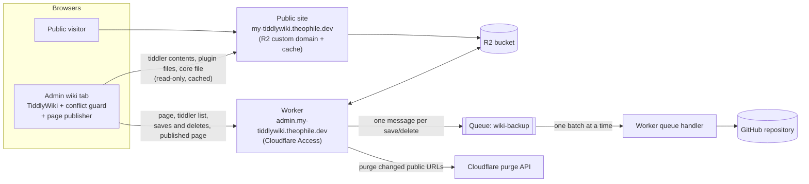
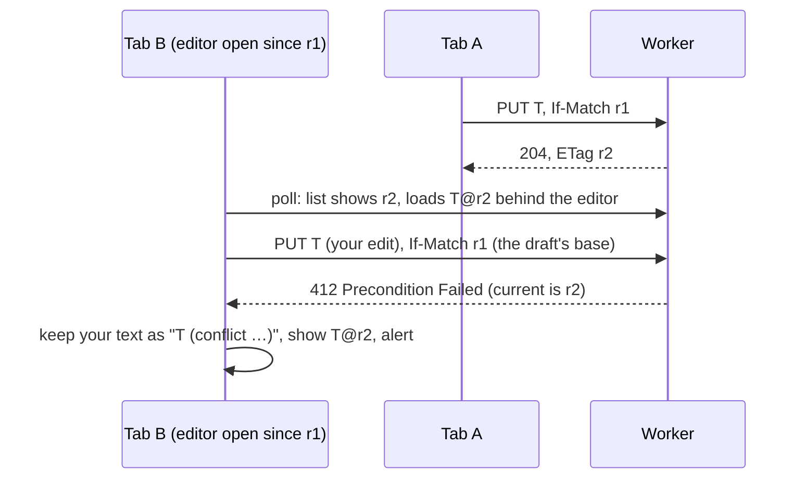
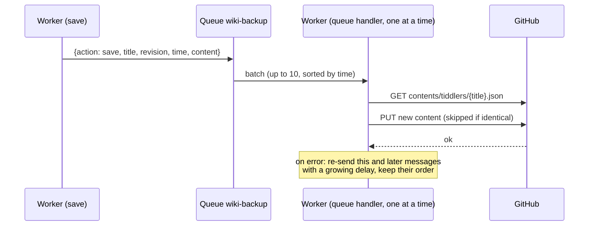
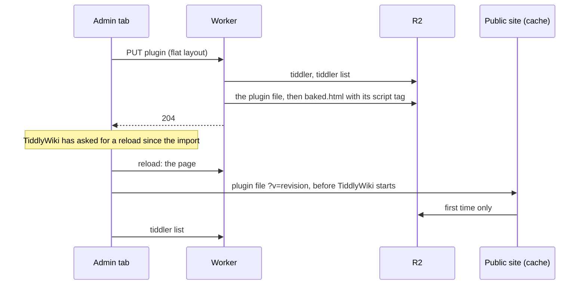

# TiddlyWiki on Cloudflare (Worker + R2 + Queue + GitHub)

A personal [TiddlyWiki](https://tiddlywiki.com) with two faces:

- **Admin wiki:** `https://admin.my-tiddlywiki.theophile.dev`, editable, behind Cloudflare Access. A Cloudflare Worker speaks TiddlyWiki's TiddlyWeb sync protocol and stores every tiddler in an R2 bucket.
- **Public wiki:** `https://my-tiddlywiki.theophile.dev`, read-only. It's the same R2 bucket served directly through R2's custom domain and Cloudflare's cache, with no worker involved.

Every save is backed up to a GitHub repository as its own commit, through a Cloudflare Queue.

The worker also does the following:
- **Protects against edit conflicts:** two tabs or devices editing the same tiddler can no longer silently overwrite each other.
- **Keeps the public copy fresh:** it purges exactly the cached URLs that changed.
- **Runs plugins installed from the wiki:** each plugin gets its own file, which the page loads from the public site before TiddlyWiki starts, on both sites.
- **Lets TiddlyWiki write its own page:** the admin wiki renders the page with TiddlyWiki's own template and publishes it by itself, so the title, the language and `$:/tags/RawMarkup…` tiddlers (link-preview tags, a splash screen...) work as in a single-file wiki. The core is a separate file cached for a year, which makes the page about 300 KB instead of 2.8 MB (4.9).
- **Uses as few worker requests as it can.**

This document covers the setup, how each part works, and why it was built this way.

---

## Contents

1. [Architecture](#1-architecture)
2. [Repository layout](#2-repository-layout)
3. [Setup](#3-setup)
4. [How it works](#4-how-it-works)
5. [Why it is built this way](#5-why-it-is-built-this-way)
6. [Operating it](#6-operating-it)
7. [Troubleshooting](#7-troubleshooting)
8. [Known limits](#8-known-limits)
9. [Development and tests](#9-development-and-tests)
10. [Reference](#10-reference)

---

## 1. Architecture



| Piece | Role |
|---|---|
| **Worker** (`worker.js`) | Serves the admin wiki: the HTML page, TiddlyWeb endpoints, saves and deletes, conflict checks, cache purges. It writes a file for each plugin, and consumes the backup queue. |
| **Conflict guard** (`src/conflict-guard.js`) | A TiddlyWiki startup module that the worker builds into the page. It makes the browser send the version each edit is based on, handles conflicts, cuts unneeded requests, and sends saves in the layout the worker stores. |
| **Page publisher** (`src/page-publisher.js`) | A second startup module built into the page. In the admin wiki, it renders the page with TiddlyWiki's own template and sends it to the worker whenever it changes (4.9). |
| **R2 bucket** | Holds everything: the wiki HTML (`index.html` and the published page), the tiddler list, one JSON file per tiddler, one script per plugin and TiddlyWiki's core file. |
| **Public site** | The bucket's custom domain. Cloudflare caches it, and nothing on it runs the worker. |
| **Queue** `wiki-backup` | Holds one message per save or delete until it has been committed to GitHub. |
| **GitHub repository** | Version history: one commit per save, in `tiddlers/<title>.json`. |

---

## 2. Repository layout

```
├── README.md                 this document
├── worker.js                 GENERATED: the file you deploy (npm run build)
├── docs/
│   └── external-plugins.md   design notes for plugin files (4.8)
├── tiddlers/                 the GitHub backup (4.7): one JSON file per tiddler, committed by the worker
├── src/
│   ├── worker.src.js         the worker's source
│   ├── conflict-guard.js     the browser module, embedded into worker.js by the build
│   └── page-publisher.js     the second browser module (4.9), embedded the same way
├── build.mjs                 inserts both modules into src/worker.src.js → worker.js
├── wrangler.example.toml     all bindings and settings, for deploying with wrangler
├── package.json              build and test scripts
└── test/
    ├── make-fixture.mjs      builds a test TiddlyWiki (test/fixtures/index.html)
    ├── two-tabs.test.mjs     real TiddlyWiki in Chromium, several tabs (84 checks)
    ├── plugins.test.mjs      real plugins on the admin and public sites (67 checks)
    ├── page-publish.test.mjs the page published from a real TiddlyWiki (53 checks)
    ├── queue-backup.test.mjs queue backup against an imitation of GitHub (40 checks)
    ├── integrity.test.mjs    the tiddler list's integrity, a failed page build, draft-like titles, .gitignore (67 checks)
    ├── r2-ops.test.mjs       R2 calls per kind of request, against a budget (29 checks)
    ├── r2-counter.mjs        test-only wrapper that counts the worker's R2 calls
    ├── browser-harness.mjs   the browser suites' shared setup (worker, public site stand-in, Chromium, helpers)
    └── bake.test.mjs         page serving and rebuilding, the published page (46 checks)
```

The browser modules live in their own files so they can be read and edited as normal JavaScript. The build embeds them in `worker.js` as strings (`CONFLICT_GUARD_SOURCE`, `PAGE_PUBLISHER_SOURCE`), so only one file is deployed, which you can paste into the dashboard. The strings are written as JSON, so a module can contain any character, backticks and `${` included.

---

## 3. Setup

Everything below can be done in the Cloudflare dashboard. `wrangler.example.toml` has the same settings for `npx wrangler deploy`.

### 3.1 R2 bucket

1. **Create a bucket** and upload:
   - **`index.html`:** a TiddlyWiki file that includes the TiddlyWeb plugin (`$:/plugins/tiddlywiki/tiddlyweb`). This is the wiki "engine"; your content lives in the tiddler files.
   - **`status`**, with this content. It's the TiddlyWeb status for the public site, which serves R2 directly: without it, public tabs don't know the recipe and can't load the tiddler list. (The admin site gets its own from the worker.)

     ```json
     {
       "username": "GUEST",
       "read_only": true,
       "anonymous": true,
       "logout_is_available": false,
       "space": {
         "recipe": "default"
       }
     }
     ```

   The tiddler list (`recipes/default/tiddlers.json`) isn't needed: if it's missing, the worker creates it from the stored tiddlers, an empty list for a new wiki (4.2).
2. **Turn on public access:**
   - **Custom Domains:** connect `my-tiddlywiki.theophile.dev`.
   - **Public Development URL (`r2.dev`):** keep it disabled. It's a second public address that skips the zone's cache and rules.
   - **CORS Policy:** leave it empty. A transform rule handles CORS instead (see 3.5 and 5.9).

Everything in the bucket is public through the custom domain, including tiddlers, the tiddler list and the HTML. That's intended: nothing private belongs in this bucket. Secrets live in the worker's settings, not in R2.

### 3.2 Worker

1. **Deploy `worker.js`** (ES module format).
2. **Attach it to `admin.my-tiddlywiki.theophile.dev`**, as a Custom Domain or a route covering every path.
3. **Bindings:**

   | Binding | Type | Required |
   |---|---|---|
   | `WIKI_BUCKET` | R2 bucket | yes |
   | `BACKUP_QUEUE` | Queue (producer) → `wiki-backup` | for queued backups (see 3.4) |

4. **Variables and secrets:**

   | Name | Kind | Purpose |
   |---|---|---|
   | `GITHUB_REPO` | variable | `owner/repo` of the backup repository |
   | `GITHUB_BRANCH` | variable | branch to commit to (default `main`) |
   | `GITHUB_TOKEN` | **secret** | fine-grained token, *Contents: read and write* on that repository |
   | `CF_ZONE_ID` | variable | zone id of `theophile.dev`, for cache purges |
   | `CF_API_TOKEN` | **secret** | API token with *Zone → Cache Purge* on that zone |
   | `PUBLIC_WIKI_URL` | variable, optional | public address (default `https://my-tiddlywiki.theophile.dev`) |
   | `CONFLICT_GUARD` | variable, optional | `off` stops building the browser module into the page |
   | `BACKUP_RETRY_SECONDS` | variable, optional | first retry delay for failed backups (default 60) |
   | `BACKUP_ALERT_MINUTES` | variable, optional | how long a backup has to keep failing before the admin wiki shows it (default 60, 4.7) |

   The worker doesn't check who's saving: Cloudflare Access protects the admin host (3.3).

   Purges are skipped without `CF_ZONE_ID`/`CF_API_TOKEN`, and backups without `GITHUB_REPO`/`GITHUB_TOKEN`.

### 3.3 Cloudflare Access

Protect the worker with **Worker Access → All traffic** (production and preview URLs) and a policy allowing your Cloudflare account members. This covers the custom domain, the worker's `workers.dev` address and its preview URLs. Requests Access blocks never reach the worker, so they cost no quota.

### 3.4 Backup queue

1. **Create the queue** under Storage & Databases → Queues: `wiki-backup`.
2. **Producer:** in the worker's Settings → Bindings, add a Queue binding named `BACKUP_QUEUE` that points to `wiki-backup`.
3. **Consumer:** in the queue's settings, add a consumer with these settings:

   | Setting | Value | Why |
   |---|---|---|
   | Worker | this worker | |
   | Batch size | 10 | one run stays within the free plan's 50-subrequest limit |
   | Batch wait time | 5 seconds | commits appear a few seconds after a save |
   | Maximum concurrency | **1** | backups run one at a time, so commits never collide |
   | Retries / dead letter queue | leave as they are | the code re-queues failures itself (see 4.7) |

Until `BACKUP_QUEUE` is bound, the worker runs the same backup directly after each save, with a couple of quick retries but no long-term waiting. So the deploy order doesn't matter.

### 3.5 Zone rules (`theophile.dev`)

**URL rewrite**, so the public site opens on the baked page:
- **When:** `http.host eq "my-tiddlywiki.theophile.dev"` and `http.request.uri.path eq "/"`
- **Then:** rewrite the path to `/baked.html`

Include the hostname condition, so `/` on other hostnames in the zone isn't rewritten too.

**Cache rule "Cache Public Wiki":**
- **When:** `http.host eq "my-tiddlywiki.theophile.dev"`
- **Cache eligibility:** eligible for cache
- **Edge TTL:** ignore the cache-control header and use a TTL. R2 sends none, and every change made through the worker is purged right away. One day is a safe default. Longer works too, but a missed purge or a file uploaded to R2 by hand then stays stale that long.
- **Browser TTL:** override with something short, for example 5 minutes. Purges can't reach visitors' browsers, and without this Cloudflare's default of 4 hours applies.
- **Serve stale content while revalidating:** off.
- **Cache key:** the defaults. The query string must stay in the key, because purges target exact URLs (see 4.6).

**Cache rule "Cache plugin files"**, placed *after* "Cache Public Wiki" (when several rules match, the last one wins):
- **When:** `http.host eq "my-tiddlywiki.theophile.dev"` and `starts_with(http.request.uri.path, "/_plugins/")`
- **Cache eligibility:** eligible for cache
- **Edge TTL:** use cache-control header if present, use default Cloudflare caching behavior if not. Plugin files carry `Cache-Control: public, max-age=31536000, immutable`.
- **Browser TTL:** respect origin
- **Cache key:** the defaults. The query string (`?v=<revision>`) must stay in the key: it's what makes each version a new URL.

Plugin files are never purged: each version has its own URL (4.8). Without this rule they follow "Cache Public Wiki", which still works, but browsers re-check them every few minutes. TiddlyWiki's core file, `_plugins/tiddlywikicore.js` (4.9), is under the same path, with the same caching.

**Cache rule "Cache status file"** (optional), also placed *after* "Cache Public Wiki":
- **When:** `http.host eq "my-tiddlywiki.theophile.dev"` and `http.request.uri.path eq "/status"`
- **Cache eligibility:** eligible for cache
- **Edge TTL:** ignore the cache-control header and use a TTL of 7 days (R2 sends none, and the file never changes)
- **Browser TTL:** override with 7 days

Public tabs ask for `/status` at every page load, before the tiddler list. With this rule a visitor's browser asks once a week; without it, "Cache Public Wiki" applies and it asks again after a few minutes. If you ever change the file, purge `/status`; browsers that have it keep the old one for up to a week. (The admin site's `/status` comes from the worker, which already tells the browser to keep it for a week, 4.5.)

A "Bypass cache" rule for the admin host is optional. Cloudflare never caches responses a worker generates itself, so it changes nothing; it only matters if part of that host were ever served by something else.

**Response header transform rule "CORS for admin wiki":**
- **When:** `http.host eq "my-tiddlywiki.theophile.dev"` and `starts_with(http.request.uri.path, "/recipes/")`
- **Then:** set the static header `Access-Control-Allow-Origin` to `https://admin.my-tiddlywiki.theophile.dev` (no trailing slash)

This lets the admin wiki read tiddler contents from the public site (see 4.5 and 5.9). Without it, everything still works, but every tiddler is fetched through the worker.

### 3.6 GitHub

- **A repository** for the backup. Files go in `tiddlers/`.
- **A fine-grained personal access token** limited to that repository, with *Contents: read and write*. Store it as the `GITHUB_TOKEN` secret.

---

## 4. How it works

### 4.1 Requests the worker answers

| Request | What happens |
|---|---|
| `OPTIONS *` | CORS headers (allows `If-Match`, `If-None-Match`, `X-Tiddler-Layout`, exposes `ETag`, `X-Tiddler-List` and `Retry-After`). |
| `GET /status` | TiddlyWeb status: user `admin`, writable, recipe `default`. Kept by the browser for a week (`Cache-Control: private, max-age=604800`), so admin pages rarely ask (4.5). |
| `GET /`, `/index.html`, `/baked.html` | The wiki page, rebuilt first if outdated, or `304 Not Modified` when the browser has it (4.3). |
| `GET recipes/default/tiddlers.json` | The tiddler list, or `304 Not Modified` when unchanged (4.5), or `503` while it's being rebuilt (4.2). With `X-Backup-Status: ask`, also how backups go, in the `X-Backup-Status` header (4.7). |
| `GET recipes/default/tiddlers/<title>` | One tiddler as JSON (a flat one exactly as stored, see 4.2), with its revision in the body and the `ETag`. |
| `GET <any other key>` | That R2 object as is. |
| `PUT recipes/default/tiddlers/<title>` | Save (4.4): precondition check, conditional write, list update, purge, backup; for a plugin, its file and the page (4.8). Stored flat, whatever layout it arrives in (4.2). A body that isn't a tiddler (a JSON object whose `title` is text, the same as in the URL), or with a value that isn't text, gets `400`. (Every value TiddlyWiki sends is text: a tag `2024` or a field `year: 2024` is the text `"2024"` and is stored like any other. What's refused is a bare JSON number or `null`, which only a script calling the worker could send, and which would otherwise break page builds.) So does and so does a title over 999 bytes of UTF-8 (an R2 key holds 1,024 with `recipes/default/tiddlers/`). |
| `DELETE bags/<bag>/tiddlers/<title>` (or `recipes/<recipe>/…`) | Delete (4.4): same checks, then removal, purge, backup. A title too long to be stored answers `204`. |
| `PUT /page/core?v=<version>-<format>` | TiddlyWiki's core file, from the admin wiki, once per TiddlyWiki version (4.9). |
| `PUT /page/shell` | The page published by the admin wiki, kept and used to build the page (4.9). |
| queue messages | Backup to GitHub (4.7). |

A path that isn't valid percent-encoding (`%E0%A4%A`, say) gets `400`, in any request.

**Ephemeral titles.** These are never stored or backed up: `$:/StoryList`, `$:/HistoryList`, anything under `$:/state/`, `$:/temp/` or `$:/status/`, and drafts, recognised by their `draft.of` field. A title alone doesn't make a draft: a tiddler called `Draft of 'Chapter 1'` is saved like any other. A `PUT` of one answers `204` with a throwaway ETag, and a `DELETE` answers `204`. In practice the browser doesn't send them: TiddlyWiki's own sync filter leaves out `$:/HistoryList`, `$:/state/`, `$:/temp/` and `$:/status/`, and the conflict guard also leaves out drafts and `$:/StoryList` (4.5).

### 4.2 Storage, revisions and ETags

R2 layout:

| Key | Content |
|---|---|
| `index.html` | The wiki engine you uploaded. |
| `status` | The public site's TiddlyWeb status, uploaded once (3.1). |
| `baked.html` | Generated: the page (the published shell, or `index.html`) plus the tiddlers needed at startup (4.3). |
| `_page/shell.html` | The page published by the admin wiki, without the core (4.9). |
| `_plugins/tiddlywikicore.js` | TiddlyWiki's core file, published by the admin wiki (4.9). |
| `recipes/default/tiddlers.json` | The "skinny" tiddler list, as compact JSON: title, tags, type, dates, custom fields and revision for every tiddler, but no text. If it's ever missing or damaged, the worker rebuilds it from the stored tiddlers (below). |
| `recipes/default/tiddlers/<title>` | One tiddler as JSON, flat (below), under its raw title. |
| `_plugins/<title>.js` | Generated: the script that loads a plugin or JavaScript module into the page (4.8). |
| `_backup/versions/…` | Temporary copies of large versions waiting to be backed up (4.7). |
| `_backup/status.json` | The backups GitHub keeps refusing, and a pause of every backup, while there are any (4.7). |
| `_repair/…` | Left by a rebuild of the tiddler list: the damaged copy, and the progress of a rebuild that takes several requests (below). |

**Revisions.** Each save gets a new revision, `Date.now()` in milliseconds. It's stored in three places that always agree: the object's custom metadata, the `revision` field inside the tiddler JSON, and the tiddler list. `GET`, `PUT` and `DELETE` all read it from the metadata, which avoids false conflicts.

**One layout.** Every tiddler is stored *flat*: every field at the top level, compact JSON, `text` last, then `revision`, `bag` and `recipe`, with `layout: flat` and the revision in the object's metadata. The conflict guard sends saves that way, with the header `X-Tiddler-Layout: flat` and without `revision`, `bag` or `recipe`. The worker then parses only the few hundred bytes before `"text"` and appends its `revision`, `bag` and `recipe`, working on the raw bytes: it never decodes, parses or re-encodes the text itself, which for a plugin is the whole plugin. Anything else is parsed and turned into that layout first: a body sent with the header but not in the layout (pretty-printed, or with `revision` before `text`), or TiddlyWeb's layout, with custom fields nested under `fields`, which TiddlyWiki sends without the guard. Field values must be text or lists of text, as TiddlyWiki's are; a value that's an object (only a script could send one) is refused with `400`. One field is the exception: a field called `fields` stays nested, as `"fields":{"fields":"…"}`, the way TiddlyWeb's layout has it, because a flat `fields` is where TiddlyWiki's loader looks for nested custom fields. A rebuilt list only includes objects in this layout: anything else in R2, left by an older version or uploaded by hand, is left out, with a line in the logs (6, 7). To convert a bucket filled by an older version, see 6.

| Plugin size | Worker CPU to handle the body, parsed (TiddlyWeb's layout) | Flat layout |
|---|---|---|
| 240 KB (markdown) | about 2.6 ms | about 0.1 ms |
| 735 KB (KaTeX) | about 6.5 ms | about 0.3 ms |
| 945 KB (geospatial) | about 10 ms | about 0.4 ms |

Measured in Node.js (the same JavaScript engine as Workers) on a development machine, so only the proportions matter.

**A tiddler saved before its text has loaded keeps its text.** After a page load, TiddlyWiki has every tiddler's fields from the list (each entry marked `_is_skinny`) and loads the texts one by one. A tiddler changed before its text arrived (a checkbox clicked during that time, say) is saved without it: the worker then keeps the stored text, as TiddlyWiki's own server does, and doesn't store the mark; the tab loads the text right after. Only such a save reads the stored tiddler.

**The list is served as stored.** Every entry the worker writes has its `bag` and `recipe`, so the list goes out as R2 has it, without being written out again; only a list without them (written by hand) gets them added on the way out. It's still parsed, to tell a damaged one.

**The list keeps the newest.** It's updated with a conditional write, retried if another request changed it in between. A retried write can therefore land after a later request for the same title: an older save then doesn't replace the newer entry, and a delete doesn't remove a title that was saved again since (both compare revisions). One exception: a save that lands between a delete's check and its removal is removed with it, since an R2 delete can't be conditional; the delete sees nothing stored and removes the entry too.

**A damaged or missing tiddler list rebuilds itself.** The list is only an index: every tiddler is also stored on its own, with all its fields. If the list can't be read (a bad upload or a hand edit) or is missing, the worker rebuilds it from the stored tiddlers wherever it needs it (serving it, a save, a delete, a page build) and carries on. Nothing needs doing by hand, and nothing runs in the background: the requests do the work.
- **It reads as little as it can.** A tiddler's fields come before `"text"`, so it reads only the first 16 KB of each object (more only for fields bigger than that). Each tiddler is listed under the title it's stored under. Objects not in the stored layout (an older version's, or uploaded by hand) are left out, with a line in the logs.
- **A big wiki takes several requests.** A request may make 1,000 R2 calls and use about 10 ms of CPU, so each request reads up to 100 tiddlers and keeps its progress in `_repair/`. Meanwhile the list, saves and deletes answer `503` with `X-Tiddler-List: rebuilding`, before changing anything (unless the list is damaged in the middle of that very request). The open tab sends them again at once, quietly (the conflict guard does this; roughly a second per 100 tiddlers), and each of those requests takes the next step. The damaged list is replaced only when the new one is complete. That last step writes the list as the steps built it, without parsing it, so it costs no more than the others.
- **Public tabs keep their tiddlers.** They read the list straight from R2. A missing list is replaced by a short text while it's rebuilt (each rebuild has its own, so it can't be mistaken for another one's). It isn't JSON, because TiddlyWiki removes every tiddler that isn't in the list it gets, and would take any JSON for one. The conflict guard recognises that text and fetches the list again every few seconds, at a URL no cache holds, and turns a list it can't read (a damaged upload) into an ordinary sync error, after asking once more past any cached copy, instead of TiddlyWiki's "Internal JavaScript Error". A tab without the guard (`CONFLICT_GUARD=off`, or a page opened before this version) stops syncing with that error, but still keeps its tiddlers.
- **Nothing is lost.** The damaged copy is kept in `_repair/` in case it held a hand edit you want to redo; delete it when you no longer need it. The new list holds exactly what is stored, so a hand edit to the list itself is gone, but no tiddler is.
- **The page is rebuilt on the next admin page load**, as the rebuilt list may differ from the one it was built from (a plugin saved by a tab closed before its list update was retried, say).
- **Progress is deleted when the rebuild completes.** If you repair the list yourself in the middle of one, its progress file stays in `_repair/` and does nothing; the next rebuild replaces it.

Deleting `recipes/default/tiddlers.json` in R2 has the same effect, which makes a rebuild easy to force.

**ETags** follow TiddlyWeb's format: `"default/<url-encoded title>/<revision>:auto"`. TiddlyWiki reads the revision from the ETag of each save response.

### 4.3 The wiki page (`baked.html`)

TiddlyWiki only runs JavaScript modules, plugins and startup actions that are present when the page boots. Tiddlers loaded later through sync arrive too late. So the worker builds `baked.html` from the page source, which is the shell the admin wiki published when there's one for the current `index.html`, and `index.html` itself otherwise (4.9). It adds, right after `<head>`, a `<script>` that preloads these tiddlers (`$tw.preloadTiddlers`):

- `$:/DefaultTiddlers`, `$:/SiteTitle`, `$:/SiteSubtitle`
- `$:/theme`, `$:/language`, `$:/palette`: TiddlyWiki reads them at boot to choose the theme, language and palette
- the sync settings `$:/config/SyncPollingInterval`, `$:/config/SyncThrottleInterval`, `$:/config/SyncFilter`, `$:/config/SyncDisableLazyLoading`: TiddlyWiki's syncer reads them once, when it starts
- plugin disable flags, `$:/config/Plugins/Disabled/…`: read at boot too
- every tiddler tagged `$:/tags/StartupAction` or one of its variants (`$:/tags/StartupAction/Browser`, `…/PostRender`)
- the conflict guard module `$:/cfworker/conflict-guard.js`
- `$:/cfworker/public-url`: the public address, read by the module. A page on that site, whatever the protocol (visited over `http` while the address says `https`, say), is the public site: read-only, nothing published
- the page publisher `$:/cfworker/page-publisher.js`, and `$:/cfworker/page-source`: what the page was built from (the `index.html` ETag, the shell's fingerprint, the stored core file's version), read by the publisher (4.9)

then one `<script src="…">` per plugin and JavaScript module (4.8). In a page built from the shell, those tags go right before TiddlyWiki's `<!--~~ Load external JavaScripts ~~-->`, at the end of the page: they still run before TiddlyWiki starts (the core file starts it), but no longer hold up the top of the page, such as a splash screen. In a full `index.html`, where TiddlyWiki starts from code inside the page, they go in `<head>`. The browser modules, the public address and the page source are left out when `CONFLICT_GUARD` is `off`.

**The browser keeps the page.** The page goes out with an ETag, `"<baked.html's R2 etag>-page"`, and `Cache-Control: no-cache`, so the browser asks at each load whether it changed. If it hasn't, the worker answers `304 Not Modified` without even reading the page's body from R2, and nothing is downloaded. A page that has to be rebuilt is sent in full, with the ETag of the page it stored, so the load after a rebuild (after a deploy, say) is already a `304`.

**Behind Cloudflare, the browser asks by date.** Cloudflare features that rewrite HTML remove the ETag on the way out. One of them, *Replace insecure JavaScript libraries*, is on by default on the Free plan, can only be turned off for the whole zone, and a configuration rule can't change it. So the page also carries `Last-Modified`, which they keep, and the browser then asks with `If-Modified-Since`. The date is the page's version, not just a time: it's set when the page is stored (`pageTime` in its metadata, in seconds), always later than the previous page's, even for two pages built within the same second, and the worker answers `304` only when it matches exactly. For the browser, the `304` is the same. In the worker it costs a little more: R2 can't check this date by itself, so the page's body is opened and cancelled unread. JSON responses keep their ETags: those features only touch HTML.

Stored tiddlers are baked as they're stored: flat, already the form `preloadTiddlers` expects. (A field called `fields` is unpacked first: TiddlyWiki does that itself only for tiddlers it loads through sync, 4.2.) The page is edited as bytes, without decoding `index.html` (a few MB) into a string and back, which costs about ten times more CPU. Text containing `$&`, `$1` and the like is copied literally.

**When it's rebuilt:**
- **On a page request,** if `baked.html` is missing, or was built by a different version of the browser modules or of the page format, or for a different public address (`bakeVersion` in its metadata), or from a different `index.html` (`sourceEtag`). Deploying a new worker or uploading a new `index.html` therefore takes effect on the next admin page load.
- **After saving or deleting a tiddler the page needs at boot:** one of those listed above, a plugin or a JavaScript module. That includes a tiddler that *stops* being needed, such as a startup action losing its tag. The save waits for the rebuild, so a reload right after it already gets the new page. If the rebuild fails (an R2 error), the save is still stored and confirmed, and the page is marked outdated, so the next page load builds it, writing any plugin file that's missing.
- **After the admin wiki publishes a new shell** (4.9).

Two builds can overlap (two tabs saving at once, a save during the first load after a deploy, or while a new shell is published). Each page records when the tiddler list and the shell it was built from were stored in R2 (`listVersion`, `shellVersion`), and a build doesn't replace a page built from a newer one of them and no older one of the other: a save that read the shell just before a new one was published doesn't put the old shell back. In the rare case where each page has the newer one of the two, the later is stored but marked outdated, so the next page load builds it from both. This is best effort: after two lost races, the last attempt writes anyway.

After each rebuild that saves the page, the worker purges `/` and `/baked.html` on the public site.

### 4.4 Edit-conflict protection

**The problem.** TiddlyWiki's TiddlyWeb adaptor never says which version an edit is based on: no `If-Match` header. The server therefore can't tell a normal save from one that overwrites someone else's newer edit. The original worker's logs show this: not one request carried `If-Match`.

It's worse than "two tabs saving at once". Each tab checks the server every minute and quietly loads newer versions, including behind an editor you have open. So the tab "knows" the latest revision even though your edit started from an older text. A naive `If-Match` using that latest revision would approve the overwrite.



**In the browser (the conflict guard module):**

- **Every save says what it's based on.** It sends `If-Match` with the base revision, or `If-None-Match: *` for a tiddler the server shouldn't have yet. That includes a tiddler that came with the page, such as a theme or plugin from `index.html`: it carries a revision the worker never gives (`0` in a published page, a change count in `index.html`), so updating it (from the plugin library, say) creates it on the worker, and is a conflict only if another tab stored it first. If the revision is unknown, nothing is sent and the save is unconditional.
- **Drafts remember their starting point.** When an editor opens, the module records the revision the draft was copied from. When you confirm the edit, that becomes the base of the save, even if the tab has synced newer versions since. After the tab's own successful save, anything based on the old revision moves to the new one, so quick consecutive edits in one tab never conflict with themselves.
- **Deletes send `If-Match` too.** A rename deletes the old title, and so does deleting from an open editor: those deletes are based on the revision the editor started from, like the save. So if another tab saved a newer version meanwhile (even one this tab has loaded behind the editor), the delete is refused rather than removing that version. That base is kept until the tab has the server's version: if fetching it fails, the delete is tried again from the same base, and refused again.
- **On `412` for a save:**
  1. The module fetches the server's version.
  2. If it has the same content as yours (ignoring `revision`, `bag`, `recipe`, `permissions`, `modified` and `modifier`), it simply adopts it: no copy, no alert.
  3. Otherwise it saves your version as a new tiddler, `Title (conflict YYYY-MM-DD hh.mm.ss)`. That copy gets a `conflict-of: Title` field. Tags starting with `$:/tags/` are moved into `conflict-removed-tags`, and `module-type` and `plugin-type` into `conflict-removed-module-type` and `conflict-removed-plugin-type`, so the copy stays inert instead of acting as a second stylesheet, macro set, startup action, JavaScript module or plugin (a plugin copy's contents would even override the original's). The alert says so for such a copy: to use that version, copy its text into the original, or, if the original was deleted elsewhere, rename the copy to its title and give it back its `module-type` or `plugin-type`.
  4. The copy opens in the story river, the original shows the server version (or disappears, if it was deleted elsewhere), and an alert explains what happened, with links.
- **On `412` for a delete:** the newer server version is restored and an alert says it wasn't deleted.
- **A background reload never overwrites unsaved local changes.** If a tiddler has changes waiting to upload, the reload is skipped, and the pending save detects any conflict instead.

**On the server:**

- **`PUT` and `DELETE` check `If-Match` and `If-None-Match`** against the current revision. They accept full ETags, bare revisions, weak (`W/`) forms and `*`, and answer `412` with the current `ETag` on a mismatch.
- **For a save that carries a precondition, the R2 write itself is conditional.** It uses `etagMatches` on the object that was checked, or `If-None-Match: *` for a new tiddler. Two saves arriving at the same instant therefore can't both succeed: exactly one wins and the other gets `412`.
- **Requests without precondition headers are still accepted**, as before. These come from tabs opened before the module existed, and from scripts.
- **A retried save that's already stored is finished, not refused.** The worker stores the tiddler, then updates the tiddler list. If the list update fails, the browser retries the save with the same precondition, which no longer matches. When the stored tiddler is byte for byte what that save would store, the worker completes the list update and answers as if it had just saved it. Without this, the conflict guard would adopt the identical copy, the list would never be fixed, and the tiddler would vanish from every tab at the next poll. Different content still gets `412`.

To find conflict copies later, use the filter `[has[conflict-of]]`.

### 4.5 Keeping worker requests down

On an admin page load the worker sees only two requests: the page (usually a `304`, 4.3) and the tiddler list (often a `304` too). TiddlyWiki also asks for `/status` before it fetches the list. The answer never changes, so the worker lets the browser keep it for a week (`private`: that browser only): only the first load in a browser that week asks the worker, and the others don't wait for its answer before your tiddlers appear. Public tabs read their `status` file (3.1), which the browser can keep for a week too (3.5). While a tab is visible the worker sees one list request a minute, plus your saves.

| Change | Effect |
|---|---|
| **Tiddler contents come from the public site.** After reading the list, TiddlyWiki fetches every tiddler's full text one by one. The module fetches each from the public site instead (same R2 object, served by cache or R2). | Removes one worker request per tiddler per page load. |
| **Each public copy is checked.** It's used only if its `revision` equals the one in the worker's list. Otherwise, or on any error (including a missing CORS header), the module falls back to the worker. | A stale cached copy can never be loaded into the admin wiki. |
| **The tiddler list stays on the worker.** | It's the up-to-date source of truth that the checks above rely on (5.8). |
| **`304` for the tiddler list.** The browser revalidates with its ETag, and when nothing changed the worker answers `304` without reading and rewriting the list. Weak `W/"…"` ETags, which Cloudflare's compression produces, are accepted. | Cheaper polls (still one request each). |
| **Drafts and `$:/StoryList` aren't synced.** | No request per navigation or per draft autosave. It also fixes a real bug (5.7). |
| **The "put" saver is switched off.** It probed the page URL with `OPTIONS` and `HEAD` on every load, but can't save to this worker. | Two fewer requests per page load. |
| **Hidden tabs don't poll.** While a tab is in the background, the minute-by-minute check is postponed. When it becomes visible again, it checks right away if the last check is more than 10 seconds old. Saves from a hidden tab still go out. | No polling from forgotten tabs. A visible tab still polls every minute. |

### 4.6 Public cache purges

After a change, the worker asks Cloudflare to purge exactly these public URLs. It's a single-file purge, never "purge everything".

- **After a save or delete:**
  - the tiddler's URL, `/recipes/default/tiddlers/<title encoded with encodeURIComponent>`, the same way TiddlyWiki requests it;
  - the same URL again, with the header `Origin: <the admin site>`. The admin page reads tiddlers from the public site cross-origin (5.8), so its requests carry that header, and Cloudflare keeps the `Origin` header in the cache key: the admin page's copy is a separate cache entry, which a purge of the bare URL leaves in place;
  - `/recipes/default/tiddlers.json` without a query string;
  - the same URL with the `?filter=…` query TiddlyWiki adds, for both the 5.4 filter and the filter of earlier versions (`SKINNY_LIST_FILTERS` in the source). The cache key includes the query string, so it has to match exactly.
- **After `baked.html` is rebuilt:** `/` and `/baked.html`.
- **After the tiddler list is rebuilt (4.2):** the list URLs above, at once and again 5 seconds later, in case a public request that read the damaged list or the stand-in was still under way.

Purges aren't awaited: they run while the response goes out, and failures are logged (`Cache purge failed`). A save purges the tiddler list only once the new list is stored, so a request in between can't put the old list back in the cache.

### 4.7 GitHub backup



1. **A save or delete adds a message** after it has been stored: `{action, title, revision, time, tries, content}`.
   - Messages are limited to 128 KB as sent, where a text takes one byte a character if they're all Latin-1, and two otherwise (so a 70 KB text with one `€` is too big). A version that would make the message bigger is stored in R2 under `_backup/versions/`, with a random name, and the message points to it.
   - If the queue isn't bound or can't be reached, the worker runs the same backup routine (steps 3–5) directly, trying up to 3 times (two retries, 1 and 2 seconds apart).
2. **The queue handler takes up to 10 messages per run, in save order.** With *maximum concurrency 1* there's only ever one run, so commits never collide. Once a run has handled 512 KB of versions, the rest go on to the next run: it always backs up one version, whatever its size, but not several big ones (a megabyte takes about 3 ms of CPU, and a run gets about 10 on the free plan).
3. **For a save,** it asks GitHub for the file's `sha` (git's blob hash, which GitHub needs to replace a file) and commits the new content. If GitHub already has exactly that content, it skips the commit, so a message delivered twice makes no duplicate: the hash of a content is always the same. GitHub sends the file's content too, but it isn't decoded: for a plugin that took more CPU than a run is allowed. The new content goes to GitHub in base64, written straight into the request's bytes, never as a string: for a 1.5 MB plugin that's about 5 ms of CPU for the whole backup, where encoding through strings took 21 (4.7 MB: 13 ms instead of 72).
4. **Late arrivals keep both history and the right final state.** If a version reaches GitHub after a newer one of the same tiddler (because it had to be retried), it's still committed, so it's in the history. Then the newer version is committed back on top, with the message `(newer version restored)`. A version is late when the wiki holds a newer one *and* GitHub already holds that one (its hash matches GitHub's `sha`); a newer version still waiting for its own backup (quick successive edits) is simply committed by its own message, in order. If putting it back fails, the retried message still does it. If the tiddler was deleted in the meantime, the late version is committed and then deleted again.
5. **For a delete,** the file is removed if present. If the tiddler has been recreated since, the delete is skipped, because the recreation's own message updates GitHub.
6. **On any GitHub error** (rate limit, outage, bad token, conflict, a path GitHub refuses), the failing message is sent to the queue again as a fresh message, with a delay. An error that may concern this file only (an outage answer, a conflict, a path GitHub refuses) holds up only that tiddler's later versions, so they stay in order, while other tiddlers' backups go ahead: a file GitHub keeps refusing can't hold up the rest. A version GitHub refuses for good (`409` or `422`: a path it won't take, or a secret its push protection found in the text) doesn't even hold up its own tiddler: the later versions go ahead, since the next one may well be fixed. The refused one is still retried, in case it's accepted after all, but once a newer version is on GitHub, or the tiddler has been deleted, it's dropped: it would only have been history. The delay starts at `BACKUP_RETRY_SECONDS` (60), doubles each time up to 6 hours, and honours GitHub's `retry-after` / `x-ratelimit-reset` when given. Re-sending, instead of using the queue's own retry, means neither the queue's retry limit nor its message lifetime (24 hours on the free plan) can drop a backup: a failure only delays it. Only if re-sending itself fails does the worker fall back to the queue's own retry, where the retry limit applies.
7. **Some errors pause every backup:** GitHub asking to slow down (a rate limit), and a token it refuses (`401`: expired or revoked). Trying the others one by one would only get the same answer, for a GitHub call and a few queue operations each. So every backup waits: the rest of the batch, and every backup delivered until the pause ends is sent back to wait for its end, without calling GitHub. Then the first one tries. If GitHub still refuses, the next pause is twice as long (from `BACKUP_RETRY_SECONDS` up to 6 hours, or as long as GitHub asks); the first backup that goes through ends it. A `403` (a token that can't write to the repository, an archived repository) or a `404` on a write (a repository the token can't see, or that doesn't exist) pauses them too, but only once two tiddlers get it in the same run: either can also concern one file (a path GitHub can't take), and one file mustn't hold up all the others. The pause is known to the next runs on the same worker instance; its end and length are kept in `_backup/status.json`, for a run on a new one. With 20 backups waiting on a refused token, that's 3 GitHub calls in 6 seconds instead of 60.

Commit messages: `✏️ Save: <title>`, `🗑️ Delete: <title>`, and `✏️ Save: <title> (newer version restored)` for the case in point 4.

**Failing backups show in the admin wiki.** Retrying means nothing is lost, but also that a token GitHub no longer accepts (an expired one, say) would otherwise only show in the worker's logs, for months. So:
- **The queue handler records each tiddler GitHub keeps refusing** in `_backup/status.json`: since when (the save of its oldest waiting version), GitHub's answer and its HTTP status. (Readable on the public site like everything in the bucket, it shows nothing new: the titles are in the public tiddler list already, and GitHub's answers hold no secret.) Rate limits aren't recorded: they only make backups wait, for hours during a big import. During a pause for a token GitHub refuses (4.7, point 7), every backup that waits is recorded, so none is left out of the count. The entry goes once that tiddler's backup gets through, and the file once none is left (and no pause). The file is written only when something changes, and read only by a run with a failure, a retry or a pause; a direct backup (no queue) records its failures too.
- **The admin wiki asks with its tiddler list request** (header `X-Backup-Status: ask`): when the page loads, then once an hour, and at each request while the alert shows. Only then does the worker read the file, at the same time as the list, and answer in a header of that response, a `304` included. No extra request.
- **An alert** ("GitHub backup") then says since when backups fail, how many tiddlers wait and the oldest, GitHub's answer, and what to do: for a `401`, make a new token and update the `GITHUB_TOKEN` secret. Only backups failing for at least `BACKUP_ALERT_MINUTES` (60) are reported, so a short GitHub outage doesn't raise one. It goes away by itself once they get through. Dismissed, it stays away for that problem; a reload shows it again if it's still there.

File paths are the ones the original worker used: the Contents API URL `…/contents/tiddlers/<encodeURIComponent(title)>.json`. History therefore continues in the same files.

### 4.8 Plugins and JavaScript modules

Plugins have to be in the page when TiddlyWiki boots, and the public site can't run the worker. So each plugin gets a file in R2, and the page loads it with a `<script>` tag from the public site, on both sites.



**What gets a file:** tiddlers with `plugin-type` `plugin`, `theme` or `language` (except `$:/core`, which comes with `index.html`, and plugins marked `platform: server`), and modules: tiddlers with a `module-type` whose type is `application/javascript`, `application/json` or `application/x-tiddler-dictionary`, the types TiddlyWiki defines modules from at boot.

**The file**, `_plugins/<title>.js`, is the stored tiddler, untouched, inside the code the external-plugins export template produces:

```js
{
const tw = globalThis.$tw ??= Object.create(null);
tw.preloadTiddlers = (tw.preloadTiddlers ?? []).concat([<the stored tiddler JSON>]);
}
```

For a tiddler with a field called `fields`, stored nested (4.2), the file has one more line that unpacks it, since TiddlyWiki doesn't for preloaded tiddlers. The file keeps the tiddler's `revision`, so after boot TiddlyWiki finds the same revision in the tiddler list and doesn't download the plugin again.

**The URL** is `https://my-tiddlywiki.theophile.dev/_plugins/<encodeURIComponent(title)>.js?v=<revision>`, on the public site even in the admin page. The file name never changes, and `?v=` changes with every version, so caches never serve an old version and plugin files are never purged. No plugin code ever goes through the worker: it costs no worker request, and the public site's cache serves it (3.5).

**When files are written:** while building the page, which checks each plugin's file against the tiddler list (one `HEAD` each) and writes the ones that are missing or out of date from the stored tiddler. So saving a plugin updates its file before the save is confirmed, and the first page load after deploying writes files for plugins already in the wiki. Deleting a plugin, or turning it into an ordinary tiddler, deletes its file, once the page has been rebuilt without it (a page load in between still finds it). If that delete fails, the file is only left behind, unused: the save or delete is still confirmed. When two builds overlap, a file is only written if it's still the one the build looked at, and not replaced by an older version (best effort, see 4.3); each script tag uses the revision the file actually holds.

**Disabled plugins keep their tag.** Their disable flag is in the page, so TiddlyWiki skips them at boot. Leaving their file out would be worse: the sync would fetch the plugin after boot, and TiddlyWiki would ask for a reload on every load.

**Themes and languages** work at boot, since both the plugin and `$:/theme` or `$:/language` are in the page.

### 4.9 The page, published from the admin wiki

When TiddlyWiki saves a single-file wiki, it writes the whole page from a template: the `<title>`, the language, the `$:/tags/RawMarkup…` tiddlers (TiddlyWiki 5.4's own Open Graph tags for link previews among them, from `$:/SiteTitle`, `$:/SiteSubtitle`, `$:/SiteUrl` and `$:/SitePreviewUrl`; a splash screen; web fonts...), the content for browsers without JavaScript. Here nothing saves the file. So the admin wiki renders the page itself, with the same template, and publishes it; the page publisher module does it by itself.

**What it renders.** TiddlyWiki's own `$:/core/templates/tiddlywiki5-external-js.html`, the page of its "external core" edition: everything but the core, which is loaded at the end from a separate file. The template only gets two inputs:
- `saveTiddlerFilter`, the tiddlers in the page: the plugins that came with the page (plugin tiddlers the worker doesn't store: the themes and TiddlyWeb from `index.html`; never `$:/core`, `$:/temp/…` or a pending import), the plugins installed from the wiki that have raw markup (below), and the tiddlers tagged `$:/tags/RawMarkup…` (without drafts). Other installed plugins are only files (4.8), and content stays synced.
- Nothing deleted, in this tab or another. TiddlyWiki keeps `$:/` tiddlers that disappear from the server in tabs already open, so "not stored" alone can't tell a theme from `index.html` from a plugin deleted elsewhere. What tells them apart is when: the tab records what came with the page when it loads (in the page, not on the worker's list, and without a revision from the worker), and from then on goes by the worker's list, its own saves and deletes counting until a newer list comes. A copy of a deleted tiddler left in the page by a failed publish carries the worker's revision, so the next admin load takes it out.
- `coreURL`, the core file on the public site.

One thing differs from TiddlyWiki's own save: the TiddlyWeb plugin writes each tiddler's `revision` in the page as its *changecount*, a count of changes made in that tab, which differs from tab to tab. Here it's the tiddler's revision, the worker's, so the same wiki gives the same page in every tab, and a page load doesn't take the copies in the page for changed tiddlers. (A tiddler the tab has just saved still carries its old revision, TiddlyWiki only records the new one in the syncer: it's loaded again before rendering.)

**The core file** is rendered with TiddlyWiki's `$:/core/templates/tiddlywiki5.js`: the boot code, library modules and `$:/core`. TiddlyWiki adds a line to it that switches the save template to the external-core one; it's taken out, since it would turn TiddlyWeb's "Save snapshot for offline use" into snapshots that need the core file next to them. If a TiddlyWiki version writes that line differently, so it's still there, the worker refuses the core file (it finds the setting outside the core plugin's JSON), and the page stays built from `index.html` until the worker is updated: loud, rather than snapshots that quietly stop working offline. It's stored as `_plugins/tiddlywikicore.js` and loaded as `?v=<TiddlyWiki version>-<format>`, cached for a year like plugin files, and sent only when the page doesn't already load that version: once per TiddlyWiki version.

**What the worker does with them** (`PUT /page/core`, `PUT /page/shell`):
- It checks the core file starts and ends like TiddlyWiki's, and the shell has TiddlyWiki's tiddler store with the TiddlyWeb plugin in it (or the page couldn't sync), the `<!--~~ Load external JavaScripts ~~-->` marker, and a `<script>` loading the stored core file. Anything else is refused with a message, shown by the admin wiki.
- It keeps the shell as `_page/shell.html`, with the `index.html` it was rendered for (refused, `409`, if `index.html` changed since the admin page loaded) and its fingerprint, then rebuilds the page from it (4.3). `index.html` is never changed: a new upload is used as it is until the admin wiki publishes a shell for it.
- The same shell again does nothing, and the same core file version isn't stored again.

**When it publishes:**
- **A moment after this tab saves or deletes something** (a second, so a burst of saves gives one publish), if the page it renders isn't the one published. It first syncs with the worker, so a change another tab saved before is included. A save that doesn't change the page costs only the render, in the browser: no request.
- **When the admin wiki loads,** once synced and loaded, if it renders something other than the page it loaded: the first load after this version is deployed or a new `index.html` is uploaded, a publish that failed, a change made outside the admin wiki.
- **Not for changes that arrive from other tabs:** the tab that saved them publishes them. Otherwise several tabs would publish, and one that hadn't caught up could publish an older page over a newer one. But once a tiddler list shows another tab changed something the page can hold (a `$:/` tiddler, or one with a raw markup tag), this tab no longer knows which page is published: its next save publishes even a page it published or loaded before. Otherwise a change another tab published and this tab undid (a raw markup tiddler deleted, a subtitle put back) would stay on both sites. The same after a failed publish, which the worker may have kept all the same. Sending the same page again only gets a `204`.
- **Not while a tiddler it needs hasn't loaded yet** (rendering would leave its text out): it waits for it. And never in safe mode (`#:safe`), on the public site, or without the worker's browser module.
- **A failure** (refused, the worker unreachable, or an error while preparing the page, such as a raw markup tiddler with a widget that can't be rendered as text) is shown in a notification, and tried again at the next save or load. A page the worker refused (it answers 400, or 409 when `index.html` changed) isn't sent again at every save, only once the page changes, or after a reload: the same page would be refused again. A refused core file only after a reload, since no page can be published without it.

The page is rendered afresh at each check, then compared with the published one by a fingerprint. It isn't kept rendered and refreshed: raw markup is wikified apart from TiddlyWiki's widget tree, so the refresh mechanism wouldn't see a change to a tiddler it transcludes (`$:/SiteTitle` in the Open Graph tags).

**Plugins with raw markup.** The template only renders the raw markup of plugins that are in the page: a plugin that loads a library from `<head>`, adds meta tags or a splash screen needs to be there. So an installed plugin with a tiddler tagged `$:/tags/RawMarkup…` is also written into the page, as TiddlyWiki would, and its markup rendered. Its file stays: TiddlyWiki reads the page's tiddlers first and the files after, so the file's copy, the same plugin, replaces the page's. The page grows by the size of those plugins only.
- A plugin without JavaScript is published a moment after it's installed, updated or deleted, like any change to the page.
- A plugin with JavaScript (TiddlyWiki asks for a reload) only starts after a reload, and the template can only render its markup then: it's published at the next admin load. After an update, the page gets the new plugin at once and its new markup at that load.

**Raw markup is written the way TiddlyWiki documents it:** `$:/tags/RawMarkup` tiddlers are copied as they are; the wikified tags render their text as wikitext, so HTML in them needs `\rules only filteredtranscludeinline transcludeinline` on the first line (transclusions are filled in, the HTML kept).

**What it costs:** nothing per page load (still 2 worker requests on the admin site, none on the public one). A first visit gets the core file from the public site's cache, one more request, then keeps it a year. The page is about 300 KB instead of 2.8 MB for the test wiki, so a rebuilt page (a plugin, a title, a deploy) costs visitors and the worker much less. A publish is one sync with the worker, an upload of about 300 KB and a page rebuild; the core file, 2.4 MB, once per TiddlyWiki version.

---

## 5. Why it is built this way

### 5.1 The original failure was a missing header, not compression

The first suspicion was Cloudflare compression turning strong ETags into weak ones (`W/"…"`). That does happen, but only on downloads, where browsers use the ETag to re-check their cache. It has nothing to do with saves. The logs showed no save ever carried `If-Match`, because TiddlyWiki's TiddlyWeb adaptor doesn't send one. The previous version then rejected every save of an existing tiddler with `428 Precondition Required`, which is why saving broke. Turning compression off couldn't change that.

### 5.2 Return `412` on real conflicts, and accept saves without the header

A "strict" server that requires the header blocks every client that doesn't send it, which is exactly how saving broke. It can also stall TiddlyWiki's sync: a save that keeps failing is retried forever and blocks everything after it. So the server only refuses a save when it can prove a conflict, and the browser module makes sure the proof is available.

### 5.3 The browser module is built into the page by the worker

TiddlyWiki only runs JavaScript modules that exist when the page boots, so the module can't simply be another synced tiddler. Building it into `baked.html` gives three things:
- **One deploy:** the worker and the browser half always change together.
- **Nothing to install** in the wiki.
- **Automatic updates:** a page built with an older module is rebuilt on the next load.

### 5.4 Drafts carry their own base revision

Each tab silently loads newer versions every minute. So "the latest revision this tab knows" is not "the version this edit started from". Without per-draft tracking, the most common conflict — an editor left open while another tab saves — would still overwrite silently.

### 5.5 A conflict copy instead of overwriting or a merge dialog

- **The version already on the server stays.** Whoever saves second gets their text kept as a copy, plus an alert.
- **Both versions survive and are visible,** which is the property that matters.
- **No modal dialog** that could interrupt typing or be dismissed by mistake.
- **No automatic text merge,** which could silently produce nonsense.

The copy is made inert (`$:/tags/…` tags removed) because a duplicate stylesheet, macro or startup action would change how the wiki behaves. Identical edits from two tabs are recognised and accepted without a copy.

### 5.6 The R2 write is conditional, not just checked

Checking the revision and then writing leaves a small window where two saves both pass the check. R2's conditional put closes it: the second write fails and gets `412`.

### 5.7 Drafts and the story list aren't synced

The worker never stored them; it answered "OK" and threw them away. That caused a real bug. After the next minute's poll, TiddlyWiki saw the draft "missing from the server" and deleted it locally, closing any editor left open longer than a poll interval. Not sending them at all fixes this and saves requests.

The flip side: what you're typing exists only in that tab, and TiddlyWiki's syncer, which no longer counts drafts, wouldn't warn before you close or reload it. So the conflict guard does: the browser asks first while an editor holds changes (not for one opened and left unchanged).

The story list wasn't stored either. The Control Panel's "retain story ordering" button sets Default tiddlers to `[list[$:/StoryList]]`, which only works when the story list is saved, so it never worked with this worker. To use your current story as the default, this button stores a snapshot of the titles:

```
<$button set="$:/DefaultTiddlers" setTo={{{ [list[$:/StoryList]format:titlelist[]join[ ]] }}}>Use current story as default</$button>
```

### 5.8 Tiddler contents come from the public site, the list from the worker

The public site already serves the same R2 objects through Cloudflare's cache, so reading tiddler contents from there costs no worker requests. Cached data can lag behind: a purge can fail, and browsers keep their own copies. That's why each copy is checked against the worker's list and only used if its revision matches. The list itself must be current: it detects changes from other tabs and checks the copies, and conflict protection depends on it. So it always comes from the worker.

### 5.9 CORS through a transform rule, not R2's CORS policy

The admin page and the public site are different hostnames, so the browser only lets the page read public responses that carry `Access-Control-Allow-Origin`. R2's CORS policy adds that header only to requests that announce another origin. A public visitor's request doesn't, so the cached copy has no header. Cloudflare's cache keeps one copy per URL, so it can hand that header-less copy to the admin page. A response header transform rule adds the header at the edge to every response, cached or not.

### 5.10 Targeted purges, not "purge everything"

The previous version purged the whole zone after every save and delete:
- **Too often:** on the free plan, "purge everything" is limited to 5 requests a minute (bursts of 25), so after a quick series of saves the purges failed and the public site stayed stale.
- **Too broad:** it also cleared every other site in the zone.

Single-URL purges allow 800 URLs a second on the free plan and touch only what changed. Their one requirement is exact URLs, query strings included.

### 5.11 Backups through a queue

Three alternatives were considered:

| Option | Why not |
|---|---|
| **Commit directly after each save** (the original) | Commits running in parallel collide on the branch. The code retried 3 times, then silently dropped the backup. This happened in any burst: imports, renames that update links, retagging several tiddlers, two tabs. GitHub also limits commits to about 80 a minute and 500 an hour. |
| **A scheduled job committing everything changed every few minutes** | Keeps only the last version of each tiddler per interval, so one bad edit could lose the good version. It also runs forever, even when the wiki is untouched for years. |
| **Retrying in place, plus a "pending" store in R2** | Would work, but it's a home-made queue: more custom code, and leftover backups only move when you use the wiki again. |

The queue solves the cause instead of working around it:
- **Commits run one at a time,** so they can't collide.
- **Every save keeps its own commit,** in order.
- **Failed backups wait** as long as needed and are sent again.
- **Nothing runs while the queue is empty.**

### 5.12 Things deliberately not done

- **Capping what's built into `baked.html`:** it holds only startup-related tiddlers and the module, so it doesn't grow with the wiki. A cap would silently drop a startup action.
- **Serving the tiddler list from the public cache:** see 5.8.
- **Requiring `If-Match` (strict mode):** see 5.2.

### 5.13 Plugins as files the page loads

- **Files, not plugins baked into the page:** the page stays small and changes only when a plugin does, and each plugin is cached on its own.
- **Loaded from the public site, even by the admin page:** the public wiki can't use the worker anyway, and this way plugin code costs no worker request on either site.
- **One stable file name, `?v=<revision>` in the URL:** nothing to clean up, and no purges, which would make the next visitor's request read from R2 again.
- **One `<script>` tag per plugin, not a loader script:** scripts added by a loader would run after TiddlyWiki boots, and the browser fetches tags it sees in the HTML in parallel.
- **The browser sends saves in the stored layout,** so the worker's CPU per save barely grows with the plugin's size (4.2), as long as the backup queue is bound: without it, the backup runs inside the save.
- **No switch in the worker to turn plugins off:** a broken plugin is fixed by deleting its file (6). TiddlyWiki's safe mode isn't an option: it also turns off the TiddlyWeb plugin, so nothing could be saved.

[`docs/external-plugins.md`](docs/external-plugins.md) has the full reasoning and the alternatives that were considered.

### 5.14 The admin wiki renders the page

- **Rendered by TiddlyWiki, not the worker:** only TiddlyWiki can run wikitext, so this is the only way the title, raw markup and the rest come out exactly as TiddlyWiki writes them, transclusions included. The worker can't, and rendering a few sections and inserting them meant reimplementing where TiddlyWiki puts each one.
- **TiddlyWiki's template as it is,** given two inputs, rather than a template of ours: whatever a TiddlyWiki version writes in its page comes with it.
- **The external-core template:** the core is most of the page, the same for a whole TiddlyWiki version, so it's a separate file cached a year, and the published page is small to send and quick to render.
- **The shell kept apart from `index.html` and `baked.html`:** `index.html` stays the file you uploaded, and each page build starts from the same clean source, never from a page that already holds the worker's additions.
- **Published from the tab that saved, without a button:** like everything else in the wiki, a change is live once saved, and nothing depends on remembering to publish.

---

## 6. Operating it

**Deploying a change:** edit `src/`, run `npm run build` and `npm test`, then deploy `worker.js`, either by pasting it into the dashboard editor or with `npx wrangler deploy`. If a browser module changed, the next admin page load rebuilds `baked.html`. If you changed how the page itself is built, also bump the number in front of `bakeVersion` (now `7-`), or existing pages keep the old format until something else rebuilds them; plugin files are only rewritten when their plugin changes, so after changing their format, delete `_plugins/` and open the admin wiki. Reload any open admin tabs: tabs opened before a change keep the old module, and tabs older than the module have no conflict protection.

**Converting a bucket filled by an older version:** the worker reads only the flat layout (4.2), and versions before it stored tiddlers in TiddlyWeb's layout, some under their URL-encoded title or with the revision only in the file. Convert them once, *before* deploying this version, while the older one is still in place (one that already stores plugins as files: the script checks, and stops if not). Close any other admin tab, open the admin wiki, wait until it has loaded, and don't edit anything until you've deployed. Paste `tools/convert-stored-tiddlers.js` into the browser's console and press Enter. It re-saves every tiddler in the list exactly as it's stored, in the flat layout (each gets a new revision and one commit in the backup), and prints a table of what it did. A tiddler with a value that isn't text (only a script could have stored one) is skipped. Then deploy right away, and reload the admin wiki. Any object left under a URL-encoded key (a `%20` or `%24` in its name in R2) is no longer used, and can be deleted. Don't deploy first: until they're converted, tiddlers whose revision is only in the file would get false conflicts, plugins stored the old way would stop working, and a rebuilt list would leave them out.

**Updating the wiki engine:** upload the new `index.html` (a regular, full TiddlyWiki) to R2. The next admin page load rebuilds `baked.html` from it and purges the public page, then publishes the core file and the page for the new version by itself (4.9). If a TiddlyWiki upgrade changes the filter in `tiddlers.json?filter=…`, add the new filter to `SKINNY_LIST_FILTERS`, or the public tiddler list won't be purged after saves. You'll see the exact URL in the browser's Network tab. Plugins installed through the wiki override the copies in `index.html`: after an upgrade, update the version in the plugin library's URL (`$:/config/OfficialPluginLibrary`) and update your plugins from its Updates tab.

**Plugins:** install, update, disable or delete them from the wiki (drag and drop, the plugin library, the Control Panel). When TiddlyWiki asks you to reload, wait until the save has finished, then reload. The public site gets the same plugins.

**The published page:** nothing to do. After this version is deployed, the first admin page load publishes the core file and the page; after that, every save that changes the page publishes it (4.9). If a raw markup tiddler stops the wiki from starting:
1. In R2, delete `_page/shell.html` and `baked.html`.
2. Open the admin wiki: the page is built from `index.html` again.
3. Fix or delete the tiddler in that tab before reloading. The tab publishes the broken page again once loaded, but it keeps running the page it has, and saving the fix publishes the fixed one.

**If a plugin breaks the page** (the wiki doesn't start), on both sites:
1. In R2, delete `_plugins/<plugin title>.js`.
2. Purge it from Cloudflare's cache: Caching → Configuration → Purge Cache, either the exact URL with its `?v=` (in the page's source) or everything.
3. Hard-reload the admin wiki (Ctrl+Shift+R). It starts without the plugin. TiddlyWiki may ask for a reload; ignore it.
4. Delete or disable the plugin in the Control Panel and wait for the save. The page is rebuilt without it, or with it disabled.

If the page is rebuilt before step 4 (by a deploy, or by saving another plugin, a startup action, `$:/theme` or a disable flag), the file is written again; delete it again.

**Checking the module is active:** in the admin wiki's browser console, `$tw.syncadaptor.conflictGuardInstalled` should be `true`.

**Log lines** (worker logs):

| Line | Meaning |
|---|---|
| `[Backup] '<title>' not backed up yet (<reason>); retrying in Ns` | A GitHub call failed. It will be retried, and nothing is lost. |
| `[Backup] Could not queue '<title>', backing up directly` | The queue was unavailable, so the backup ran directly. |
| `[Backup] '<title>' could not be backed up` | A direct backup (no queue bound, or the queue unavailable) failed 3 times. That version isn't on GitHub. |
| `Cache purge failed (<status>)` | The purge API refused; check the `CF_API_TOKEN` permission. |
| `[Manifest] Write conflict detected, retrying` | Two saves updated the tiddler list at once. This is normal and retried automatically. |
| `The tiddler list can't be read: rebuilding it from the stored tiddlers` | The list was damaged, and the worker is rebuilding it (4.2). The damaged copy is in `_repair/`. |
| `Tiddler list rebuilt: <n> tiddlers` | The rebuild is complete. |
| `Rebuilding the tiddler list: <key> is not a readable tiddler, left out` | That object in R2 isn't valid JSON. It was already unreadable for the wiki. |
| `Rebuilding the tiddler list: <key> isn't stored the way the worker stores tiddlers, left out` | An object in an older layout, under a URL-encoded key, or uploaded by hand (4.2). Save the tiddler from the wiki instead, or convert the bucket (6); an object under a URL-encoded key can be deleted. |
| `Failed to rebake HTML` | Building `baked.html` failed; the last page built is served instead (or `index.html` if there is none). A list being rebuilt over several requests also shows this line until it's done. |

**Manual purge:** Cloudflare dashboard → Caching → Configuration → Purge Cache. Use it if something on the public site looks stuck, for example after uploading files to R2 by hand.

**Turning the browser module off:** set `CONFLICT_GUARD` to `off`. The next page load rebuilds `baked.html` without it. Saves then go back to TiddlyWiki's default behaviour, without protection or request savings.

---

## 7. Troubleshooting

| Symptom | Likely cause | What to do |
|---|---|---|
| Every save fails with 428 | The previous ("strict") worker is still deployed | Deploy this `worker.js`. |
| Alert "Edit conflict: … was changed in another tab or browser" | Another tab, device or script saved that tiddler after you started editing | Compare the tiddler with its `(conflict …)` copy, keep what you want and delete the copy. |
| Console shows "blocked by CORS policy" for `my-tiddlywiki…` | The transform rule is missing or scoped wrong | Add or fix it (3.5). Until then, tiddlers simply load through the worker. |
| The public site shows an old version | Browser TTL, or a failed purge | Check the cache rule's Browser TTL; look for `Cache purge failed` in the logs; purge manually. |
| Link previews or the tab show "My TiddlyWiki", or raw markup (yours or a plugin's) has no effect | The page hasn't been published since the change (4.9); for a plugin with JavaScript, the admin wiki hasn't been reloaded since installing it | Open or reload the admin wiki: it publishes once loaded. A notification says if it can't. |
| "GitHub backup: Backups to GitHub have been failing since …" alert | GitHub refuses the backups; the alert gives its answer | `Bad credentials` (`401`): the token has expired or was revoked. Make a new one (3.6) and put it in the `GITHUB_TOKEN` secret; the waiting backups then go through by themselves, and the alert goes. For other answers, the alert says what to check. |
| "Page not published: …" notification | The worker refused the page, or couldn't be reached | The message says why. It's tried again at the next save or load (a refused page once it changes); "index.html has changed" means reload the admin wiki. |
| "Page not published: The core file still switches the save template…" | A new TiddlyWiki version (a new `index.html`) writes the line the publisher takes out of the core file differently. | The site keeps working, built from `index.html` (heavier). Update the worker to a version that knows that TiddlyWiki, or go back to the previous `index.html`. |
| "Page not published: The page doesn't contain the TiddlyWeb plugin…" | TiddlyWeb was installed or updated from the wiki (the library, or a file dropped in), separately from `index.html`. It's then loaded as a file and left out of the page, and a page without it couldn't sync. TiddlyWeb is meant to match the core's version. | Delete it in the wiki and reload: the page still holds the one from `index.html`, and that load publishes. To move to a newer TiddlyWeb, upload an `index.html` of that TiddlyWiki version instead. |
| Console shows a failed `_plugins/tiddlywikicore.js` request | The core file is missing from R2 | Delete `_page/shell.html` and `baked.html` in R2 and open the admin wiki: it publishes both again. |
| The admin page downloads in full at every load | Neither `ETag` nor `Last-Modified` reaches the browser (look at the page's response headers), or "Disable cache" is ticked in DevTools | Without `Last-Modified`: check that the deployed worker is current (its pages carry it since `bakeVersion` 5). Cloudflare removing the `ETag` alone is expected (4.3). |
| The admin page reads a tiddler from the public site and then again from the worker | The public copy is out of date, often one cached before a worker that purges the admin page's copy (4.6) | Nothing breaks, only a request more. It clears up when that tiddler is saved, or when the cached copy expires (Edge TTL). To clear everything at once: Purge Cache → Custom Purge → Hostname `my-tiddlywiki.theophile.dev`. |
| No commits on GitHub | `GITHUB_REPO` or `GITHUB_TOKEN` not set (backups are then skipped without a log line), no queue consumer, or a GitHub token problem | Check 3.2 and 3.4, and look for `[Backup]` lines in the logs. Queued backups go through once fixed, if that's within the queue's retention (24 hours on the free plan). A direct backup logged as "could not be backed up" isn't retried. |
| The editor closes by itself after about a minute | The module isn't loaded (`CONFLICT_GUARD=off`, or an old tab) | Reload; check `$tw.syncadaptor.conflictGuardInstalled`. |
| Changes to `index.html` don't show | You haven't opened the admin wiki since uploading | Open the admin wiki once; it rebuilds `baked.html` and purges the public page. |
| A plugin is still inactive after the reload | You reloaded before the save finished, or the page build failed | Reload once the save has finished. A failed build is done again at the next page load; if the logs keep showing `Failed to rebake HTML`, the error after it says why. |
| The wiki doesn't start after installing a plugin | The plugin breaks at boot | Follow "If a plugin breaks the page" (6). |
| A tiddler that is in R2 doesn't show in the wiki | It's missing from the tiddler list: a save whose list update failed and was never retried (the tab was closed) | Delete `recipes/default/tiddlers.json` in R2: the worker rebuilds it from the stored tiddlers (4.2). A rebuild lists only tiddlers in the flat layout. |
| Console shows a failed `_plugins/…` request | The file is missing from R2 | Delete `baked.html` in R2 and open the admin wiki: the rebuild writes missing files. |

---

## 8. Known limits

- **A plugin that breaks at boot breaks both sites** until you remove it (6).
- **A damaged or missing list is rebuilt only while the admin wiki is open** (4.2): the worker's requests do the work, and public visitors don't use the worker. Until then the public site keeps what its cache holds; a visitor who gets the damaged list or the stand-in sees no tiddlers until it's done.
- **A rebuild step's CPU** stays around a normal save's, but a single stored tiddler with several megabytes in fields other than its text (rare: plugins keep their content in the text) is read in one step, and could take that step over the limit each time.
- **An installed plugin's raw markup reaches the page after a reload if the plugin has JavaScript** (4.9): TiddlyWiki only starts such a plugin then. And plugins with raw markup are in the page as well as in their file, so a big one makes the page bigger (the worker refuses a page over 2 MB).
- **Both sites depend on the core file on the public site,** as they already do on plugin files. If it can't be loaded, the wiki doesn't start (TiddlyWiki shows an alert).
- **The page follows the admin wiki.** A change made elsewhere (a tiddler edited in R2) reaches the page at the next admin page load. Raw markup that depends on being logged in is rendered as the admin sees it.
- **Conflict copies are merged by hand.** That's by design: you get both versions and decide.
- **A short window at page load.** A tiddler that's part of `index.html` itself, edited before the first sync finishes, is saved without a version check.
- **Big imports take a while to back up.** GitHub allows about 500 commits an hour, so 1,000 tiddlers take a little over two hours. Nothing is lost while they wait.
- **Free-plan quotas** (October 2026, see 10): 100,000 worker requests a day; 10,000 queue operations a day, about 3 per backup or retry, so roughly 3,300 saves a day; 10 ms of CPU per request, with some flexibility for occasional overruns. Each save reads and rewrites the whole tiddler list, about 1 ms of CPU per 400–500 tiddlers, which is now the largest cost of a save. At several thousand tiddlers, saves could start hitting that limit. Saving a plugin also rebuilds the page, from the list the save has just written.
- **A tab closed right after a failed list update.** The worker stores a tiddler, then updates the tiddler list. If that update fails, the browser's retry completes it (4.4), but if the tab is closed first, the tiddler stays out of the list until the list is rebuilt (7).
- **Waiting backups cost queue operations.** If the GitHub token stays broken, every backup waiting is sent back to the queue at the end of each pause (every 6 hours, once the pauses have grown), a few queue operations each time, until it's fixed (the admin wiki shows an alert after an hour, 4.7). A rate limit does the same while it lasts: a big import that GitHub slows down costs more than 3 operations a tiddler.

---

## 9. Development and tests

Requirements: Node.js 20 or newer and a Chromium for the browser tests.

```bash
npm install
npx playwright install chromium      # or: export CHROMIUM_PATH=/path/to/chrome
npm test                             # build, make the test wiki, run all seven suites
```

| Command | What it runs |
|---|---|
| `npm run build` | Writes `worker.js`. |
| `npm run check:build` | Fails, writing nothing, if `worker.js` isn't what the sources build (run it before committing, so `worker.js` is never out of date). |
| `npm run fixture` | Builds `test/fixtures/index.html`, an empty TiddlyWiki with the TiddlyWeb plugin. It keeps an existing file of the installed TiddlyWiki version, and rebuilds one of another version by itself (after upgrading the `tiddlywiki` package, say); `npm run fixture -- --force` rebuilds it anyway. |
| `npm run test:bake` | Page serving: rebuild on an outdated bake or a new `index.html`, the `304` for an unchanged page (also with a weakened ETag, and by date alone, including two pages built within the same second), a byte order mark; CORS, a bad `PUT` path, and `/status`, kept by the browser for a week and no longer baked into the page. The published page: the core file stored and each kind refused (also one still switching the save template, while the core plugin's escaped mentions of it are accepted), each kind of shell refused, a shell kept and the page built from it, the same again, plugin tags before the core (only in a shell: in a full `index.html` they stay in `<head>`, even with TiddlyWiki's marker in raw markup), a new `index.html` built from until a shell is published for it. |
| `npm run test:integrity` | The tiddler list's integrity, the page after a failed build, draft-like titles and `.gitignore` (see below). |
| `npm run test:r2` | R2 calls per kind of request, against a budget (see below). |
| `npm run test:backup` | Queue backup against an imitation of GitHub's Contents API (see below). |
| `npm run test:tabs` | Real TiddlyWiki in Chromium with several tabs (see below). |
| `npm run test:plugins` | Real plugins in Chromium, on the admin site and a stand-in for the public site (see below). |
| `npm run test:publish` | The page published from a real TiddlyWiki in Chromium (see below). |

The tests run the real worker in Cloudflare's local runtime (workerd, through Miniflare) with a local R2 bucket and queue. Outgoing calls to GitHub and Cloudflare's API are answered by imitations, so nothing touches your accounts. Every suite takes free local ports, so they can run at the same time. The three browser suites share their setup, `test/browser-harness.mjs`: the worker, the stand-in for the public site, Chromium, and the helpers that wait for TiddlyWiki or record each tab's requests (marking the ones the browser answered from its cache, which never reached a server). (On a machine too busy to keep up, such as with the browser suites running alongside, the backup suite's "never overlapped" check can fail: Miniflare then starts a second batch before the first ends, which `max_concurrency = 1` prevents on Cloudflare. It passes run on its own.)

`test:integrity` covers:
- a save whose list update failed: its retry completes it, for a new and an existing tiddler, while real conflicts are still refused;
- a damaged or missing tiddler list: rebuilt from the stored tiddlers when it's served, saved to, deleted from or used for a page, with every field but the text, a save in TiddlyWeb's layout among them stored flat, leaving out the story list, drafts and objects not in the stored layout (an older layout, a URL-encoded key, no metadata), the damaged copy kept;
- a list too big for one request (400 tiddlers): `503` until it's complete (with `X-Tiddler-List` readable from another origin), the damaged list untouched meanwhile, two tabs driving it at once, a save and a delete in the middle retried successfully, a later damage or deletion starting over rather than resuming old progress, no progress left behind;
- a missing list: each rebuild with its own stand-in in R2, which isn't JSON;
- a title listed twice by hand, listed once after its next save;
- a list whose entries all have bag and recipe served byte for byte as stored, one without them given them;
- list writes landing out of order (one delayed through `test/r2-counter.mjs`): a delete after the title was created again keeps the new tiddler listed, a save landing between a delete's check and its removal (removed with it) isn't left listed, and an older save doesn't replace a newer entry;
- a page build that fails after a plugin save or delete (the page or the plugin file can't be written, through `test/r2-counter.mjs`): the change is still confirmed, the page is marked outdated, and the next page load builds it with the change; a plugin file that can't be deleted (its plugin deleted, or saved as an ordinary tiddler): confirmed, and the page built without it;
- overlapping page builds: a save's build that read the shell before a new one was published (its page write delayed) doesn't put the old shell back;
- titles: a save whose title isn't text, or isn't the one in its URL, or is too long for an R2 key, is refused (`400`; the longest that fits is stored and deleted, and one too long is "deleted" with a `204`), a path that isn't valid percent-encoding refused (`400`) by reads, saves and deletes, and such tiddlers stored by hand are listed under their key instead of stopping the rebuild or being listed under the wrong title;
- a field called `fields` stored nested, as TiddlyWeb's layout has it; a value that's an object refused (`400`), and a tag that isn't text (in either layout), while one already listed doesn't stop the page from being built; custom fields named like built-in properties (`constructor`) kept, and a `text` among the custom fields doesn't move the text;
- a save of a tiddler whose text never loaded (`_is_skinny`), in both layouts, keeping the stored text without storing the mark, and one the worker doesn't have stored without text;
- tiddlers titled `Draft of '…'` saved and deleted like any other, while real drafts still aren't stored;
- `.gitignore` covering `wrangler.toml`, `.dev.vars` and `.wrangler/`.

`test:r2` runs the worker unchanged behind `test/r2-counter.mjs`, which counts every R2 call it makes, including work left running after the answer (and can make chosen calls fail, which `test:integrity` and `test:backup` use, and tells which queue run made each, for `test:backup`). Each kind of request has a budget, and a change that makes more calls fails. It also checks that a save reads the stored tiddler and the list at the same time. These are the counts now:

| Request | R2 calls |
|---|---|
| Admin page load, page up to date | 2: read `baked.html`, check `index.html` |
| Admin page load, the browser has the page (`304`) | 2: check `baked.html` (its body isn't read), check `index.html` |
| Tiddler list, first fetch or unchanged (`304`) | 1 |
| Tiddler list asking how backups go (page load, then hourly) | 2, at the same time: the list and `_backup/status.json` |
| Save a new tiddler, or an update | 4: look it up and read the list (both at once), write the tiddler, write the list |
| Save refused (`412`) | 2: look it up and read the list, both at once (the stored tiddler itself is read only if it's the same size as the save, to recognise a save sent again) |
| Save sent again, already stored | 4: look it up, read it to compare, read and write the list |
| Delete | 4: read the list, look it up, delete it, write the list |
| Save a plugin | 10: the save's 4, and the page build: read `index.html`, check and write the plugin file, read the stored plugin, check and write `baked.html`. The page build reuses the list the save wrote. |
| Delete a plugin | 8 |

Backups don't appear here: with the queue bound, as deployed, they run later in the queue consumer.

`test:backup` covers:
- a 150-tiddler import (one commit each, never two at once, byte-identical content);
- quick successive edits;
- a rate limit and an outage;
- a version delivered late;
- delete then recreate;
- a 200 KB tiddler;
- the queue's limit on the message as sent: a text under 100 KB that takes two bytes a character, and a big one with a title too long for an R2 key, wait in R2; a Latin-1 one over 100 KB fits in the message;
- saves in the flat layout, small and large;
- a tiddler over 1 MB saved twice, with a later backup behind it;
- three big versions waiting in one batch: one per run, all committed exactly;
- non-ASCII text;
- a title with quotes and a backslash, in its commit message;
- a duplicate delivery;
- a rate limit pausing every backup: 40 saves during 6 seconds of it make 3 GitHub calls, then all go through;
- a file GitHub keeps refusing: the backups after it go through, it keeps being retried, and goes through once accepted;
- one file answered `404` (like a repository out of reach) doesn't pause the others, and is reported;
- a version GitHub refuses for good (a secret in its text): that tiddler's next version goes through, the refused one is then dropped, and so is one whose tiddler was deleted, with the alert cleared;
- a token GitHub refuses (`401`), and one that can't write (`403` on every write): every backup pauses, so 20 of them waiting make 3 GitHub calls in 6 seconds (10 with a `403`: 12 in 5), and the pause ends once they go through;
- what the admin wiki is told: a refused file (with GitHub's answer), every backup failing with a token GitHub refuses (how many, the oldest, since when; only to a request that asks), cleared once they go through; a rate limit not reported; a direct backup that fails for good recorded, and reported only after `BACKUP_ALERT_MINUTES`; an R2 error while recording that doesn't make a backup that went through count as failed;
- GitHub's copy not decoded (only its `sha` used), and a late version whose "newer version restored" step fails, put back by the retry, without committing the late version again when a newer one was committed meanwhile;
- a big version's R2 copy that can't be removed after its commit: the backup still counts as done;
- the fallback without a queue.

`test:tabs` covers:
- **Conflicts:** an editor open while another tab saves, a stale tab, a new title created in two tabs, a stale delete, identical edits, rename, a rename or a delete from an editor opened before another tab's save (refused, that version kept, also when fetching it after the refusal fails once), simultaneous saves, conflict copies of a JavaScript module and a plugin that don't run (no file, no script tag; a fresh load runs only the version kept), with an alert saying so and how to use that version (also when the original was deleted elsewhere).
- **Baking:** startup tiddlers with their custom fields.
- **Public cache:** exact purge URLs (also the admin page's copy, purged with its `Origin` header, on a save and a delete) and the `304`.
- **Request savings:** `/status` asked from the worker once by the first page load in a browser, then answered from the browser's cache: a 2-request page load (TiddlyWiki still knows it's logged in), a reload that downloads none of the page (`304`), also through a stand-in for Cloudflare that removes the page's ETag (the browser asks by date), the stale-public-copy fallback, a missing CORS header, the hidden-tab pause.
- **A damaged tiddler list** rebuilt over several requests while a tab is open: the tab keeps its tiddlers and shows no error; a save answered "rebuilding" is sent again quietly, and any other `503` is reported as before.
- **A tiddler changed before its text loaded** (its text held back): the stored text kept with the change, and the tab then loads it.
- **Failing backups:** a page load asks how backups go with its first tiddler list request, shows an alert (since when, how many, the oldest, GitHub's answer, what to do), asks at each request while it shows, removes it once backups get through, then asks no more than hourly.
- **Leaving with an editor open:** the browser asks before closing a tab whose editor holds changes, not one left unchanged.

`test:plugins` uses the markdown and KaTeX plugins shipped with TiddlyWiki and covers:
- **Install** through the import messages a drop sends: the flat save, the stored tiddler, the file (byte for byte the template format), the script tag, no purge of plugin files.
- **After the reload:** the plugin works, no reload loop, plugin code never comes through the worker, at most two worker requests per page load, the browser cache on the next load.
- **The public site:** the plugin works, with no worker request.
- **Update, disable and re-enable, a theme, the sync settings, a standalone module, delete,** and a plugin turned back into an ordinary tiddler.
- **Edge cases:** a body containing `,"text":` in a field and in the text, a tiddler without text, a field called `fields` (stored nested, and read back after a reload, on an ordinary tiddler and on a startup tiddler and a module loaded at boot), "flat" bodies that aren't and a save in TiddlyWeb's layout (both stored flat), a title with spaces, `#` and non-ASCII, a stored plugin whose file is missing, the order of a save's purge, overlapping page builds, a tiddler list replaced by hand, and the recovery steps.
- **A public tab while the tiddler list is missing or damaged:** it keeps its tiddlers and doesn't crash, asks again at a URL no cache holds, and catches up by itself once the worker has rebuilt the list; after a damaged list, its next sync bypasses caches too, and a damaged copy its browser kept is passed over quietly; it never asks how backups go (only the admin site does).

`test:publish` starts from the full test wiki as `index.html` and covers:
- **The first admin load** publishing the core file (TiddlyWiki's, without the snapshot setting, which the worker checks) and the shell (TiddlyWiki's external-core page, a fraction of the size), `index.html` untouched; the next load getting the light page with the core from the public site, at 2 worker requests, publishing nothing.
- **A plugin that came with `index.html`, updated from the wiki,** saved like an installed one (no conflict copy, still on both sites), and a conflict for a second tab updating it from the page's version too; **a plugin installed from the wiki** staying a file, loaded before the core; **one with raw markup** also written into the page with its markup, published once when it's installed, updated or deleted (one with JavaScript at the next load, then running its markup first), nothing published at a reload; **what another tab deleted** (a raw markup tiddler, a plugin) not published again by a tab that still has it, a plugin deleted here and installed again elsewhere taken for an installed one, and a deleted tiddler left in the page by a failed publish taken out at the next admin load; **the title and raw markup** published once per burst, each where TiddlyWiki puts it, the Open Graph tags with your title, the copies in the page with the worker's revisions; **the public site** running from the page, splash screen removed once started, and still read-only and publishing nothing when visited over `http` while its address says `https`.
- **Nothing published** for a save that doesn't change the page (not even a list request) or typing in a draft; **another tab** not publishing at load or for changes it receives, a tab publishing after another including that one's change, and a change another tab published, undone in this one, published by it.
- **An edit made in R2** published at the next admin load once its slow-loading text has arrived; **a failed publish** reported and retried (and one the worker kept, its answer lost, then undone: published), a refused one sent again only once the page changes, a refused core file not sent again at the next changes, and an error while rendering the page too, without stopping later publishes; **a new `index.html`** used at once, then published for (the core file not sent again); **safe mode** neither publishing nor syncing.

To run the browser tests against your own wiki file, download `index.html` from the bucket and run `WIKI_HTML=/path/to/index.html npm run test:tabs` (or `test:plugins`).

---

## 10. Reference

Limits and behaviours this design relies on (checked October 2026):

- **Workers:** [platform limits](https://developers.cloudflare.com/workers/platform/limits/) (requests per day, CPU and its flexibility for occasional overruns, subrequests); [how the cache works with Workers](https://developers.cloudflare.com/workers/reference/how-the-cache-works/) (worker-generated responses aren't cached).
- **R2:** [Workers API](https://developers.cloudflare.com/r2/api/workers/workers-api-reference/), including conditional `put` with `onlyIf`.
- **Queues:** [limits](https://developers.cloudflare.com/queues/platform/limits/) (128 KB messages, 24-hour retention on free, 100 retries, delays up to 24 hours) and [pricing](https://developers.cloudflare.com/queues/platform/pricing/) (10,000 operations a day on free).
- **Cache:** [cache rule settings](https://developers.cloudflare.com/cache/how-to/cache-rules/settings/) and [their order](https://developers.cloudflare.com/cache/how-to/cache-rules/order/) (the last matching rule wins); [purge methods and rate limits](https://developers.cloudflare.com/cache/how-to/purge-cache/); [single-file purge](https://developers.cloudflare.com/cache/how-to/purge-cache/purge-by-single-file/); [browser cache TTL](https://developers.cloudflare.com/cache/how-to/edge-browser-cache-ttl/) (4-hour default); [ETag headers](https://developers.cloudflare.com/cache/reference/etag-headers/) and [Replace insecure JavaScript libraries](https://developers.cloudflare.com/waf/tools/replace-insecure-js-libraries/) (removes the ETag of HTML, on by default on Free); [single-file purge with an `Origin` header](https://community.cloudflare.com/t/why-after-purge-cache-the-data-keep-old-when-with-origin/553911) (the header is part of the cache key).
- **GitHub:** [REST API rate limits](https://docs.github.com/en/rest/using-the-rest-api/rate-limits-for-the-rest-api), including the secondary limits of 80 content-creating requests a minute and 500 an hour.
- **TiddlyWiki:** the TiddlyWeb adaptor (`$:/plugins/tiddlywiki/tiddlyweb/tiddlywebadaptor.js`), the syncer (`$:/core/modules/syncer.js`), plugin handling (`$:/core/modules/startup/plugins.js`) and the boot sequence (`boot/boot.js`).
