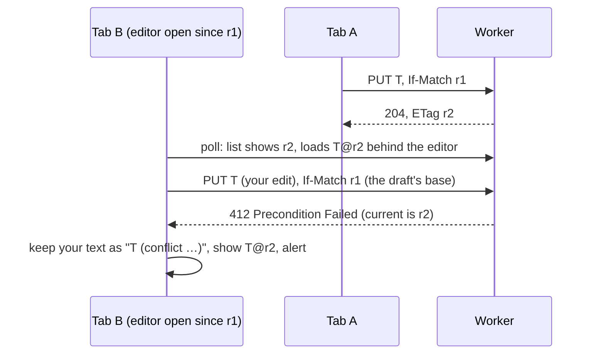
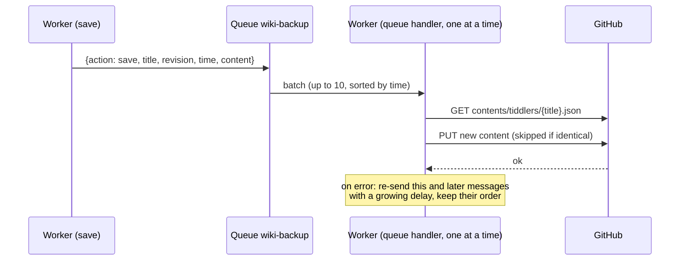
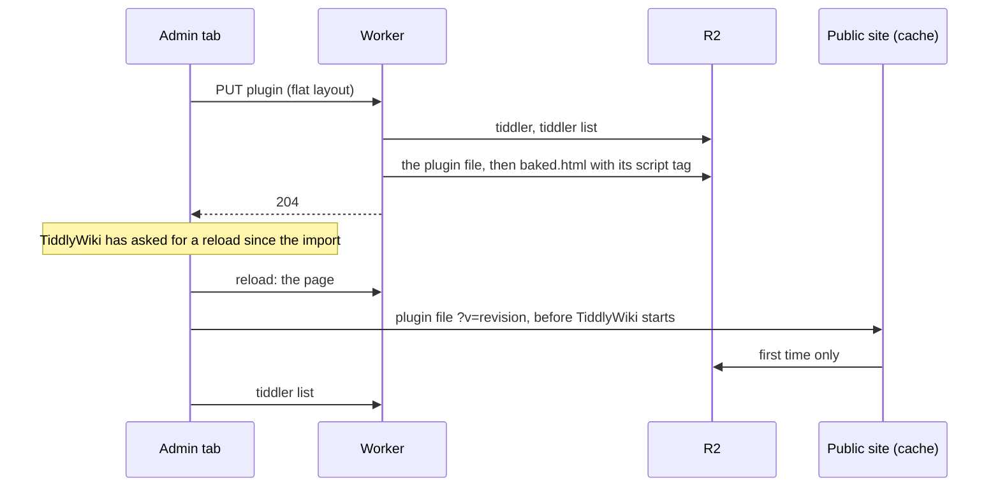

# How it works, and why

The design of the worker: what each part does, and the reasons behind the choices. Setting it up and operating it are in the [README](../README.md). Section numbers here are what the code's comments refer to as "design 1.4" and the like.

## Contents

1. [How it works](#1-how-it-works)
2. [Why it is built this way](#2-why-it-is-built-this-way)

---

## 1. How it works

### 1.1 Requests the worker answers

| Request | What happens |
|---|---|
| any, without Cloudflare Access | `403`, before anything else: the request didn't come through Access (README 2.6). |
| any, with `PUBLIC_WIKI_URL` wrong | `500`, next: the worker isn't set up (README 2.5). Missing, the wiki is private (2.15): the worker serves everything itself. |
| `OPTIONS *` | CORS headers (allows `If-Match`, `If-None-Match`, `X-Tiddler-Layout`, exposes `ETag`, `X-Tiddler-List` and `Retry-After`). |
| `GET /status` | TiddlyWeb status: user `admin`, writable, recipe `default`. Kept by the browser for a week (`Cache-Control: private, max-age=604800`), so admin pages rarely ask (1.5). |
| `GET /sw.js` | The admin wiki's service worker (1.11), asked for with its version (`?v=`). |
| `GET /`, `/index.html`, `/baked.html` | The wiki page, rebuilt first if outdated, or `304 Not Modified` when the browser has it (1.3). A bucket without `index.html` gets the empty wiki first (1.3). |
| `GET recipes/default/tiddlers.json` | The tiddler list, or `304 Not Modified` when unchanged (1.5), or `503` while it's being rebuilt (1.2). With `X-Backup-Status: ask`, also how backups go, in the `X-Backup-Status` header (1.7). |
| `GET recipes/default/tiddlers/<title>` | One tiddler as JSON (a flat one exactly as stored, see 1.2), with its revision in the body and the `ETag`, or `304 Not Modified` when the browser has that revision. |
| `GET <any other key>` | That R2 object as is, or `304 Not Modified` when the browser has it (R2's ETag; the object isn't read). |
| `PUT recipes/default/tiddlers/<title>` | Save (1.4): precondition check, conditional write, list update, purge, backup; for a plugin, its file and the page (1.8). Stored flat, whatever layout it arrives in (1.2). A body that isn't a tiddler (a JSON object whose `title` is text, the same as in the URL), or with a value that isn't text, gets `400`. (Every value TiddlyWiki sends is text: a tag `2024` or a field `year: 2024` is the text `"2024"` and is stored like any other. What's refused is a bare JSON number or `null`, which only a script calling the worker could send, and which would otherwise break page builds.) So does and so does a title over 999 bytes of UTF-8 (an R2 key holds 1,024 with `recipes/default/tiddlers/`). |
| `DELETE bags/<bag>/tiddlers/<title>` (or `recipes/<recipe>/…`) | Delete (1.4): same checks, then removal, purge, backup. A title too long to be stored answers `204`. |
| `PUT /page/core?v=<version>-<format>` | TiddlyWiki's core file, from the admin wiki, once per TiddlyWiki version, for the `index.html` it says (`X-Page-Index`, 1.9). |
| `PUT /page/shell` | The page published by the admin wiki, kept and used to build the page (1.9). |
| `POST /backup/sync` | Starts a full backup, GitHub made to mirror the bucket (1.7): `202` with its status, `409` with the running one's, `400` without backups or the queue. |
| `GET /backup/sync` | The last full backup's status. |
| queue messages | Backup to GitHub (1.7). |

A path that isn't valid percent-encoding (`%E0%A4%A`, say) gets `400`, in any request.

**Ephemeral titles.** These are never stored or backed up: `$:/StoryList`, `$:/HistoryList`, anything under `$:/state/`, `$:/temp/` or `$:/status/`, and drafts, recognised by their `draft.of` field (even an empty one, as TiddlyWiki tells them). A title alone doesn't make a draft: a tiddler called `Draft of 'Chapter 1'` is saved like any other, and only `$:/StoryList` itself is a tab's own: a second story river's `$:/StoryList/2` is stored like any tiddler. A `PUT` of one answers `204` with a throwaway ETag, and a `DELETE` answers `204`. In practice the browser doesn't send them: TiddlyWiki's own sync filter leaves out `$:/HistoryList`, `$:/state/`, `$:/temp/` and `$:/status/`, and the conflict guard also leaves out drafts and `$:/StoryList` (1.5).

### 1.2 Storage, revisions and ETags

R2 layout:

| Key | Content |
|---|---|
| `index.html` | The wiki engine you uploaded. |
| `status` | The public site's TiddlyWeb status, uploaded once (README 2.2). |
| `baked.html` | Generated: the page (the published shell, or `index.html`) plus the tiddlers needed at startup (1.3). |
| `_page/shell.html` | The page published by the admin wiki, without the core (1.9). |
| `_plugins/tiddlywikicore.js` | TiddlyWiki's core file, published by the admin wiki (1.9). |
| `recipes/default/tiddlers.json` | The "skinny" tiddler list, as compact JSON: title, tags, type, dates, custom fields and revision for every tiddler, but no text. If it's ever missing or damaged, the worker rebuilds it from the stored tiddlers (below). |
| `recipes/default/tiddlers/<title>` | One tiddler as JSON, flat (below), under its raw title. |
| `_plugins/<title>.js` | Generated: the script that loads a plugin or JavaScript module into the page (1.8). |
| `_backup/versions/…` | Temporary copies of large versions waiting to be backed up (1.7). |
| `_backup/status.json` | The backups GitHub keeps refusing, and a pause of every backup, while there are any (1.7). |
| `_repair/…` | Left by a rebuild of the tiddler list: the damaged copy, and the progress of a rebuild that takes several requests (below). |

**Revisions.** Each save gets a new revision, `Date.now()` in milliseconds. It's stored in three places that always agree: the object's custom metadata, the `revision` field inside the tiddler JSON, and the tiddler list. `GET`, `PUT` and `DELETE` all read it from the metadata, which avoids false conflicts.

**One layout.** Every tiddler is stored *flat*: every field at the top level, compact JSON, `text` last, then `revision`, `bag` and `recipe`, with `layout: flat` and the revision in the object's metadata. The conflict guard sends saves that way, with the header `X-Tiddler-Layout: flat` and without `revision`, `bag` or `recipe`. The worker then parses only the few hundred bytes before `"text"` and appends its `revision`, `bag` and `recipe`, working on the raw bytes: it never decodes, parses or re-encodes the text itself, which for a plugin is the whole plugin. It only checks that the text is a string that ends the body: it opens with a quote, and the body ends with one that isn't escaped. Up to 256 KB, it also checks that no field follows the text (scanning for the first quote that isn't escaped); a bigger body isn't scanned, since that costs milliseconds of CPU a megabyte, and the browser module always puts the text last. Anything else is parsed and turned into that layout first: a body sent with the header but not in the layout (pretty-printed, with `revision` before `text`, or with a field after the text), or TiddlyWeb's layout, with custom fields nested under `fields`, which TiddlyWiki sends without the guard. Field values must be text or lists of text, as TiddlyWiki's are; a value that's an object (only a script could send one) is refused with `400`, and so is a `text` that isn't text. One field is the exception: a field called `fields` stays nested, as `"fields":{"fields":"…"}`, the way TiddlyWeb's layout has it, because a flat `fields` is where TiddlyWiki's loader looks for nested custom fields. A rebuilt list only includes objects in this layout: anything else in R2, left by an older version or uploaded by hand, is left out, with a line in the logs (README 3).

| Plugin size | Worker CPU to handle the body, parsed (TiddlyWeb's layout) | Flat layout |
|---|---|---|
| 240 KB (markdown) | about 2.6 ms | about 0.1 ms |
| 735 KB (KaTeX) | about 6.5 ms | about 0.3 ms |
| 945 KB (geospatial) | about 10 ms | about 0.4 ms |

Measured in Node.js (the same JavaScript engine as Workers) on a development machine, so only the proportions matter.

**A tiddler saved before its text has loaded keeps its text.** After a page load, TiddlyWiki has every tiddler's fields from the list (each entry marked `_is_skinny`) and loads the texts one by one. A tiddler changed before its text arrived (a checkbox clicked during that time, say) is saved without it: the worker then keeps the stored text, as TiddlyWiki's own server does, and doesn't store the mark; the tab loads the text right after. Only such a save reads the stored tiddler.

**The list is served as stored.** Every entry the worker writes has its `bag` and `recipe`, so the list goes out as R2 has it, without being written out again; only a list without them (written by hand) gets them added on the way out. It's still parsed, to tell a damaged one.

**The list keeps the newest.** It's updated with a conditional write, retried if another request changed it in between. A retried write can therefore land after a later request for the same title: an older save then doesn't replace the newer entry, and a delete doesn't remove a title that was saved again since (both compare revisions). One exception: a save that lands between a delete's check and its removal is removed with it, since an R2 delete can't be conditional; the delete sees nothing stored and removes the entry too.

**A damaged or missing tiddler list rebuilds itself.** The list is only an index: every tiddler is also stored on its own, with all its fields. If the list can't be read (a bad upload or a hand edit) or is missing, the worker rebuilds it from the stored tiddlers wherever it needs it (serving it, a save, a delete, a page build) and carries on. Nothing needs doing by hand, and nothing runs in the background: the requests do the work.
- **It reads as little as it can.** A tiddler's fields come before `"text"`, so it reads only the first 16 KB of each object (more only for fields bigger than that). Each tiddler is listed under the title it's stored under. Objects not in the stored layout (an older version's, or uploaded by hand) are left out, with a line in the logs.
- **A big wiki takes several requests.** A request may make 1,000 R2 calls and use about 10 ms of CPU, so each request reads up to 100 tiddlers and keeps its progress in `_repair/`. Meanwhile the list, saves and deletes answer `503` with `X-Tiddler-List: rebuilding`, before changing anything (unless the list is damaged in the middle of that very request). The open tab sends them again at once, quietly (the conflict guard does this; roughly a second per 100 tiddlers), and each of those requests takes the next step. The damaged list is replaced only when the new one is complete. That last step writes the list as the steps built it, without parsing it, so it costs no more than the others.
- **Public tabs keep their tiddlers.** They read the list straight from R2. A missing list is replaced by a short text while it's rebuilt (each rebuild has its own, so it can't be mistaken for another one's). It isn't JSON, because TiddlyWiki removes every tiddler that isn't in the list it gets, and would take any JSON for one. The conflict guard recognises that text and fetches the list again every few seconds, at a URL no cache holds, and turns a list it can't read (a damaged upload) into an ordinary sync error, after asking once more past any cached copy, instead of TiddlyWiki's "Internal JavaScript Error". A tab without the guard (`CONFLICT_GUARD=off`, or a page opened before this version) stops syncing with that error, but still keeps its tiddlers.
- **Nothing is lost.** The damaged copy is kept in `_repair/` in case it held a hand edit you want to redo; delete it when you no longer need it. The new list holds exactly what is stored, so a hand edit to the list itself is gone, but no tiddler is.
- **The page is rebuilt on the next admin page load**, as the rebuilt list may differ from the one it was built from (a plugin saved by a tab closed before its list update was retried, say).
- **Progress is deleted when the rebuild completes.** If you repair the list yourself in the middle of one, its progress file stays in `_repair/` and does nothing; the next rebuild replaces it.

Deleting `recipes/default/tiddlers.json` in R2 has the same effect, which makes a rebuild easy to force.

**ETags** follow TiddlyWeb's format: `"default/<url-encoded title>/<revision>:auto"`. TiddlyWiki reads the revision from the ETag of each save response.

### 1.3 The wiki page (`baked.html`)

**The first visit.** A page request that finds no `index.html` in the bucket first puts the empty wiki there (`seed/empty.html`, uploaded with the worker as a text module: not as a static asset, which would put a router in front of the worker that drops Cloudflare Access's mark, README 2.6), with the public site's `status` file, both create-only, so nothing already in the bucket is replaced: an `index.html` deleted by hand gets a fresh engine, and the stored tiddlers stay. Then the page is built as for any new `index.html`. Without the module (a pasted worker) the page answers `404` saying what to upload.

TiddlyWiki only runs JavaScript modules, plugins and startup actions that are present when the page boots. Tiddlers loaded later through sync arrive too late. So the worker builds `baked.html` from the page source, which is the shell the admin wiki published when there's one for the current `index.html`, and `index.html` itself otherwise (1.9). It adds, right after `<head>`, a `<script>` that preloads these tiddlers (`$tw.preloadTiddlers`):

- `$:/DefaultTiddlers`, `$:/SiteTitle`, `$:/SiteSubtitle`
- `$:/theme`, `$:/language`, `$:/palette`: TiddlyWiki reads them at boot to choose the theme, language and palette
- the sync settings `$:/config/SyncPollingInterval`, `$:/config/SyncThrottleInterval`, `$:/config/SyncFilter`, `$:/config/SyncDisableLazyLoading`: TiddlyWiki's syncer reads them once, when it starts
- plugin disable flags, `$:/config/Plugins/Disabled/…`: read at boot too
- every tiddler tagged `$:/tags/StartupAction` or one of its variants (`$:/tags/StartupAction/Browser`, `…/PostRender`)
- the browser modules (`src/browser/`): the library `$:/cfworker/lib.js` the others require, the conflict guard `$:/cfworker/conflict-guard.js` (saves and deletes, section 2), the list sync `$:/cfworker/list-sync.js` (the tiddler list, reads from the public site, what isn't sent: 1.5), the backup alert `$:/cfworker/backup-alert.js` (1.7), the page publisher `$:/cfworker/page-publisher.js` (1.9), and the restore import `$:/cfworker/restore-import.js` (the backup's files dropped onto the wiki, 1.7), the control panel's Cloudflare tab `$:/cfworker/control-panel.js` (how backups go, the full backup, 1.7), and the outbox `$:/cfworker/outbox.js` (every change kept on the device until the worker has it, 1.10), and the cold start `$:/cfworker/cold-start.js` (the service worker registered, 1.11)
- `$:/cfworker/sw-url`: the service worker's address, `/sw.js?v=<its version>` (1.11)
- `$:/cfworker/public-url`: the public address, read by the modules; empty for a private wiki (2.15). A page on that site, whatever the protocol (visited over `http` while the address says `https`, say), is the public site: read-only, nothing published. Any other site, or any site when there's no public address, is the admin site (`lib.onAdminSite`)
- `$:/cfworker/page-source`: what the page was built from (the `index.html` ETag, the shell's fingerprint, the stored core file's version), read by the page publisher (1.9)

then one `<script src="…">` per plugin and JavaScript module (1.8). In a page built from the shell, those tags go right before TiddlyWiki's `<!--~~ Load external JavaScripts ~~-->`, at the end of the page: they still run before TiddlyWiki starts (the core file starts it), but no longer hold up the top of the page, such as a splash screen. In a full `index.html`, where TiddlyWiki starts from code inside the page, they go in `<head>`. The browser modules, the public address and the page source are left out when `CONFLICT_GUARD` is `off`.

**The browser keeps the page.** The page goes out with an ETag, `"<baked.html's R2 etag>-page"`, and `Cache-Control: no-cache`, so the browser asks at each load whether it changed. If it hasn't, the worker answers `304 Not Modified` without even reading the page's body from R2, and nothing is downloaded. A page that has to be rebuilt is sent in full, with the ETag of the page it stored, so the load after a rebuild (after a deploy, say) is already a `304`.

**Behind Cloudflare, the browser asks by date.** Cloudflare features that rewrite HTML remove the ETag on the way out. One of them, *Replace insecure JavaScript libraries*, is on by default on the Free plan, can only be turned off for the whole zone, and a configuration rule can't change it. So the page also carries `Last-Modified`, which they keep, and the browser then asks with `If-Modified-Since`. The date is the page's version, not just a time: it's set when the page is stored (`pageTime` in its metadata, in seconds), always later than the previous page's, even for two pages built within the same second, and the worker answers `304` only when it matches exactly. For the browser, the `304` is the same. In the worker it costs a little more: R2 can't check this date by itself, so the page's body is opened and cancelled unread. JSON responses keep their ETags: those features only touch HTML.

Stored tiddlers are baked as they're stored: flat, already the form `preloadTiddlers` expects. (A field called `fields` is unpacked first: TiddlyWiki does that itself only for tiddlers it loads through sync, 4.2.) The page is edited as bytes, without decoding `index.html` (a few MB) into a string and back, which costs about ten times more CPU. Text containing `$&`, `$1` and the like is copied literally.

**When it's rebuilt:**
- **On a page request,** if `baked.html` is missing, or was built by a different version of the browser modules or of the page format, or for a different public address (`bakeVersion` in its metadata), or from a different `index.html` (`sourceEtag`). Deploying a new worker or uploading a new `index.html` therefore takes effect on the next admin page load.
- **After saving or deleting a tiddler the page needs at boot:** one of those listed above, a plugin or a JavaScript module. That includes a tiddler that *stops* being needed, such as a startup action losing its tag. The save waits for the rebuild, so a reload right after it already gets the new page. If the rebuild fails (an R2 error), the save is still stored and confirmed, and the page is marked outdated, so the next page load builds it, writing any plugin file that's missing. The mark writes the same object the build just failed on (R2 takes one write a second to an object), so if it fails too it's tried once more a second later; if that fails as well, the save or delete answers `500` with the change stored, and the browser's retry finishes it: a plugin deleted, or saved as an ordinary tiddler, whose file is still there gets the page rebuilt without it and the file deleted. Without that, the retry would find nothing left to do, and the page would keep loading the plugin from its file on both sites.
- **After the admin wiki publishes a new shell** (1.9).

Two builds can overlap (two tabs saving at once, a save during the first load after a deploy, or while a new shell is published). Each page records when the tiddler list and the shell it was built from were stored in R2 (`listVersion`, `shellVersion`), and a build doesn't replace a page built from a newer one of them and no older one of the other: a save that read the shell just before a new one was published doesn't put the old shell back. In the rare case where each page has the newer one of the two, the later is stored but marked outdated, so the next page load builds it from both. This is best effort: after two lost races, the last attempt writes anyway.

After each rebuild that saves the page, the worker purges `/` and `/baked.html` on the public site.

### 1.4 Edit-conflict protection

**The problem.** TiddlyWiki's TiddlyWeb adaptor never says which version an edit is based on: no `If-Match` header. The server therefore can't tell a normal save from one that overwrites someone else's newer edit. The original worker's logs show this: not one request carried `If-Match`.

It's worse than "two tabs saving at once". Each tab checks the server every minute and quietly loads newer versions, including behind an editor you have open. So the tab "knows" the latest revision even though your edit started from an older text. A naive `If-Match` using that latest revision would approve the overwrite.



**In the browser (the conflict guard module):**

- **Every save says what it's based on.** It sends `If-Match` with the base revision, or `If-None-Match: *` for a tiddler the server shouldn't have yet. That includes a tiddler that came with the page, such as a theme or plugin from `index.html`: it carries a revision the worker never gives (`0` in a published page, a change count in `index.html`), so updating it (from the plugin library, say) creates it on the worker, and is a conflict only if another tab stored it first. If the revision is unknown, nothing is sent and the save is unconditional.
- **Drafts remember their starting point.** When an editor opens, the module records the revision the draft was copied from. When you confirm the edit, that becomes the base of the save, even if the tab has synced newer versions since. After the tab's own successful save, anything based on the old revision moves to the new one, so quick consecutive edits in one tab never conflict with themselves.
- **Deletes send `If-Match` too.** A rename deletes the old title, and so does deleting from an open editor: those deletes are based on the revision the editor started from, like the save. So if another tab saved a newer version meanwhile (even one this tab has loaded behind the editor), the delete is refused rather than removing that version. That base is kept until the tab has the server's version: if fetching it fails, the delete is tried again from the same base, and refused again.
- **On `412` for a save:**
  1. The module fetches the server's version.
  2. If it has the same content as yours (ignoring `revision`, `bag`, `recipe`, `permissions`, `modified` and `modifier`), it simply adopts it: no copy, no alert.
  3. Otherwise it saves your version as a new tiddler, `Title (conflict YYYY-MM-DD hh.mm.ss)` (with `Title` shortened, ending in `…`, if the copy's name would be too long for the worker: 999 bytes). That copy gets a `conflict-of: Title` field. System tags (starting with `$:/`, such as `$:/tags/Stylesheet` or TiddlyWiki's older `$:/core/wiki/rawmarkup`) are moved into `conflict-removed-tags`, and `module-type` and `plugin-type` into `conflict-removed-module-type` and `conflict-removed-plugin-type`, so the copy stays inert instead of acting as a second stylesheet, macro set, startup action, JavaScript module or plugin (a plugin copy's contents would even override the original's). The alert says so for such a copy: to use that version, copy its text into the original, or, if the original was deleted elsewhere, rename the copy to its title and give it back its `module-type` or `plugin-type`.
  4. The copy opens in the story river, the original shows the server version (or disappears, if it was deleted elsewhere), and an alert explains what happened, with links.
- **On `412` for a delete:** the newer server version is restored and an alert says it wasn't deleted.
- **A background reload never overwrites unsaved local changes.** If a tiddler has changes waiting to upload, the reload is skipped, and the pending save detects any conflict instead.

**On the server:**

- **`PUT` and `DELETE` check `If-Match` and `If-None-Match`** against the current revision. They accept full ETags, bare revisions, weak (`W/`) forms and `*`, and answer `412` with the current `ETag` on a mismatch.
- **For a save that carries a precondition, the R2 write itself is conditional.** It uses `etagMatches` on the object that was checked, or `If-None-Match: *` for a new tiddler. Two saves arriving at the same instant therefore can't both succeed: exactly one wins and the other gets `412`.
- **Requests without precondition headers are still accepted**, as before. These come from tabs opened before the module existed, and from scripts.
- **A retried save that's already stored is finished, not refused.** The worker stores the tiddler, then updates the tiddler list. If the list update fails, the browser retries the save with the same precondition, which no longer matches. When the stored tiddler is byte for byte what that save would store, the worker completes the list update and answers as if it had just saved it. Without this, the conflict guard would adopt the identical copy, the list would never be fixed, and the tiddler would vanish from every tab at the next poll. Different content still gets `412` (the tab may have edited again before its retry, or it's another tab's stale save: the worker can't tell), but that stored save is finished all the same, so the list, the public cache and the page don't stay behind it.
- **A tab recognises its own earlier save.** A save that gets an error may still have been stored (the answer lost on the way, say). The browser module remembers it, and if the next try is refused, it fetches the server's copy as usual: when that copy is exactly the save that got the error, it's this tab's own, so the newer content is sent again based on it, with no conflict copy. Identical content also counts a tiddler created in this tab, without a type, as having the default one the browser module sends.

To find conflict copies later, use the filter `[has[conflict-of]]`.

### 1.5 Keeping worker requests down

On an admin page load the worker sees only two requests: the page (usually a `304`, 1.3) and the tiddler list (often a `304` too). TiddlyWiki also asks for `/status` before it fetches the list. The answer never changes, so the worker lets the browser keep it for a week (`private`: that browser only): only the first load in a browser that week asks the worker, and the others don't wait for its answer before your tiddlers appear. Public tabs read their `status` file (README 2.2), which the browser can keep for a week too (README 2.7). While a tab is visible the worker sees one list request a minute, plus your saves.

| Change | Effect |
|---|---|
| **Tiddler contents come from the public site.** After reading the list, TiddlyWiki fetches every tiddler's full text one by one. The module fetches each from the public site instead (same R2 object, served by cache or R2). A private wiki has no public site: from the worker, once per device (the next row). | Removes one worker request per tiddler per page load. |
| **Each public copy is checked.** It's used only if its `revision` equals the one in the worker's list. Otherwise it's asked for once more at a URL no cache holds (`?cfworker-retry=`), and if that isn't the listed revision either, or on any error (including a missing CORS header), the module falls back to the worker, and also when the public site doesn't answer within 5 seconds, so a hanging site can't hold up loading. | A stale cached copy can never be loaded into the admin wiki, and a cache that kept one costs no worker request. |
| **Loaded tiddlers are kept on the device.** Every tiddler a tab loads or saves goes into the browser's IndexedDB with its revision (one database per site). A load first looks there, and uses the copy only if its revision is the one the worker lists; entries the list no longer has are pruned. | A page load fetches the list and the tiddlers that changed since the last visit, nothing else: a 1,000-tiddler wiki opens again with one request, on a phone too. Where storage is unavailable (a private window, say), loads fall back to the network. |
| **What's shown loads first, the rest fills in several at a time.** Since 5.1.23 TiddlyWiki loads every tiddler in full after the list, one at a time, in the list's order, so a tiddler opened directly waits for everything before it. The module arranges the loads: a tiddler whose text is needed (opened, transcluded, in the story at startup) goes to the front; the fill waits a moment after each list so the page can ask, pauses while the tab is hidden, and looks the next tiddlers up ahead of TiddlyWiki (24 at a time, 6 of them over the network) and stores the ones that have arrived together, one refresh for all of them. With `$:/config/cfworker/LoadAll` set to `no` there is no fill: a tiddler loads the moment its text is needed, and text search and backlinks see only the loaded ones (README 3). | A tiddler opened directly appears after one request; a first visit fills a 1,000-tiddler wiki in seconds instead of minutes; a hidden tab costs nothing. |
| **The page publisher doesn't wait for the fill.** It waits for saves and for loads of tiddlers the page needs (plugins, raw markup), not for the queue to empty (1.9). | The page is published after a save even while a big wiki is still filling in. |
| **The tiddler list stays on the worker.** | It's the up-to-date source of truth that the checks above rely on (2.8). |
| **`304` for the tiddler list.** The browser revalidates with its ETag, and when nothing changed the worker answers `304` without reading and rewriting the list. Weak `W/"…"` ETags, which Cloudflare's compression produces, are accepted. | Cheaper polls (still one request each). |
| **`304` for a tiddler or a file.** The same for the admin wiki's reads from the worker (one whose public copy is stale or missing, or the conflict guard reading the server's version): a browser that has it gets `304` and no body. A tiddler is still read (its revision is in its metadata); a file isn't even that. | Nothing downloaded twice. |
| **Drafts and `$:/StoryList` aren't synced.** | No request per navigation or per draft autosave. It also fixes a real bug (2.7). |
| **The "put" saver is switched off.** It probed the page URL with `OPTIONS` and `HEAD` on every load, but can't save to this worker. | Two fewer requests per page load. |
| **Hidden tabs don't poll.** While a tab is in the background, the minute-by-minute check is postponed. When it becomes visible again, it checks right away if the last check is more than 10 seconds old. Saves from a hidden tab still go out. | No polling from forgotten tabs. A visible tab still polls every minute. |

### 1.6 Public cache purges

After a change, the worker asks Cloudflare to purge exactly these public URLs. It's a single-file purge, never "purge everything". A private wiki has no public site, so nothing is purged, whatever `CF_ZONE_ID` and `CF_API_TOKEN` say.

- **After a save or delete:**
  - the tiddler's URL, `/recipes/default/tiddlers/<title encoded with encodeURIComponent>`, the same way TiddlyWiki requests it;
  - the same URL again, with the header `Origin: <the admin site>`. The admin page reads tiddlers from the public site cross-origin (2.8), so its requests carry that header, and Cloudflare keeps the `Origin` header in the cache key: the admin page's copy is a separate cache entry, which a purge of the bare URL leaves in place;
  - `/recipes/default/tiddlers.json` without a query string;
  - the same URL with the `?filter=…` query TiddlyWiki adds, for both the 5.4 filter and the filter of earlier versions (`SKINNY_LIST_FILTERS` in the source). The cache key includes the query string, so it has to match exactly.
- **After `baked.html` is rebuilt:** `/` and `/baked.html`.
- **After the tiddler list is rebuilt (1.2):** the list URLs above, at once and again 5 seconds later, in case a public request that read the damaged list or the stand-in was still under way.

Purges aren't awaited: they run while the response goes out, and failures are logged (`Cache purge failed`). A save purges the tiddler list only once the new list is stored, so a request in between can't put the old list back in the cache.

### 1.7 GitHub backup



1. **A save or delete adds a message** after it has been stored: `{action, title, revision, time, tries, content}`.
   - Messages are kept under 64 KB as sent, where a text takes one byte a character if they're all Latin-1, and two otherwise (so a 40 KB text with one `€` is too big). The queue takes up to 128 KB, but counts an operation per 64 KB of message, so a bigger one would cost 6 operations instead of 3. A version that would make the message bigger is stored in R2 under `_backup/versions/`, with a random name, and the message points to it.
   - If the queue isn't bound or can't be reached, the worker runs the same backup routine (steps 3–5) directly, trying up to 3 times (two retries, 1 and 2 seconds apart).
2. **The queue handler takes up to 10 messages per run, in save order.** With *maximum concurrency 1* there's only ever one run, so commits never collide. Once a run has handled 512 KB of versions, the rest go on to the next run: it always backs up one version, whatever its size, but not several big ones (a megabyte takes about 3 ms of CPU, and a run gets about 10 on the free plan).
3. **For a save,** it asks GitHub for the file's `sha` (git's blob hash, which GitHub needs to replace a file) and commits the new content. If GitHub already has exactly that content, it skips the commit, so a message delivered twice makes no duplicate: the hash of a content is always the same. GitHub sends the file's content too, but it isn't decoded: for a plugin that took more CPU than a run is allowed. The new content goes to GitHub in base64, written straight into the request's bytes, never as a string: for a 1.5 MB plugin that's about 5 ms of CPU for the whole backup, where encoding through strings took 21 (4.7 MB: 13 ms instead of 72).
4. **Late arrivals keep both history and the right final state.** If a version reaches GitHub after a newer one of the same tiddler (because it had to be retried), it's still committed, so it's in the history. Then the newer version is committed back on top, with the message `(newer version restored)`. A version is late when the wiki holds a newer one *and* GitHub already holds that one (its hash matches GitHub's `sha`); a newer version still waiting for its own backup (quick successive edits) is simply committed by its own message, in order. If putting it back fails, the retried message still does it. If the tiddler was deleted in the meantime, the late version is committed and then deleted again.
5. **For a delete,** the file is removed if present. If the tiddler has been recreated since, the delete is skipped, because the recreation's own message updates GitHub.
6. **On any GitHub error** (rate limit, outage, bad token, conflict, a path GitHub refuses), the failing message is sent to the queue again as a fresh message, with a delay. An error that may concern this file only (an outage answer, a conflict, a path GitHub refuses) holds up only that tiddler's later versions, so they stay in order, while other tiddlers' backups go ahead: a file GitHub keeps refusing can't hold up the rest. A version GitHub refuses for good (`409` or `422`: a path it won't take, or a secret its push protection found in the text) doesn't even hold up its own tiddler: the later versions go ahead, since the next one may well be fixed. The refused one is still retried, in case it's accepted after all, but once a newer version is on GitHub, or the tiddler has been deleted, it's dropped: it would only have been history. The delay starts at `BACKUP_RETRY_SECONDS` (60), doubles each time up to 6 hours, and honours GitHub's `retry-after` / `x-ratelimit-reset` when given. Re-sending, instead of using the queue's own retry, means neither the queue's retry limit nor its message lifetime (24 hours on the free plan) can drop a backup: a failure only delays it. A message that only waits, though (in a pause, behind an earlier version of its tiddler, or for the next run), uses the queue's own retry while that's safe: it costs 1 operation, the next delivery, instead of 3 for a fresh message. Safe means a retry to spare under the default limit of 3 (so a message is delivered at most 3 times before it's sent again fresh), and an hour to spare before 24 hours since it was sent. In the tests, 20 backups waiting on a refused token, then going through, take 164 queue operations instead of 240. Only if re-sending itself fails does the worker fall back to the queue's own retry, where the retry limit applies.
7. **Some errors pause every backup:** GitHub asking to slow down (a rate limit), and a token it refuses (`401`: expired or revoked). Trying the others one by one would only get the same answer, for a GitHub call and a few queue operations each. So every backup waits: the rest of the batch, and every backup delivered until the pause ends is sent back to wait for its end, without calling GitHub. Then the first one tries. If GitHub still refuses, the next pause is twice as long (from `BACKUP_RETRY_SECONDS` up to 6 hours, or as long as GitHub asks); the first backup that goes through ends it. A `403` (a token that can't write to the repository, an archived repository) or a `404` on a write (a repository the token can't see, or that doesn't exist) pauses them too, but only once two tiddlers get it in the same run: either can also concern one file (a path GitHub can't take), and one file mustn't hold up all the others. The pause is known to the next runs on the same worker instance; its end and length are kept in `_backup/status.json`, for a run on a new one. With 20 backups waiting on a refused token, that's 3 GitHub calls in 6 seconds instead of 60.

Commit messages: `✏️ Save: <title>`, `🗑️ Delete: <title>`, and `✏️ Save: <title> (newer version restored)` for the case in point 4.

**Failing backups show in the admin wiki.** Retrying means nothing is lost, but also that a token GitHub no longer accepts (an expired one, say) would otherwise only show in the worker's logs, for months. So:
- **The queue handler records each tiddler GitHub keeps refusing** in `_backup/status.json`: since when (the save of its oldest waiting version), GitHub's answer and its HTTP status. (Readable on the public site like everything in the bucket, it shows nothing new: the titles are in the public tiddler list already, and GitHub's answers hold no secret.) Rate limits aren't recorded: they only make backups wait, for hours during a big import. During a pause for a token GitHub refuses (1.7, point 7), every backup that waits is recorded, so none is left out of the count. The entry goes once that tiddler's backup gets through, and the file once none is left (and no pause). The file is written only when something changes, and read only by a run with a failure, a retry or a pause. A direct backup (no queue) records its failures too, and reads the file after each backup that goes through, to clear its entry: without a queue, a backup doesn't know whether it failed before.
- **The admin wiki asks with its tiddler list request** (header `X-Backup-Status: ask`): when the page loads, then once an hour, and at each request while the alert shows or a full backup runs. Only then does the worker read the file, at the same time as the list, and answer in a header of that response, a `304` included. No extra request.
- **An alert** ("GitHub backup") then says since when backups fail, how many tiddlers wait and the oldest, GitHub's answer, and what to do: for a `401`, make a new token and update the `GITHUB_TOKEN` secret. Only backups failing for at least `BACKUP_ALERT_MINUTES` (60) are reported, so a short GitHub outage doesn't raise one. It goes away by itself once they get through. Dismissed, it stays away for that problem; a reload shows it again if it's still there.

**A full backup makes GitHub mirror the bucket** (`POST /backup/sync` from the control panel's Cloudflare tab; `backup/sync.js`, `queue.js`). The per-save backup covers saves made since backups were set up; what came before (an imported wiki), a restore, a tiddler put in R2 by hand, or a backup GitHub refused for good and that was fixed, leave GitHub behind. The job runs in the queue, as a message that carries where it stands and queues its next step, so a wiki of any size goes through in as many steps as it takes:
- **The push phase** walks the stored tiddlers in key order (`after`: the last key walked), each through the same backup as a save (`backupJob`): GitHub's `sha` is asked, nothing is committed for a tiddler GitHub has the same bytes of, and a file GitHub refuses (its push protection, say) is reported like a save's would be while the walk goes on. Objects not in the stored layout are left out, as the list leaves them out.
- **The prune phase** lists GitHub's tiddler files in one call (the Git Trees API, the whole branch, subdirectories included) and the stored keys (one R2 call per 1,000), and removes the files whose titles are no longer stored; a file that changed or went meanwhile (a save or delete that landed) is left alone. A tree too big for one answer (100,000 files) skips the prune.
- **Each step stays within a run's budgets:** the GitHub calls the saves of the same run left (40 of the 50 outside calls a run may make; a step runs only with 8 left, after the saves, one step a run) and the bytes a run may encode (512 KB), so a step is about 20 tiddlers to commit, 40 to check, or one big one. Rate limits and a refused token pause the step like any backup; any other failure retries it with a growing delay, its progress noted as an error meanwhile. 3 queue operations a step.
- **Its status lives in `_backup/status.json`** (`sync`: id, when, total from the tiddler list, phase, steps, done, committed, removed, failed, finished, error), written by each step; the admin wiki gets it in the tiddler list's answer (asked every minute while one runs) and in the trigger's answer, and the tab shows it. Only one runs at a time: a second request is refused with the running one's status, unless it has made no progress for 8 hours (its message lost), in which case a new one replaces it and a late step of the old one does nothing.
- **A hint, once per browser:** when backups are on and no full backup has ever run, the admin wiki says so in an alert pointing to the tab; closing it is remembered on the device, a full backup makes it moot everywhere.

File paths are the ones the original worker used: the Contents API URL `…/contents/tiddlers/<encodeURIComponent(title)>.json`. History therefore continues in the same files.

**Restoring is an import, through a conversion the admin wiki does itself.** Each file is the tiddler as stored: TiddlyWeb's layout, where the tags are a list, with the revision, bag and recipe of the wiki it came from. TiddlyWiki's JSON import keeps only the fields whose value is text, so such a file dropped onto any other TiddlyWiki loses its tags. The restore-import module (`$:/cfworker/restore-import.js`) takes those files over with TiddlyWiki's `th-importing-file` hook, which a drop, a paste and the import button all go through: a `.json` file whose content is a stored tiddler, or a list of them (a title, with a revision, a bag, tags as a list or nested fields), is handed to the import dialog with every field as text (tags as TiddlyWiki writes them, `[[two words]]` included), the nested fields flat, and without the old revision, bag and recipe; any other file, a plain export or an HTML wiki, is read as TiddlyWiki reads it. Each tiddler is then saved as new (the saves carry `If-None-Match: *`, since the tab never knew those tiddlers from the server), stored, listed and backed up like any other. `tools/restore.mjs` (README 2.4) does the same conversion outside the wiki, for merging a whole clone into one file, or for any other TiddlyWiki. The two-tabs suite runs the round trip through TiddlyWiki's own file-import path.

### 1.8 Plugins and JavaScript modules

Plugins have to be in the page when TiddlyWiki boots, and the public site can't run the worker. So each plugin gets a file in R2, and the page loads it with a `<script>` tag from the public site, on both sites.



**What gets a file:** tiddlers with `plugin-type` `plugin`, `theme` or `language` (except `$:/core`, which comes with `index.html`, and plugins marked `platform: server`), and modules: tiddlers with a `module-type` whose type is `application/javascript`, `application/json` or `application/x-tiddler-dictionary`, the types TiddlyWiki defines modules from at boot.

**The file**, `_plugins/<title>.js`, is the stored tiddler, untouched, inside the code the external-plugins export template produces:

```js
{
const tw = globalThis.$tw ??= Object.create(null);
tw.preloadTiddlers = (tw.preloadTiddlers ?? []).concat([<the stored tiddler JSON>]);
}
```

For a tiddler with a field called `fields`, stored nested (1.2), the file has one more line that unpacks it, since TiddlyWiki doesn't for preloaded tiddlers. The file keeps the tiddler's `revision`, so after boot TiddlyWiki finds the same revision in the tiddler list and doesn't download the plugin again.

**The URL** is `https://wiki.example.com/_plugins/<encodeURIComponent(title)>.js?v=<revision>`, on the public site even in the admin page (root-relative, `/_plugins/…`, in a private wiki: the worker serves the file, with the same caching). The file name never changes, and `?v=` changes with every version, so caches never serve an old version and plugin files are never purged. No plugin code ever goes through the worker: it costs no worker request, and the public site's cache serves it (README 2.7).

**When files are written:** while building the page, which checks each plugin's file against the tiddler list (one `HEAD` each) and writes the ones that are missing or out of date from the stored tiddler. So saving a plugin updates its file before the save is confirmed, and the first page load after deploying writes files for plugins already in the wiki. Deleting a plugin, or turning it into an ordinary tiddler, deletes its file, once the page has been rebuilt without it (a page load in between still finds it). If that delete fails, the file is only left behind, unused: the save or delete is still confirmed. When two builds overlap, a file is only written if it's still the one the build looked at, and not replaced by an older version (best effort, see 1.3); each script tag uses the revision the file actually holds.

**Disabled plugins keep their tag.** Their disable flag is in the page, so TiddlyWiki skips them at boot. Leaving their file out would be worse: the sync would fetch the plugin after boot, and TiddlyWiki would ask for a reload on every load.

**Themes and languages** work at boot, since both the plugin and `$:/theme` or `$:/language` are in the page.

### 1.9 The page, published from the admin wiki

When TiddlyWiki saves a single-file wiki, it writes the whole page from a template: the `<title>`, the language, the `$:/tags/RawMarkup…` tiddlers (TiddlyWiki 5.4's own Open Graph tags for link previews among them, from `$:/SiteTitle`, `$:/SiteSubtitle`, `$:/SiteUrl` and `$:/SitePreviewUrl`; a splash screen; web fonts...), the content for browsers without JavaScript. Here nothing saves the file. So the admin wiki renders the page itself, with the same template, and publishes it; the page publisher module does it by itself.

**What it renders.** TiddlyWiki's own `$:/core/templates/tiddlywiki5-external-js.html`, the page of its "external core" edition: everything but the core, which is loaded at the end from a separate file. The template only gets two inputs:
- `saveTiddlerFilter`, the tiddlers in the page: the plugins that came with the page (plugin tiddlers the worker doesn't store: the themes and TiddlyWeb from `index.html`; never `$:/core`, `$:/temp/…` or a pending import), the plugins installed from the wiki that have raw markup (below), and the tiddlers tagged `$:/tags/RawMarkup…` (without drafts). Other installed plugins are only files (1.8), and content stays synced.
- Nothing deleted, in this tab or another. TiddlyWiki keeps `$:/` tiddlers that disappear from the server in tabs already open, so "not stored" alone can't tell a theme from `index.html` from a plugin deleted elsewhere. What tells them apart is when: the tab records what came with the page when it loads (in the page, not on the worker's list, and without a revision from the worker), and from then on goes by the worker's list, its own saves and deletes counting until a newer list comes. A copy of a deleted tiddler left in the page by a failed publish carries the worker's revision, so the next admin load takes it out.
- `coreURL`, the core file on the public site (root-relative in a private wiki, the same URL the worker expects, 2.15).

One thing differs from TiddlyWiki's own save: the TiddlyWeb plugin writes each tiddler's `revision` in the page as its *changecount*, a count of changes made in that tab, which differs from tab to tab. Here it's the tiddler's revision, the worker's, so the same wiki gives the same page in every tab, and a page load doesn't take the copies in the page for changed tiddlers. (A tiddler the tab has just saved still carries its old revision, TiddlyWiki only records the new one in the syncer: it's loaded again before rendering.)

**The core file** is rendered with TiddlyWiki's `$:/core/templates/tiddlywiki5.js`: the boot code, library modules and `$:/core`. TiddlyWiki adds a line to it that switches the save template to the external-core one; it's taken out, since it would turn TiddlyWeb's "Save snapshot for offline use" into snapshots that need the core file next to them. If a TiddlyWiki version writes that line differently, so it's still there, the worker refuses the core file (it finds the setting outside the core plugin's JSON), and the page stays built from `index.html` until the worker is updated: loud, rather than snapshots that quietly stop working offline. It's stored as `_plugins/tiddlywikicore.js` and loaded as `?v=<TiddlyWiki version>-<format>`, cached for a year like plugin files, and sent only when the page doesn't already load that version: once per TiddlyWiki version.

**What the worker does with them** (`PUT /page/core`, `PUT /page/shell`):
- It refuses (`409`) a core file sent for another `index.html` than the current one, as it does a shell: an admin tab opened before an upgrade would otherwise replace the core file with its older version, which the public site would serve under the new version's URL, cached for a year.
- It checks the core file starts and ends like TiddlyWiki's, and the shell has TiddlyWiki's tiddler store with the TiddlyWeb plugin in it (or the page couldn't sync), the `<!--~~ Load external JavaScripts ~~-->` marker, and a `<script>` loading the stored core file. Anything else is refused with a message, shown by the admin wiki.
- It keeps the shell as `_page/shell.html`, with the `index.html` it was rendered for (refused, `409`, if `index.html` changed since the admin page loaded) and its fingerprint, then rebuilds the page from it (1.3). `index.html` is never changed: a new upload is used as it is until the admin wiki publishes a shell for it.
- A shell says which stored shell the page it replaces was built from (`X-Page-Shell`, its version from the page source, then from each answer). One built before another tab published is refused (`409`) with the current version, and the write itself is conditional, so two tabs sending at the same moment can't both win: the loser syncs, so it has the other tab's change, and sends its page again. Without that, a page rendered a moment before another tab's change, reaching the worker a moment after that tab's page, would replace it, and neither tab would know. A tab from before this check (no version) is refused too: reload it.
- The same shell again does nothing, and the same core file version isn't stored again. A new core file marks the page outdated, so the next load builds it again: the page tells the admin wiki which core file is stored, and otherwise a page whose shell keeps being refused would have it send the core file (2.4 MB) at every load.

**When it publishes:**
- **A moment after this tab saves or deletes something** (a second, so a burst of saves gives one publish), if the page it renders isn't the one published. It first syncs with the worker, so a change another tab saved before is included. A save that doesn't change the page costs only the render, in the browser: no request.
- **When the admin wiki loads,** once synced and loaded, if it renders something other than the page it loaded: the first load after this version is deployed or a new `index.html` is uploaded, a publish that failed, a change made outside the admin wiki.
- **Not for changes that arrive from other tabs:** the tab that saved them publishes them. Otherwise several tabs would publish, and one that hadn't caught up could publish an older page over a newer one. But once a tiddler list shows another tab changed something the page can hold (a `$:/` tiddler, or one with a raw markup tag), this tab no longer knows which page is published: its next save publishes even a page it published or loaded before. Otherwise a change another tab published and this tab undid (a raw markup tiddler deleted, a subtitle put back) would stay on both sites. The same after a failed publish, which the worker may have kept all the same. Sending the same page again only gets a `204`.
- **Not while a tiddler it needs hasn't loaded yet** (rendering would leave its text out): it waits for it, and for saves, but not for the background fill of the other tiddlers (1.5). And never in safe mode (`#:safe`), on the public site, or without the worker's browser module.
- **A failure** (refused, the worker unreachable, or an error while preparing the page, such as a raw markup tiddler with a widget that can't be rendered as text) is shown in a notification, and tried again at the next save or load. A page the worker refused (it answers 400, or 409 when `index.html` changed) isn't sent again at every save, only once the page changes, or after a reload: the same page would be refused again. A refused core file only after a reload, since no page can be published without it.

The page is rendered afresh at each check, then compared with the published one by a fingerprint. It isn't kept rendered and refreshed: raw markup is wikified apart from TiddlyWiki's widget tree, so the refresh mechanism wouldn't see a change to a tiddler it transcludes (`$:/SiteTitle` in the Open Graph tags).

**Plugins with raw markup.** The template only renders the raw markup of plugins that are in the page: a plugin that loads a library from `<head>`, adds meta tags or a splash screen needs to be there. So an installed plugin with a tiddler tagged `$:/tags/RawMarkup…` is also written into the page, as TiddlyWiki would, and its markup rendered. Its file stays: TiddlyWiki reads the page's tiddlers first and the files after, so the file's copy, the same plugin, replaces the page's. The page grows by the size of those plugins only.
- A plugin without JavaScript is published a moment after it's installed, updated or deleted, like any change to the page.
- A plugin with JavaScript (TiddlyWiki asks for a reload) only starts after a reload, and the template can only render its markup then: it's published at the next admin load. After an update, the page gets the new plugin at once and its new markup at that load.

**Raw markup is written the way TiddlyWiki documents it:** `$:/tags/RawMarkup` tiddlers are copied as they are; the wikified tags render their text as wikitext, so HTML in them needs `\rules only filteredtranscludeinline transcludeinline` on the first line (transclusions are filled in, the HTML kept).

**What it costs:** nothing per page load (still 2 worker requests on the admin site, none on the public one). A first visit gets the core file from the public site's cache, one more request, then keeps it a year. The page is about 300 KB instead of 2.8 MB for the test wiki, so a rebuilt page (a plugin, a title, a deploy) costs visitors and the worker much less. A publish is one sync with the worker, an upload of about 300 KB and a page rebuild; the core file, 2.4 MB, once per TiddlyWiki version.

---

### 1.10 Editing offline: the outbox

TiddlyWiki does most of this by itself, which the probe behind this design confirmed (a real TiddlyWiki 5.4.1 in Chromium, the network cut): its syncer has no queue of its own, it compares the store with what it last saw on the server, so a save that fails is tried again every 5 seconds (`errorRetryInterval`), one tiddler at a time in title order, with one *Network Error* alert whose counter climbs, the page marked dirty and the browser's "unsaved changes" warning on closing; once the network is back, every change goes through at the next retry, each through the conflict guard, and the alert clears itself. What it doesn't do is survive the tab: a change made offline is nowhere but in memory, so a reload (which can't load the page offline anyway), a crash or a closed tab loses it, and the device copy (1.5) holds only what came from the server.

The outbox module (`$:/cfworker/outbox.js`) adds the missing part, on the admin site:
- **Every change is written to the device the moment it's made**, into a second table (`outbox`) of the device database the list sync keeps (`cfworker-tiddlers`, now version 2): a save as the tiddler's fields with the server revision this run of changes started from (`base`, kept through later changes, `null` for a tiddler the worker never had) and the change count; a delete with the revision it deletes; a draft as its fields, a moment after the typing. It's removed once the worker confirms the save or delete (the adaptor's callback, unless the tiddler changed again since the save was sent), or once the conflict guard has settled it (the worker's version adopted here, this tab's kept as a copy that waits in its own right), and a draft when it's saved or cancelled. A change made online is written too, and removed a moment later: there's no knowing the network is gone until a save fails.
- **At the next page load on this device**, once the first tiddler list is in and before TiddlyWiki processes it, what's still in the outbox is put back into the wiki: a save as the tiddler (TiddlyWiki then saves it, as a change it doesn't know on the server, before any load; the list sync never lets a load overwrite an unsaved change), a delete once the syncer knows the tiddler from the list (`wiki.deleteTiddler`, its queued load dropped), a draft as a draft, which TiddlyWiki lists at the top of the page. The conflict guard is told the revision the change was made from (`cfworkerBaseFor`), so the save or delete carries that as its `If-Match`, not what the list says now: a version saved elsewhere meanwhile is a conflict, with a copy, as it would have been in the tab that made the change. The outbox is shared by every tab of the browser, so before putting anything back the loading tab asks the others, over a `BroadcastChannel`, what they hold, waits 300 ms for their answers, and leaves those entries alone: a draft being typed in another tab, or a change that tab is still sending, stays with it (a tab that can't answer, frozen in the background say, is taken for gone, which is the behaviour without the channel).
- **The network's return wakes the syncer** (the browser's `online` event calls `processTaskQueue`), so the changes go out at once rather than at the next retry, up to 5 seconds later.
- **`$:/temp/cfworker/outbox`** holds the status: `waiting` (saves and deletes, not drafts), `since` (the oldest), `online` (the browser's events, and a save answered with a network error or a success). **`$:/temp/cfworker/outbox-status`** is an item in the dropdown of TiddlyWeb's cloud icon (`$:/tags/SyncerDropdown`, under "You are logged in"), shown while something waits: "2 changes waiting since 19:29", then "offline: kept on this device until sent" or "sending (kept on this device until then)". The icon itself is TiddlyWiki's: red and turning while anything is unsaved (`body.tc-dirty`), which is the same condition, so nothing is added to the page; the detail is one click away. TiddlyWiki's own network alert stays as it is.

What it costs: one IndexedDB write per change and one delete per confirmed save, nothing on the worker, no request. What waits on a device is sent from that device: another device doesn't see it until then (README 5).

### 1.11 Opening the wiki offline: the service worker

After one visit online, the admin wiki opens with no network. The cold-start module registers a service worker on the admin site (`src/browser/service-worker.js`, served by the worker at `/sw.js?v=<its version>`; the address is baked into the page as `$:/cfworker/sw-url`, so a new script is a new address, registered at the next load, and a page already controlled by the current one registers nothing — a `register()` call asks the browser to check the script, a request). The public site registers nothing: it's read-only and served without the worker.

The service worker answers requests from the page by kind:
- **The page** (a navigation, or `/`, `/index.html`, `/baked.html`): the network first; the cached page only when the network fails, or hasn't answered after 8 seconds. Only an answer carrying the worker's own mark is kept, a response header `X-Wiki-Page` the worker puts on the page: Cloudflare's login page, or the worker refusing a request without Access, is shown as it is and never cached. Online, nothing changes, the `304` included: the cache is the fallback, not the source.
- **The core file and the plugin files** (`_plugins/<name>.js?v=<version>`, on this site or the public one): the cache first; their address carries their version, so a copy is never stale. One from the public site is asked for by the service worker itself with CORS (the zone's rule allows the admin site, README 2.7, and the request goes past the browser's own cache, where a copy taken before the rule carries no permission), so the answer can be seen and is kept at its real size. If the site doesn't allow it, the page's own plain `<script>` request goes out instead and nothing is kept: the wiki boots online as it always did, and that file isn't there offline. Never an "opaque" answer (a plain script load from another site, which the service worker can't look into): the browser charges those several megabytes each against the site's storage whatever their size, and storage under pressure is evicted whole, the outbox with it (2.18). When a new page is cached, the files it no longer refers to leave the cache.
- **The status file and the tiddler list**: the network first; the cached one when the network fails, with the header `X-Served-From: cache` added. The list sync reads it: with the last list kept rather than the worker's, a device copy counts whatever its revision, since it's the best there is and may well be newer than that list (a save of this device's made after it, say).
- **Anything else** — a tiddler's contents, a save, a delete, the page published, the backup — goes to the network only; offline it fails as it does today, and the outbox (1.10) keeps the change.

The first visit online fills the cache as the page loads (the page, the core, the plugins, the status, the list), so no precaching is needed. Offline, a tiddler never loaded on this device stays empty when opened: TiddlyWiki's load fails, with its network alert, which it clears at once since nothing is unsaved (its own behaviour); the cloud icon's dropdown says the browser is offline. The tests take "no network" as the worker taken down: the browser's offline mode doesn't cut a service worker's own requests (`test/cold-start.test.mjs`). The other browser suites block the service worker (`launchBrowser` in the harness): with it in place, what a page's requests show (their headers, the `304`s) is no longer what reaches the worker, and those suites watch at the page.

**Storage.** The outbox asks the browser to keep this site's storage (`navigator.storage.persist()`): a browser short of space evicts a site's storage whole — the service worker's cache, the device copy and the outbox together — and a change waiting in the outbox would go with it. Granted by the browser's own rules (Chrome: a site used often, installed or bookmarked; Firefox asks), the answer is in the status (`storage`: `persistent` or `best-effort`), and the cloud icon's dropdown says so beside a change that waits when it isn't granted. The cache itself is a few megabytes at their real size (the page, the core file, the plugin files), beside the device copy.

**What it costs:** nothing per page load: still 2 worker requests, the page and the list, both `304` — measured at the worker, behind a counting proxy, over eight reloads with the service worker in place. The browser checks the script of a registration at navigations; registered with `updateViaCache: "all"` and served fresh for a day (`Cache-Control: max-age=86400`, an `ETag` for the daily revalidation, a `304`), that check costs a request once a day, not once a load — without both, Chrome fetched the script at every reload after the first minute. One request for the script at registration. The cache is a few megabytes (the page, the core file, the plugin files) in the browser's storage, beside the device copy.

## 2. Why it is built this way

### 2.1 The original failure was a missing header, not compression

The first suspicion was Cloudflare compression turning strong ETags into weak ones (`W/"…"`). That does happen, but only on downloads, where browsers use the ETag to re-check their cache. It has nothing to do with saves. The logs showed no save ever carried `If-Match`, because TiddlyWiki's TiddlyWeb adaptor doesn't send one. The previous version then rejected every save of an existing tiddler with `428 Precondition Required`, which is why saving broke. Turning compression off couldn't change that.

### 2.2 Return `412` on real conflicts, and accept saves without the header

A "strict" server that requires the header blocks every client that doesn't send it, which is exactly how saving broke. It can also stall TiddlyWiki's sync: a save that keeps failing is retried forever and blocks everything after it. So the server only refuses a save when it can prove a conflict, and the browser module makes sure the proof is available.

### 2.3 The browser modules are built into the page by the worker

TiddlyWiki only runs JavaScript modules that exist when the page boots, so the modules can't simply be synced tiddlers. Building them into `baked.html` gives three things:
- **One deploy:** the worker and the browser half always change together.
- **Nothing to install** in the wiki.
- **Automatic updates:** a page built with older modules is rebuilt on the next load.

They're one file per concern (`src/browser/`, README 6.1): the conflict guard only patches saves and deletes; the tiddler list, the reads from the public site and what isn't sent are the list sync, which the guard, the backup alert and the page publisher use through the adaptor (`cfworkerListed`, `cfworkerOnList`, `cfworkerOnListRequest`, `cfworkerNoteListed`); what they share is a TiddlyWiki library module. Each startup module declares what it runs after, so the alert registers its request once the list sync is in place.

### 2.4 Drafts carry their own base revision

Each tab silently loads newer versions every minute. So "the latest revision this tab knows" is not "the version this edit started from". Without per-draft tracking, the most common conflict — an editor left open while another tab saves — would still overwrite silently.

### 2.5 A conflict copy instead of overwriting or a merge dialog

- **The version already on the server stays.** Whoever saves second gets their text kept as a copy, plus an alert.
- **Both versions survive and are visible,** which is the property that matters.
- **No modal dialog** that could interrupt typing or be dismissed by mistake.
- **No automatic text merge,** which could silently produce nonsense.

The copy is made inert (`$:/tags/…` tags removed) because a duplicate stylesheet, macro or startup action would change how the wiki behaves. Identical edits from two tabs are recognised and accepted without a copy.

### 2.6 The R2 write is conditional, not just checked

Checking the revision and then writing leaves a small window where two saves both pass the check. R2's conditional put closes it: the second write fails and gets `412`.

### 2.7 Drafts and the story list aren't synced

The worker never stored them; it answered "OK" and threw them away. That caused a real bug. After the next minute's poll, TiddlyWiki saw the draft "missing from the server" and deleted it locally, closing any editor left open longer than a poll interval. Not sending them at all fixes this and saves requests.

The flip side: what you're typing exists only in that tab, and TiddlyWiki's syncer, which no longer counts drafts, wouldn't warn before you close or reload it. So the conflict guard does: the browser asks first while an editor holds changes (not for one opened and left unchanged). Since 1.10 the draft is also kept on the device, and back after a reload.

The story list wasn't stored either. The Control Panel's "retain story ordering" button sets Default tiddlers to `[list[$:/StoryList]]`, which only works when the story list is saved, so it never worked with this worker. To use your current story as the default, this button stores a snapshot of the titles:

```
<$button set="$:/DefaultTiddlers" setTo={{{ [list[$:/StoryList]format:titlelist[]join[ ]] }}}>Use current story as default</$button>
```

### 2.8 Tiddler contents come from the public site, the list from the worker

The public site already serves the same R2 objects through Cloudflare's cache, so reading tiddler contents from there costs no worker requests. Cached data can lag behind: a purge can fail, and browsers keep their own copies. That's why each copy is checked against the worker's list and only used if its revision matches. The list itself must be current: it detects changes from other tabs and checks the copies, and conflict protection depends on it. So it always comes from the worker.

### 2.9 CORS through a transform rule, not R2's CORS policy

The admin page and the public site are different hostnames, so the browser only lets the page read public responses that carry `Access-Control-Allow-Origin`. R2's CORS policy adds that header only to requests that announce another origin. A public visitor's request doesn't, so the cached copy has no header. Cloudflare's cache keeps one copy per URL, so it can hand that header-less copy to the admin page. A response header transform rule adds the header at the edge to every response, cached or not.

### 2.10 Targeted purges, not "purge everything"

The previous version purged the whole zone after every save and delete:
- **Too often:** on the free plan, "purge everything" is limited to 5 requests a minute (bursts of 25), so after a quick series of saves the purges failed and the public site stayed stale.
- **Too broad:** it also cleared every other site in the zone.

Single-URL purges allow 800 URLs a second on the free plan and touch only what changed. Their one requirement is exact URLs, query strings included.

### 2.11 Backups through a queue

Three alternatives were considered:

| Option | Why not |
|---|---|
| **Commit directly after each save** (the original) | Commits running in parallel collide on the branch. The code retried 3 times, then silently dropped the backup. This happened in any burst: imports, renames that update links, retagging several tiddlers, two tabs. GitHub also limits commits to about 80 a minute and 500 an hour. |
| **A scheduled job committing everything changed every few minutes** | Keeps only the last version of each tiddler per interval, so one bad edit could lose the good version. It also runs forever, even when the wiki is untouched for years. |
| **Retrying in place, plus a "pending" store in R2** | Would work, but it's a home-made queue: more custom code, and leftover backups only move when you use the wiki again. |

The queue solves the cause instead of working around it:
- **Commits run one at a time,** so they can't collide.
- **Every save keeps its own commit,** in order.
- **Failed backups wait** as long as needed and are sent again.
- **Nothing runs while the queue is empty.**

### 2.12 Things deliberately not done

- **Capping what's built into `baked.html`:** it holds only startup-related tiddlers and the module, so it doesn't grow with the wiki. A cap would silently drop a startup action.
- **Serving the tiddler list from the public cache:** see 5.8.
- **Requiring `If-Match` (strict mode):** see 5.2.

### 2.13 Plugins as files the page loads

- **Files, not plugins baked into the page:** the page stays small and changes only when a plugin does, and each plugin is cached on its own.
- **Loaded from the public site, even by the admin page:** the public wiki can't use the worker anyway, and this way plugin code costs no worker request on either site.
- **One stable file name, `?v=<revision>` in the URL:** nothing to clean up, and no purges, which would make the next visitor's request read from R2 again.
- **One `<script>` tag per plugin, not a loader script:** scripts added by a loader would run after TiddlyWiki boots, and the browser fetches tags it sees in the HTML in parallel.
- **The browser sends saves in the stored layout,** so the worker's CPU per save barely grows with the plugin's size (1.2), as long as the backup queue is bound: without it, the backup runs inside the save.
- **No switch in the worker to turn plugins off:** a broken plugin is fixed by deleting its file (README 3). TiddlyWiki's safe mode isn't an option: it also turns off the TiddlyWeb plugin, so nothing could be saved.

[`docs/external-plugins.md`](docs/external-plugins.md) has the full reasoning and the alternatives that were considered.

### 2.14 The admin wiki renders the page

- **Rendered by TiddlyWiki, not the worker:** only TiddlyWiki can run wikitext, so this is the only way the title, raw markup and the rest come out exactly as TiddlyWiki writes them, transclusions included. The worker can't, and rendering a few sections and inserting them meant reimplementing where TiddlyWiki puts each one.
- **TiddlyWiki's template as it is,** given two inputs, rather than a template of ours: whatever a TiddlyWiki version writes in its page comes with it.
- **The external-core template:** the core is most of the page, the same for a whole TiddlyWiki version, so it's a separate file cached a year, and the published page is small to send and quick to render.
- **The shell kept apart from `index.html` and `baked.html`:** `index.html` stays the file you uploaded, and each page build starts from the same clean source, never from a page that already holds the worker's additions.
- **Published from the tab that saved, without a button:** like everything else in the wiki, a change is live once saved, and nothing depends on remembering to publish.

### 2.15 A private wiki is the same worker without a public address

Many wikis are notebooks: one person, behind a login, nothing to publish. For those, the public site is a cost (a domain, the zone rules, the purge token) and a worry (everything in the bucket readable by anyone). So `PUBLIC_WIKI_URL` is optional, and without it the worker is a private wiki:
- **The worker serves what the public site would have:** the core file, the plugin files and the tiddler contents, all behind Access. The page's URLs for the core and plugin files are root-relative (`/_plugins/…`), so the page publisher, the shell check and the page build agree without a setting of their own: `publicUrl` gives the path alone. The device copy keeps a reload from fetching the tiddlers again, so a page load is still 2 worker requests; the first load on a device reads each tiddler from the worker, the one cost of not having a public cache (README 5).
- **The page carries an empty public address,** and the browser modules take that as "this is the admin site" (`lib.onAdminSite`): the backup alert asks, the Cloudflare tab shows, the page publisher publishes. A public wiki's page opened at the public address stays the public site's, as before.
- **Nothing is purged:** there's no public site, whatever the purge settings say.
- **Going public is one setting.** The first visit writes the public `status` file for a private wiki too, the bucket's layout is the same, and the page's version includes the public address, so the first load after the setting is saved rebuilds the page with it; the admin wiki then publishes the shell again, with the core on the public site. Nothing to migrate, and the same worker runs both.
- **A wrong address is still refused,** as a missing one no longer is: a setting that isn't a site's address would make the page load its code from nowhere, and the worker's own address would make the browser modules take the admin site for the public one.

Not done: a separate "private mode" switch (the absence of the address says it), or serving the private wiki's tiddlers in one request (the list with every text): each tiddler is an R2 object, so that's one R2 read per tiddler per request, against the first load's requests, which the device copy pays once.

### 2.16 The backup's files stay the stored tiddler

Considered when the restore procedure was written (1.7): writing the tags as text in the backup's files, so that TiddlyWiki's own JSON import would take them back. Not done: the backup is the stored object, byte for byte, and that's what makes it cheap. A backup and a full backup decide whether GitHub already has a tiddler by comparing the git hash of the stored bytes with the file's `sha` on GitHub, without reading either (decoding a big plugin's text took more CPU than a run is allowed, 1.7); a converted file would have to be rebuilt from the stored one for every comparison. A plain import would still have lost the nested fields and carried the old revision, bag and recipe. So the conversion happens where the files come back: in the admin wiki, whose import hook sees every file dropped on it, and in `tools/restore.mjs` for a whole clone.

### 2.17 Offline editing keeps what TiddlyWiki does, and adds the device

Three ways were weighed for editing offline:

| Option | Why not |
|---|---|
| **A local-first store, as TiddlyPWA has** (every tiddler and every change in IndexedDB, a sync protocol of its own with tombstones and timestamps, the server a replica) | A second sync engine beside TiddlyWeb's, and a second conflict model beside the guard's, for a wiki whose server already holds the truth and whose reads already come from the device copy. Most of its value, reading and editing with the page open, needed only the outbox. |
| **A sending queue of our own**, replacing the syncer's retries | The probe showed the syncer's retries and its network alert do the job: one alert, everything sent at the network's return, conflicts through the guard. Replacing them would reimplement what works and lose TiddlyWiki's own "unsaved changes" warning. |
| **The outbox: write-ahead on the device, replayed through the syncer** (chosen) | Nothing is lost between a change and its confirmation, whatever happens to the tab; what's sent still goes through TiddlyWiki's syncer and the conflict guard, with the base revision carried along, so the conflict behaviour is exactly the online one. |

Also decided:
- **Drafts are kept too.** "Nothing is lost" has to include what's being typed, and the mechanism is the same table. They're never sent (2.7); after a reload, TiddlyWiki's own drafts list at the top of the page shows them. One draft per tiddler can come back: the device keeps the latest written, and a wiki can't hold two drafts of one title.
- **A tab asks the others before putting back.** The first version put back whatever the device held, so a tab opened while another was typing adopted that tab's draft as of that moment — a stale ghost, and a fork if edited. TiddlyPWA uses a `BroadcastChannel` to propagate every change between tabs live; here it's used only for the question "who holds this?", which is all the shared outbox needs.
- **No indicator of our own on the page.** The first version had a line under the alerts saying what waits; it duplicated TiddlyWeb's cloud icon, which already goes red for exactly that condition, and so needed a delay to keep it from flashing at every save. The detail (how many, since when, offline or sending, kept on this device) went behind the icon instead, in its dropdown: nothing new to look at, one click for the specifics.
- **TiddlyWiki's network alert stays.** It's accurate, it clears itself, and replacing core behaviour for a cosmetic gain isn't this project's business.
- **Not done: opening the wiki with no network at all.** That needs the page, the core file and the plugin files from a cache the browser keeps: the service worker, the next step (roadmap).

### 2.18 Opening offline: the network first, the cache behind

The roadmap said "stale-while-revalidate, as TiddlyPWA does it": the cached page at once, the new one fetched behind, the tab told when it changed. That's right for TiddlyPWA, which has no login wall. Here the admin site is behind Cloudflare Access: when the session has expired, the worker's address answers with Cloudflare's login page, and a cached page served stale would show the old wiki while every request behind it failed on the login redirect — a broken wiki instead of a login screen. So:
- **The page is network-first.** The worker's answer when there is one, as today and at the same speed (the `304` included); the cached page only when the network fails or doesn't answer in time. No "the page changed, reload" notification is needed: online, you always have the current page.
- **Only a marked answer is cached.** The worker puts a header of its own on the page; Cloudflare's login page and the worker's own refusals carry none, so they're shown and never kept. The check is on the header, not on the content type: Cloudflare's features that rewrite HTML remove the `ETag` but not a custom header (1.3).
- **The core and plugin files are cache-first,** because their address carries their version: there's nothing to revalidate.
- **Cross-site files: the service worker asks with CORS, the page doesn't.** The plan was to give the `<script>` tags `crossorigin="anonymous"`, so the service worker could see the public site's answers. That would make the CORS rule (README 2.7) a condition for the page to boot at all: without it, the browser refuses a CORS script, where today a plain `<script>` loads from anywhere; a public wiki whose owner skipped the rule works today and must go on working. The first version instead cached the plain loads as the browser hands them to a service worker, "opaque" answers it can't look into. That was wrong twice over: the browser charges each opaque entry several megabytes of the site's storage whatever its size, and a site's storage is evicted whole under pressure, so a cache that looked big would take the outbox down with it — unsent changes lost. So the service worker makes its own CORS request for such a file and keeps the real answer; when the site doesn't allow it, the page's plain load goes out and nothing is kept. The rule stays an optimisation online and becomes a condition for the public site's files offline, which the README says. And the outbox asks for persistent storage (1.11): eviction is the one way a kept change can be lost, and the browser can be asked not to.
- **Nothing is precached.** The first visit fills the cache as the page loads; the install step does nothing. A precache would be one more list of files to keep in step with the page.
- **The list is cached too,** so that offline the device copies have something to be checked against; and the list sync, told the list is the cached one, takes a device copy whatever its revision (1.11). Without that, a tiddler saved after the last cached list would come back skinny offline.

Not done: the public site offline. Its readers get no service worker (nothing to register it from, the bucket being served as it is) and the public cache already serves them while they're online; a snapshot for offline use is TiddlyWiki's own "Save snapshot" (2.7).
