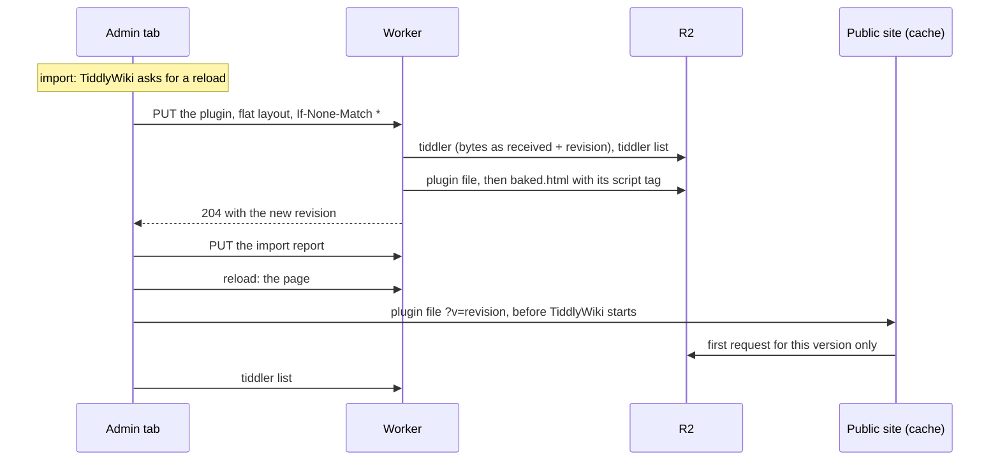

# Plugins as files the page loads

> The code excerpts below show the worker as it was when plugin files were added (one file, `src/worker.src.js`). The worker is now split into modules under `src/worker/` (README 2); the design and its reasons haven't changed. Read the current code there.

**Status: implemented and deployed (October 2026).** These are the design notes behind README section 4.8: the problem, the design and why it was chosen over baking plugins into the page, what it costs, the change step by step, and how to operate it.

The change is covered by the tests: `test/plugins.test.mjs` (66 checks) runs real plugins shipped with TiddlyWiki, markdown and KaTeX, on the admin site and on a stand-in for the public site. All eight suites pass (`npm test`).

"The external-plugins plugin" below is `$:/plugins/theophile.dev/external-plugins`, which exports plugins as standalone `.js` files for single-file wikis. The plugin files here use the same format as its export template.

## Contents

1. [The problem](#1-the-problem)
2. [The design](#2-the-design)
3. [Why it's built this way](#3-why-its-built-this-way)
4. [Cost](#4-cost)
5. [The change, step by step](#5-the-change-step-by-step)
6. [Tests](#6-tests)
7. [Cloudflare: a cache rule for plugin files](#7-cloudflare-a-cache-rule-for-plugin-files)
8. [Rollout](#8-rollout)
9. [If a plugin breaks the page](#9-if-a-plugin-breaks-the-page)
10. [Edge cases and limits](#10-edge-cases-and-limits)

---

## 1. The problem

### How TiddlyWiki starts

When the page loads, TiddlyWiki boots in this order:

1. It reads the tiddlers inside the HTML, then the ones in `$tw.preloadTiddlers`. Scripts that run before TiddlyWiki can add to that list; the worker already uses it for startup tiddlers in `baked.html`.
2. It registers plugins. It reads `$:/config/Plugins/Disabled/<plugin>` at this moment.
3. It defines JavaScript modules (widgets, macros, parsers, startup code), from plugins and from standalone tiddlers.
4. It runs startup modules. One of them starts the sync, which fetches the tiddler list from the worker and then each tiddler.

Anything that arrives in step 4 is too late for steps 2 and 3. Before this change, plugins installed through the wiki arrived in step 4:

| Kind | Before | Why |
|---|---|---|
| Plugin without JavaScript (`plugin-type: plugin`) | Works | TiddlyWiki registers plain plugins live when they arrive. |
| Plugin with JavaScript modules | **Never works** | TiddlyWiki asks you to reload. After the reload the plugin again arrives after boot, so its code never runs, and TiddlyWiki asks again. |
| Theme or language plugin | **Unreliable** | TiddlyWiki only switches when `$:/theme` or `$:/language` changes. If that tiddler arrives before the plugin, the plugin isn't applied in that session. |
| Standalone JavaScript module (`module-type: …`) | **Never works** | Modules are only defined at boot. |
| Disabling a plugin | **Ignored at boot** | The flag arrives after plugins are registered. |

The workaround was to build plugins into `index.html` locally and upload it. That works, but every plugin change needs a local build.

**The constraint:** the public site is R2 behind Cloudflare's cache, and can never use the worker. Whatever loads plugins has to work from files in R2 alone.

---

## 2. The design

- **One file per plugin in R2,** `_plugins/<title>.js`. It's the stored tiddler, untouched, inside the same code the external-plugins export template produces: it adds the tiddler to `$tw.preloadTiddlers`. The stored JSON can go in as it is because JSON is valid JavaScript (since ES2019, even with the U+2028 and U+2029 characters).
- **One `<script>` tag per plugin in `baked.html`,** pointing to the public site: `https://my-tiddlywiki.theophile.dev/_plugins/%24%3A%2Fplugins%2Ftiddlywiki%2Fmarkdown.js?v=1791041234567`. Both sites use this page, so neither loads plugin code through the worker.
- **The browser sends saves in the layout the worker stores:** flat, compact, `text` last. The worker never parses plugin code: it parses only the small part before `"text"`, and appends its revision to the bytes it received.
- **The page build writes the files.** It checks each plugin's file against the tiddler list and rewrites any file that is missing or out of date.
- **The boot choices go into the page too:** `$:/theme`, `$:/language`, `$:/palette` and the plugin disable flags.

What gets a file: tiddlers with `plugin-type` `plugin`, `theme` or `language` (except `$:/core`, which comes with `index.html`, and plugins marked `platform: server`, which only run on a Node.js server and which TiddlyWiki's own tiddler list leaves out too), and modules: tiddlers with a `module-type` whose type is `application/javascript`, `application/json` or `application/x-tiddler-dictionary`, the types TiddlyWiki defines modules from at boot.

### What happens when you drop a plugin on the wiki



**In the browser**

1. **The drop.** TiddlyWiki opens the import dialog. While it waits for you, it holds the plugin in `$:/Import`, which isn't synced while the import is pending.
2. **You click Import.** TiddlyWiki adds `$:/plugins/tiddlywiki/markdown` to its store. `$:/Import` becomes a short import report, an ordinary tiddler that gets saved too.
3. **TiddlyWiki sees a plugin with JavaScript.** It can't activate it without a reload, so it shows "Please save and reload…". The plugin is in the store but not running.
4. **The save is automatic.** About a second later, the conflict guard sends it:
   - `PUT /recipes/default/tiddlers/%24%3A%2Fplugins%2Ftiddlywiki%2Fmarkdown` with `If-None-Match: *` (or `If-Match` for an update) and `X-Tiddler-Layout: flat`;
   - the body has every field at the top level, `text` last, and no `revision`, `bag` or `recipe`:

   ```json
   {"title":"$:/plugins/tiddlywiki/markdown","type":"application/json","plugin-type":"plugin","version":"5.4.1","list":"readme usage","text":"{\"tiddlers\":{…}}"}
   ```

**In the worker: one request**

5. **It reads the body as bytes** and finds the first `,"text":`. It parses only what comes before: the fields, a few hundred bytes.
6. **It checks for a conflict:** the stored revision against `If-Match` / `If-None-Match`, as before.
7. **It appends `,"revision":"1791041234567","bag":"default","recipe":"default"`** before the final `}` and writes the result to `recipes/default/tiddlers/$:/plugins/tiddlywiki/markdown`, with `layout: flat` in its metadata. The text is copied as bytes, never decoded.
8. **It queues the GitHub backup,** as before.
9. **It updates the tiddler list** with the plugin's entry (all fields but `text`), and gets back the entry it replaced. Only then does it purge the tiddler's public URLs and the list's, so a public request in between can't put the old list back in the cache. Plugin files are never purged.
10. **The plugin is something the page needs at boot, so it rebuilds `baked.html` before answering.** The page build:
    - reads `index.html`, the tiddler list and the startup tiddlers, as before;
    - checks each plugin's file with a `HEAD`. This one is missing or has an older revision, so it reads the stored tiddler and writes `_plugins/$:/plugins/tiddlywiki/markdown.js`: the opening of the template, the stored bytes, the closing;
    - inserts the preload script and one `<script src>` per plugin after `<head>`, working on the bytes of `index.html` (since the admin wiki publishes the page, README 4.9, usually the published shell instead, where the plugin tags go right before the core file's `<script>`);
    - saves `baked.html` and purges `/` and `/baked.html` on the public site.
11. **It answers `204`** with the new revision in the `ETag`.

Steps 9 and 10 run under `ctx.waitUntil` as well as being awaited, so they finish even if the browser goes away first, for example when you reload while the page is being built.

The import report is a second, small save that goes through steps 5–9 and 11.

**After you reload**

12. **The page:** the worker serves the new `baked.html`.
13. **The plugin file:** the browser fetches it from the public site, not the worker. The new `?v=` misses Cloudflare's cache once, so it's read from R2; after that both Cloudflare and the browser keep it.
14. **It runs before TiddlyWiki boots** and adds the plugin to `$tw.preloadTiddlers`. TiddlyWiki registers it and defines its modules.
15. **No reload loop.** The sync gets the tiddler list and finds the same revision for the plugin as the one in the file, so it doesn't download it again.

The worker sees two requests on that load: the page and the tiddler list. (Three when this change was made; since then the browser keeps `/status` for a week, README 4.5.) The public site serves the same `baked.html`, so visitors get the plugin too.

---

## 3. Why it's built this way

### 3.1 Files, not plugins baked into the page

The earlier plan put every plugin inside `baked.html`:
- **The page would grow** with each plugin, easily by a megabyte or more, and both sites would download all of it again whenever anything in the page changed.
- **Each rebuild would read and re-serialize every plugin,** which doesn't fit in 10 ms of CPU.

With files, the page grows by one line per plugin, each plugin is cached on its own, and the rebuild never parses plugin code: it only copies a plugin's stored bytes when that plugin's file needs rewriting (and, for a plugin stored by another tool without the worker's metadata, reads it once to find its revision).

The external-plugins plugin does the same for a single-file wiki, where you export and upload each file by hand. Here the worker already receives every plugin when it's saved, so it writes the file itself.

### 3.2 Loaded from the public site, even by the admin page

A relative URL (`/_plugins/…`) would make the admin page load plugins through the worker. Browsers would still cache them, since the worker passes the files' cache headers on, but every browser would cost one worker request per plugin version, every hard reload would cost more, and Cloudflare never caches what a worker generates, so there'd be no shared cache. The public URL costs no worker request on either site. A `<script src>` from another hostname needs no CORS header.

The trade-off: the admin page now depends on the public site being up to load its plugins. It already uses the public site for tiddler contents, but those fall back to the worker; plugin files don't.

### 3.3 A stable name, `?v=<revision>` in the URL

- **The name is the title,** URL-encoded the same way as the tiddler URLs the public wiki already loads. Titles are unique, so no hash is needed.
- **`?v=` is the revision,** which is the save time in milliseconds. Every version gets a new URL, so Cloudflare and browsers can keep each file for a year (`Cache-Control: public, max-age=31536000, immutable`), and nothing ever needs purging.
- **Not per-version file names:** they'd pile up in R2 and need cleaning.
- **Not purging:** a purge makes the next visitor's request read from R2 again (a Class B operation), and needs an exact URL anyway.

R2 ignores the query string when it looks up the file.

### 3.4 One tag per plugin, not a loader

A single loader script that adds the others would have to insert them dynamically, and dynamically added scripts run after TiddlyWiki has booted (`document.write` would work but is fragile). It would also add a round trip before any plugin starts loading. With the tags in the HTML, the browser finds them all at once and fetches them in parallel.

### 3.5 The browser sends the layout the worker stores

Before this change, every save was parsed and re-serialized by the worker, just to add `revision`, `bag` and `recipe`. For plugins that's a lot of CPU:

| Plugin | Size | TiddlyWeb layout (before) | Flat layout |
|---|---|---|---|
| markdown | 240 KB | 2.6 ms | 0.1 ms |
| KaTeX | 735 KB | 6.5 ms | 0.3 ms |
| geospatial | 945 KB | 10 ms | 0.4 ms |

Median CPU of the body handling, measured in Node.js (the same JavaScript engine as Workers) on a slow, shared 2-core test machine, so only the proportions matter. The flat column includes building the plugin file.

**Why cutting at `,"text":` is safe:** inside a JSON string every quote is escaped as `\"`, so the sequence `,"text":` can only be the `text` key itself. The flat layout has no nested objects except that one, `{"fields":"…"}`, which holds no `"text"` key, and the browser puts `text` last. In UTF-8, bytes of multi-byte characters are never ASCII, so searching the bytes can't match inside one either.

**The worker's fields come last.** It appends `revision`, `bag` and `recipe` to the end of the body, so even if a client sent its own `revision`, the worker's wins: JSON readers keep the last value of a repeated key.

**Compatibility:**
- Saves in any other layout are parsed and turned into the flat one: saves without the `X-Tiddler-Layout: flat` header (tabs opened before the deploy, or with the module off, which use TiddlyWeb's layout), and bodies sent with the header that don't follow the layout (pretty-printed, with `text`, `revision`, `bag` or `recipe` among the fields before `"text"`, or with a value that isn't text). A body that isn't a tiddler is refused with `400`. The one thing the worker can't check cheaply is fields placed *after* `text`: they're stored, but missing from the tiddler list. The browser module never does that.
- A field literally called `fields` is the one exception to the flat layout: it's sent and stored nested, as `"fields":{"fields":"…"}`, the way TiddlyWeb's layout has it, because a flat `fields` is where TiddlyWiki's loader looks for nested custom fields. TiddlyWiki unpacks it only for tiddlers loaded through sync, so the page build unpacks it in baked startup tiddlers and plugin files. A field value that's an object can't be stored (a `"text"` key inside it would be taken for the text) and is refused with `400`; TiddlyWiki never sends one.

At first, other layouts were stored as they came, so the bucket held both and every reader handled both. A later change made the flat layout the only one stored, which removed that code throughout the worker; a bucket filled before then had to be converted once, with a script since removed.

**Alternatives considered:** flattening in the worker would have added about half again to the save's CPU, which is why the browser sends the flat layout; the worker flattens only the rare saves that arrive in another one. Flattening in the plugin file (one extra line in the browser) costs nothing there, but leaves the save's own parse and re-serialize.

### 3.6 The page build is the only writer of plugin files

- **One place** that decides what a file contains.
- **It repairs itself:** a missing or outdated file is rewritten on the next build. That also covers the first load after deploying, for plugins already in the wiki.
- **The cost:** one `HEAD` per plugin per build, and one read of the stored tiddler when its file is rewritten. Builds only happen when something the page needs at boot changes, and on the first admin page load after a deploy or a new `index.html`.

**Overlapping builds don't go backwards.** Two builds can run at once: two tabs saving, or a save during the first load after a deploy. Without care, the slower one could write an older version last. That would be bad for a file in particular: the page could ask for `?v=r2` while R2 holds r1, and Cloudflare would cache r1 under that URL for a year. So:
- **A file** is written only if it's still the one the build looked at (`etagMatches`, or create-only if it was missing), and not replaced by one holding a newer revision. If another build got there first, the tag uses the revision the file holds.
- **The page:** each `baked.html` records when the tiddler list it was built from was stored in R2 (`listVersion`, R2's own upload time). A build doesn't replace a page built from a newer list for the same worker and `index.html`. Using R2's time rather than a counter of the worker's own means a list replaced by hand counts as newer too, instead of freezing the page.
- **Best effort:** each of these tries three times, and the last try writes without a condition, like the create-only fallback in the save handler (a create-only write can be refused even though nothing is there). Losing two races in a row is very unlikely with one person editing.

### 3.7 The page is built from bytes

`index.html` is a few MB. On the test machine (a slow, shared 2-core server), decoding the 2.6 MB test wiki into a string, inserting the script and encoding it back took about 16 ms of CPU. Working on the bytes, and only decoding the first 16 KB to find `<head>`, took about 1.6 ms. (In a published shell, plugin tags go before the core file's `<script>`, found by decoding the page's last 64 KB the same way.) Cloudflare's servers are faster, so both numbers are lower there, but the ratio holds. Decoding that start of the file keeps a byte order mark, if there is one, so the insertion point stays exact.

### 3.8 Disabled plugins keep their tag

Leaving a disabled plugin out of the page would make the sync fetch it after boot. TiddlyWiki then asks for a reload for any plugin with JavaScript that arrives after boot, disabled or not (`$:/core/modules/startup/plugins.js`), so it would ask on every load. Instead, the disable flag goes into the page, so TiddlyWiki skips the plugin at boot. The Control Panel still lists it, so it can be enabled again. The cost is one cached download.

### 3.9 Theme, language and palette choices are in the page

With the theme plugin present at boot, `$:/theme` has to be there too. Otherwise TiddlyWiki starts with the default theme and only switches when `$:/theme` arrives through sync, which shows the wrong theme for a moment. The same goes for `$:/language` and `$:/palette`.

### 3.10 No switch in the worker

A plugin that breaks the page is fixed by deleting its file (section 9). TiddlyWiki's safe mode isn't an option: it also turns off the TiddlyWeb plugin, so nothing could be saved back, and TiddlyWiki warns against it in client-server setups.

### 3.11 The TiddlyWeb plugin is treated like any other

If it were excluded, updating it from the plugin library would store the new version, which the sync would then fetch after boot on every load: TiddlyWiki would ask for a reload every time, and the update would never run. Included, the update runs at boot like any plugin. The conflict guard modifies whichever version loads. After such an update, run the two-tab test against your new version (section 10).

---

## 4. Cost

**CPU per request** (Workers Free allows 10 ms, with some flexibility for occasional overruns):

| Request | Before | After |
|---|---|---|
| Saving a 945 KB plugin | about 10 ms for the body alone | about 0.4 ms for the body, plus about 2 ms for the page build |
| Saving an ordinary tiddler | small | the same, slightly less |
| Any save | the tiddler list: about 1 ms per 400–500 tiddlers | the same; after a plugin save, the page build reuses the list the save wrote |

These figures come from the same test machine as in section 3, so read them as proportions. The worker's metrics in the Cloudflare dashboard show its real CPU time per request.

**The backup queue consumer** spends about 1 ms of CPU on a 254 KB plugin, measured on the test machine (git's blob hash, and the base64 written straight into the request's bytes; GitHub's copy of the previous version isn't decoded, which took about 14 ms more). Queue consumers share the Workers per-invocation CPU limits ([Queues limits](https://developers.cloudflare.com/queues/platform/limits/)), so on the Free plan count on 10 ms, with some tolerance for occasional overruns. A run stops taking versions once it has handled 512 KB, so a batch of several plugin updates is spread over several runs (README 4.7). The fallback without a queue runs inside the save request, so keep the queue bound.

**Worker requests:** unchanged by this change: plugin files never reach the worker. (A page load was three requests, and is two since the browser keeps `/status` for a week, README 4.5.)

**Per plugin save:**
- **R2 writes (Class A):** the tiddler, the tiddler list, the plugin file, `baked.html`, plus the backup copy for a version over 100 KB.
- **R2 reads (Class B):** eight with a published shell (nine before the first publish, when the page is built from `index.html`), plus one `HEAD` per other plugin and one read per listed startup tiddler for the page build.
- **Subrequests:** all of the above, plus the queue message, count against the Free plan's 1,000 calls to Cloudflare services per request; only the purges count against its 50 external ones.
- **Purges:** the tiddler's URLs and the two page URLs, as for any page change. Never plugin files.

**Saving a boot choice** (`$:/theme`, a disable flag, a startup action) costs the same page build, without rewriting files. Ordinary saves are unchanged.

**Visitors** download each plugin once per version. Cloudflare compresses JavaScript, so a 1 MB plugin travels as a few hundred KB.

---

## 5. The change, step by step

What changed relative to the previous worker, with the code as it now is in `src/conflict-guard.js` and `src/worker.src.js`, then the tests and the README. Each step says what replaced what in the previous code. After editing the source, `npm run build` rebuilds `worker.js` and `npm test` checks everything.

### 5.1 The browser module sends the flat layout

In `src/conflict-guard.js`, this function was added after `link()`:

```js
// The body of a save in the worker's "flat" layout, the only one it stores; the worker appends its
// own revision, bag and recipe. A field called "fields" stays nested as {fields: value}, the way
// TiddlyWeb's layout has it: a flat "fields" is where TiddlyWeb's loader looks for nested fields.
function flatBody(tiddler) {
	var result = {},
		fields = tiddler.fields;
	$tw.utils.each(fields,function(value,name) {
		if(name === "fields") {
			result.fields = {fields: tiddler.getFieldString(name)};
		} else if(name !== "text" && name !== "revision" && name !== "bag" && name !== "recipe") {
			result[name] = name === "tags" ? value : tiddler.getFieldString(name);
		}
	});
	result.type = result.type || "text/vnd.tiddlywiki";
	if(fields.text !== undefined) {
		result.text = tiddler.getFieldString("text");
	}
	return JSON.stringify(result);
}
```

In `proto.saveTiddler`, the `headers` and `data` of the `$tw.utils.httpRequest({` call are now built first:

```js
var body = flatBody(tiddler),
	headers = {"Content-type": "application/json", "X-Tiddler-Layout": "flat"},
	tries = 0;
function send() {
	$tw.utils.httpRequest({
		url: self.host + "recipes/" + encodeURIComponent(self.recipe) + "/tiddlers/" + encodeURIComponent(title),
		type: "PUT",
		headers: addPreconditions(headers,title,base,info),
		data: body,
```

A paragraph in the header comment says the module sends saves in the flat layout.

### 5.2 The worker: what the page needs at boot

In `src/worker.src.js`, the block that defined `STARTUP_TITLES` and `isStartupTiddler` (just above `tiddlerKey`) became:

```js
// --- What the page needs at boot ---------------------------------------------------------------
// TiddlyWiki only runs startup actions, plugins and JavaScript modules that are present when it
// boots; anything that arrives later through sync is too late. Small startup tiddlers are baked
// into baked.html. Plugins and JavaScript modules each get a file in R2 (_plugins/<title>.js),
// which baked.html loads from the public site with a <script> tag before TiddlyWiki boots.

const STARTUP_TITLES = ["$:/DefaultTiddlers", "$:/SiteTitle", "$:/SiteSubtitle",
  // read at boot to choose the theme, language and palette
  "$:/theme", "$:/language", "$:/palette",
  // read once by TiddlyWiki's syncer, when it starts
  "$:/config/SyncPollingInterval", "$:/config/SyncThrottleInterval", "$:/config/SyncFilter", "$:/config/SyncDisableLazyLoading"];
const DISABLED_PLUGIN_PREFIX = "$:/config/Plugins/Disabled/";   // read at boot, when plugins are registered
const PLUGIN_FILE_TYPES = ["plugin", "theme", "language"];
const MODULE_TYPES = ["application/javascript", "application/json", "application/x-tiddler-dictionary"];   // TiddlyWiki defines modules from these at boot

// These take a saved tiddler or an entry of the tiddler list
function isStartupTiddler(tiddler) {
  const title = tiddler.title || "", tags = tiddler.tags;
  // (A list entry stored before field values had to be text, or by hand, may hold a tag that isn't)
  return STARTUP_TITLES.includes(title) || title.startsWith(DISABLED_PLUGIN_PREFIX) || (Array.isArray(tags)
    ? tags.some(tag => String(tag).includes("$:/tags/StartupAction"))
    : typeof tags === "string" && tags.includes("$:/tags/StartupAction"));
}

// Plugins (but not the core: it comes with index.html and is never synced) and JavaScript modules
function needsPluginFile(tiddler) {
  const pluginType = tiddler["plugin-type"];
  if (pluginType) {
    return PLUGIN_FILE_TYPES.includes(pluginType) && tiddler.title !== "$:/core" && tiddler.platform !== "server";
  }
  return MODULE_TYPES.includes(tiddler.type) && Boolean(tiddler["module-type"]);
}

function isPageTiddler(tiddler) {
  return isStartupTiddler(tiddler) || needsPluginFile(tiddler);
}
```

`isStartupTiddler` now takes a tiddler (or a tiddler-list entry) instead of a title and tags.

### 5.3 The worker: reading a save

This block was added after `conflictResponse()`:

```js
// --- Reading a save ---------------------------------------------------------------------------
// Every tiddler is stored "flat": every field at the top level, compact JSON, "text" last, then the
// worker's revision, bag and recipe; customMetadata { revision, layout: "flat" }. The browser module
// sends exactly that, without revision, bag or recipe (header X-Tiddler-Layout: flat): the worker
// parses only the fields before "text" and appends its own, working on the raw bytes, so the text
// itself (a whole plugin, an image...) is never decoded, parsed or re-encoded. Anything else, such
// as TiddlyWeb JSON (custom fields under "fields", the text anywhere) from a tab without the module,
// is parsed and turned into the flat layout first.

const FLAT_LAYOUT = "flat";
const encoder = new TextEncoder();
const decoder = new TextDecoder();
const TEXT_KEY = encoder.encode(',"text":');

function concatBytes(parts) {
  const out = new Uint8Array(parts.reduce((length, part) => length + part.length, 0));
  let offset = 0;
  for (const part of parts) {
    out.set(part, offset);
    offset += part.length;
  }
  return out;
}

// Where ',"text":' starts in a flat body. Inside a JSON string every quote is escaped, so this
// sequence can only be the "text" key itself.
function textKeyOffset(bytes) {
  for (let i = bytes.indexOf(TEXT_KEY[0]); i !== -1; i = bytes.indexOf(TEXT_KEY[0], i + 1)) {
    if (TEXT_KEY.every((byte, j) => bytes[i + j] === byte)) return i;
  }
  return -1;
}

// A save whose body isn't a tiddler: answered 400, nothing stored
class BadSave extends Error {}

function isTiddlerObject(value) {
  return value !== null && typeof value === "object" && !Array.isArray(value) && typeof value.title === "string";
}

function parseJsonBody(text) {
  try {
    return JSON.parse(text);
  } catch (e) {
    throw new BadSave(`the body is not JSON (${e.message})`);
  }
}

// TiddlyWiki's field values are text, or lists of text (tags). An object can't be stored flat (a
// "text" key inside it would be taken for the tiddler's text), with one exception: a field called
// "fields" stays nested as { fields: value }, the way TiddlyWeb's layout has it, because a flat
// "fields" is where TiddlyWiki's loader looks for nested custom fields.
function isFieldValue(value) {
  return typeof value === "string" || (Array.isArray(value) && value.every(item => typeof item === "string"));
}
function isStorable(name, value) {
  if (name !== "fields") return isFieldValue(value);
  return value !== null && typeof value === "object" && !Array.isArray(value) && Object.keys(value).length === 1 &&
    Object.hasOwn(value, "fields") && typeof value.fields === "string";
}

// TiddlyWiki unpacks that nested "fields" when it loads a tiddler through sync, but not the tiddlers
// the page hands it at boot (preloadTiddlers): the page build unpacks those
function hasNestedFields(tiddler) {
  return isStorable("fields", tiddler.fields);
}

const BOOKKEEPING = ["text", "revision", "bag", "recipe"];

// The fields before "text" of a body in the flat layout, or null if it isn't one
function flatFields(bytes, end) {
  if (bytes[0] !== 0x7b || bytes[end - 1] !== 0x7d) return null;
  let cut = textKeyOffset(bytes);
  if (cut === -1) cut = end - 1;   // no text: the fields run up to the closing brace
  else if (!textIsLast(bytes, cut + TEXT_KEY.length, end)) return null;
  if (cut <= 0) return null;
  let fields = null;
  try { fields = JSON.parse(decoder.decode(bytes.subarray(0, cut)) + "}"); } catch (e) { return null; }
  // Pretty-printed, with these before "text", or with a value that isn't text: not the flat layout after all
  if (!isTiddlerObject(fields) || BOOKKEEPING.some(name => Object.hasOwn(fields, name)) ||
      !Object.entries(fields).every(([name, value]) => isStorable(name, value))) return null;
  return fields;
}

// Whether the text, from its opening quote at start, is a string that ends the body (end - 1 is its
// closing brace), as the flat layout has it: it opens with a quote, and the body ends with one that
// isn't escaped. Up to FLAT_CHECK_BYTES, also that no other field follows: the first quote that isn't
// escaped (inside a JSON string, every quote is) must be that last one. A bigger body (a plugin) isn't
// scanned: it costs milliseconds of CPU a megabyte, and the browser module always puts the text last.
// Otherwise the body is read in full (toFlat).
const FLAT_CHECK_BYTES = 256 * 1024;
function textIsLast(bytes, start, end) {
  const close = end - 2;
  if (bytes[start] !== 0x22 || close <= start || bytes[close] !== 0x22) return false;
  const escaped = at => {
    let slashes = 0;
    while (bytes[at - 1 - slashes] === 0x5c) slashes++;
    return slashes % 2 === 1;
  };
  if (escaped(close)) return false;
  if (end > FLAT_CHECK_BYTES) return true;
  let i = bytes.indexOf(0x22, start + 1);
  while (i !== -1 && i < close && escaped(i)) i = bytes.indexOf(0x22, i + 1);
  return i === close;
}

// Any other tiddler JSON, TiddlyWeb's layout included, turned into the flat layout
function toFlat(tiddler) {
  // A title that isn't text would make the tiddler list unreadable (and no browser sends one)
  if (!isTiddlerObject(tiddler)) throw new BadSave("the body is not a tiddler (a JSON object with a text title)");
  let { fields: custom = {}, text, revision, bag, recipe, ...fields } = tiddler;
  if (text !== undefined && typeof text !== "string") throw new BadSave('the field "text" isn\'t text');
  // In TiddlyWeb's layout, "fields" holds the custom fields (text there is a field called "fields")
  if (custom === null) custom = {};
  else if (typeof custom !== "object") custom = { fields: custom };
  else if (Array.isArray(custom)) throw new BadSave('"fields" must hold the custom fields');
  for (const [name, value] of Object.entries(custom)) {
    if (!Object.hasOwn(fields, name) && !BOOKKEEPING.includes(name)) fields[name] = value;
  }
  if (Object.hasOwn(fields, "fields")) fields.fields = { fields: fields.fields };   // see isStorable
  const notText = Object.keys(fields).find(name => !isStorable(name, fields[name]));
  if (notText !== undefined) throw new BadSave(`the field "${notText}" isn't text`);
  return { fields, bytes: encoder.encode(JSON.stringify(text === undefined ? fields : { ...fields, text })) };
}

// Returns { fields, stored(revision) }: fields = the tiddler without its text, stored(revision) =
// the bytes to store, with the worker's revision, bag and recipe
async function readSave(request) {
  let bytes = new Uint8Array(await request.arrayBuffer());
  let end = bytes.length;
  while (end > 0 && bytes[end - 1] <= 0x20) end--;
  let fields = request.headers.get("X-Tiddler-Layout") === FLAT_LAYOUT ? flatFields(bytes, end) : null;
  if (!fields) {
    ({ fields, bytes } = toFlat(parseJsonBody(decoder.decode(bytes))));
    end = bytes.length;
  }
  return flatSave(fields, bytes.subarray(0, end));
}

// A save from its fields and its body in the flat layout (ending with "}")
function flatSave(fields, body) {
  return {
    fields,
    stored: revision => concatBytes([body.subarray(0, body.length - 1), storedSuffix(revision)])
  };
}

// What the worker appends to a stored tiddler, after its text
function storedSuffix(revision) {
  return encoder.encode(`,"revision":"${revision}","bag":"default","recipe":"default"}`);
}
```

And this helper just above `export default {`:

```js
// Waits for work the response depends on, and keeps it running even if the browser disconnects
// first (a reload while the page is being rebuilt, say): without waitUntil it could be cancelled
function untilDone(ctx, promise) {
  ctx.waitUntil(promise.catch(() => {}));
  return promise;
}
```

`X-Tiddler-Layout` was added to `Access-Control-Allow-Headers` in `corsHeaders`.

### 5.4 Saving

In the `PUT` handler, `const tiddler = JSON.parse(await request.text());` and the draft check became the lines below. (The title check came later, with the rebuild of the tiddler list, README 4.2, which lists every tiddler under the title it's stored under. So did reading the tiddler list with `readableList(env, ctx)`, now at the same time as the lookup of the stored tiddler: the list is read before the tiddler is written, and while a damaged list is being rebuilt the save answers `503` before anything is written.)

```js
let save = await readSave(request);
// Stored and listed under the title in the URL: a different one in the body would make the
// list disagree with the stored tiddlers (the browser always sends the same one)
if (save.fields.title !== title) throw new BadSave("the title in the body isn't the one in the URL");

if (isEphemeralTitle(title) || isDraft(save.fields)) {
```

Everything from `const newRevision = …` to `const putOptions = {…};` became:

```js
const newRevision = Date.now().toString();
const body = save.stored(newRevision);
const putOptions = {
  httpMetadata: { contentType: "application/json" },
  customMetadata: { revision: newRevision, layout: FLAT_LAYOUT }
};
```

The three `env.WIKI_BUCKET.put(tiddlerKey, …)` calls write `body` instead of `modifiedBody`, and the lines from `await updateManifest(…)` to the `isStartupTiddler` block became these two lines:

```js
ctx.waitUntil(queueBackup(env, { action: "save", title, revision: newRevision, content: body }));
await untilDone(ctx, finishSave(env, ctx, title, save.fields, newRevision, list, url.origin));
```

The rest of the save is in `finishSave`, which a retried save that's already stored also runs (README 4.4):

```js
// The rest of a save once the tiddler is stored: the tiddler list, the public cache and the page.
// list: the list as read before the tiddler was stored (readableList), or null to read it here.
// adminOrigin: the admin site's origin (where this request came to), see tiddlerPurgeUrls.
async function finishSave(env, ctx, title, fields, revision, list, adminOrigin) {
  const { previous, list: stored, superseded } = await updateManifest(env, ctx, title, fields, revision, list);
  // A newer save of this tiddler got there first: its purge, plugin file and page build are the ones
  if (superseded) return;
  // Only once the new list is in R2: a public request between the purge and the list update
  // would put the old list back in Cloudflare's cache
  ctx.waitUntil(purgePublicCache(env, tiddlerPurgeUrls(env, title, adminOrigin)));
  const saved = { ...fields, title };
  // Something the page needs at boot was added, changed or is no longer needed: rebuild the
  // page (which writes the plugin file) before confirming, so a reload right after has it
  if (isPageTiddler(saved) || (previous && isPageTiddler(previous))) {
    await rebuildPage(env, ctx, stored);
  }
  // No longer a plugin: its file goes, now that the page doesn't load it
  if (previous && needsPluginFile(previous) && !needsPluginFile(saved)) await deletePluginFile(env, title);
}
```

**Why wait for the rebuild:** TiddlyWiki asks for a reload as soon as a plugin is imported. If the page were rebuilt after the response, a reload right after the save could still get the old page.

**Why `untilDone` rather than a plain `await`:** if the browser disconnects before the response (a reload during the build), work that is only awaited can be cancelled. `untilDone` also hands it to `ctx.waitUntil`, which keeps it running. For the same reason the backup is now queued before the tiddler list is updated, not after. The purge stays after the list update: purging first would let a public request in between put the old list back in Cloudflare's cache.

**Why check `previous` too:** it covers a tiddler that stops being needed at boot, such as a startup action losing its tag, or a plugin turned into an ordinary tiddler. Before, such a tiddler stayed in the page until something else triggered a rebuild.

### 5.5 Reading a flat tiddler through the worker

The `GET` branch for `recipes/default/tiddlers/…` serves flat objects as they are stored. Since every tiddler is stored flat, that's all it does:

```js
if (key.startsWith(TIDDLER_PREFIX)) {
  // Stored with its revision, bag and recipe already in place: served as is
  headers.set("Cache-Control", "no-cache");
  headers.set("ETag", tiddlerEtag(key.slice(TIDDLER_PREFIX.length), revisionOf(object)));
  return new Response(body, { headers });
}
```

### 5.6 Deleting

In the `DELETE` handler, the lines from the backup to the end of the `rebakeHtml` block became the following. The backup of a stored tiddler is now queued before the list update: if that update fails, the browser's retry finds nothing left to delete and wouldn't queue it. (Since then, the handler also starts with `const list = await readableList(env, ctx);`, which reads the tiddler list before the precondition check, and passes it to `removeFromManifest`.)

```js
// Queued before the list update, which may fail (the retry then finds nothing to delete)
if (found) ctx.waitUntil(queueBackup(env, { action: "delete", title, revision: currentRevision }));
await untilDone(ctx, (async () => {
  // If it was neither stored nor listed, there is nothing to back up or purge
  let { removed, list: stored, recreated } = await removeFromManifest(env, ctx, title, list, found ? currentRevision : null);
  if (recreated) {
    // Saved again since: that save's purge, plugin file and page build are the ones. Unless that
    // save landed between the check above and the delete, which then removed it too (an R2
    // delete can't be conditional): nothing is stored, so the entry goes as well
    if (await env.WIKI_BUCKET.head(tiddlerKey(title))) return;
    ({ removed, list: stored } = await removeFromManifest(env, ctx, title, stored));
  }
  if (!found && removed) ctx.waitUntil(queueBackup(env, { action: "delete", title, revision: currentRevision }));
  if (found || removed) ctx.waitUntil(purgePublicCache(env, tiddlerPurgeUrls(env, title, url.origin)));
  // The list entry says what it was; if it wasn't listed, rebuild the page for system tiddlers,
  // and delete any plugin file anyway (deleting a missing object is free), once the page is
  // rebuilt without it (see deletePluginFile)
  if (removed ? isPageTiddler(removed) : found && title.startsWith("$:/")) {
    await rebuildPage(env, ctx, stored);
  }
  if (removed ? needsPluginFile(removed) : found) await deletePluginFile(env, title);
})());
```

### 5.7 Plugin files and the page build

`rebakeHtml` (and the comment above it) became the following. (Shown as it is now: it has since learned to build the page from the shell the admin wiki publishes, `readPageSource`, see README 4.3 and 4.9.)

```js
// --- Plugin files -------------------------------------------------------------------------------
// _plugins/<title>.js holds the stored tiddler, untouched, inside the same code the external-plugins
// export template produces: it adds the tiddler to $tw.preloadTiddlers before TiddlyWiki boots.
// The file name never changes; the page loads it as <title>.js?v=<revision>, so every version has
// its own URL and nothing needs purging. Files are served by the public site, never by the worker.

const PLUGIN_FILE_DIR = "_plugins/";
const PRELOAD_OPEN = "{\nconst tw = globalThis.$tw ??= Object.create(null);\ntw.preloadTiddlers = (tw.preloadTiddlers ?? []).concat([";
const PRELOAD_CLOSE = "]);\n}\n";
// A tiddler with a field called "fields" (stored nested: hasNestedFields) is unpacked first
const PRELOAD_NESTED_OPEN = "{\nconst t = ";
const PRELOAD_NESTED_CLOSE = ";\nt.fields = t.fields.fields;\nconst tw = globalThis.$tw ??= Object.create(null);\ntw.preloadTiddlers = (tw.preloadTiddlers ?? []).concat([t]);\n}\n";

function pluginFileKey(title) {
  return `${PLUGIN_FILE_DIR}${title}.js`;
}

// Encoded the same way as the tiddler URLs the public wiki already loads
function pluginFileUrl(env, title, revision) {
  return publicUrl(env, `/${PLUGIN_FILE_DIR}${encodeURIComponent(title)}.js?v=${encodeURIComponent(revision)}`);
}

// Writes the plugin file from the stored tiddler. entry: its list entry; file: what head()
// returned for the file (or null).
// Two page builds can overlap, so it doesn't replace a file holding a newer version, and writes
// only if the file is still the one it looked at. After two lost races, a missing file is written
// unconditionally (like the PUT handler's create-only fallback): best effort, not a guarantee.
// Returns the revision the file holds, or null.
async function writePluginFile(env, entry, file) {
  const title = entry.title;
  const obj = await env.WIKI_BUCKET.get(tiddlerKey(title));
  if (!obj) return null;
  const revision = revisionOf(obj);
  const nested = hasNestedFields(entry);
  const content = concatBytes([
    encoder.encode(nested ? PRELOAD_NESTED_OPEN : PRELOAD_OPEN), new Uint8Array(await obj.arrayBuffer()), encoder.encode(nested ? PRELOAD_NESTED_CLOSE : PRELOAD_CLOSE)
  ]);
  const key = pluginFileKey(title);
  for (let attempt = 1; attempt <= 3; attempt++) {
    const held = file?.customMetadata?.revision;
    if (held && (held === revision || isNewerRevision(held, revision))) return held;
    const options = {
      httpMetadata: { contentType: "text/javascript; charset=utf-8", cacheControl: "public, max-age=31536000, immutable" },
      customMetadata: { revision }
    };
    // Create-only if missing; on the last try, a missing file is written whatever happens
    if (file) options.onlyIf = { etagMatches: file.etag };
    else if (attempt < 3) options.onlyIf = new Headers({ "If-None-Match": "*" });
    if (await env.WIKI_BUCKET.put(key, content, options)) return revision;
    file = await env.WIKI_BUCKET.head(key);   // another build wrote it meanwhile: look again
  }
  return file?.customMetadata?.revision ?? null;
}

// Makes sure each listed plugin's file holds its current version (writing it if not) and returns
// the <script> tags that load them, in the order of the tiddler list. Disabled plugins are loaded
// too: their disable flag is baked into the page, so TiddlyWiki skips them at boot. (Leaving them
// out would make the sync fetch them after boot, and TiddlyWiki would then ask for a reload.)
async function pluginScriptTags(env, entries) {
  const tags = await Promise.all(entries.map(async (entry) => {
    const file = await env.WIKI_BUCKET.head(pluginFileKey(entry.title));
    let revision = file?.customMetadata?.revision;
    if (!revision || revision !== String(entry.revision)) {
      revision = await writePluginFile(env, entry, file);
    }
    return revision ? `<script src="${pluginFileUrl(env, entry.title, revision)}"></script>` : "";
  }));
  return tags.filter(Boolean).join("\n");
}

// Inserts markup right after <head ...>. Works on the bytes of index.html (a few MB): decoding,
// editing and re-encoding the whole page as a string costs about ten times more CPU.
const pageDecoder = new TextDecoder("utf-8", { fatal: false, ignoreBOM: true });   // keeps a BOM, so offsets stay right
function insertAfterHead(html, markup) {
  for (const length of [16384, html.length]) {
    const start = pageDecoder.decode(html.subarray(0, length));
    const match = /<head[^>]*>/i.exec(start);
    if (match) {
      const at = encoder.encode(start.slice(0, match.index + match[0].length)).length;
      return concatBytes([html.subarray(0, at), encoder.encode(markup), html.subarray(at)]);
    }
    if (length >= html.length) break;
  }
  return html;
}

// A byte offset moved back to the start of a character, so a window never cuts one in two
function charStart(bytes, at) {
  while (at > 0 && at < bytes.length && (bytes[at] & 0xC0) === 0x80) at--;
  return at;
}

// Inserts markup right before the last occurrence of marker, looked for in the page's last 64 KB
// (all of it if it isn't there). Returns the new bytes, or null if the page doesn't have it.
function insertBeforeLast(html, marker, markup) {
  for (const length of [65536, html.length]) {
    const from = charStart(html, Math.max(0, html.length - length));
    const tail = pageDecoder.decode(html.subarray(from));
    const index = tail.lastIndexOf(marker);
    if (index >= 0) {
      const at = from + encoder.encode(tail.slice(0, index)).length;
      return concatBytes([html.subarray(0, at), encoder.encode(markup), html.subarray(at)]);
    }
    if (from === 0) break;
  }
  return null;
}

// Saves baked.html, unless an overlapping build has already saved a newer one for the same worker
// and index.html: from a newer tiddler list or a newer shell, and no older one of the other.
// "Newer" compares when R2 stored each (listVersion, shellVersion), so a list replaced by hand
// counts as newer too. If each page has the newer one of the two (a rare three-way overlap), this
// one is stored as outdated, so the next page load builds it from both. Each page gets its date
// (pageTime, see serveWiki). Returns the stored page (its R2 object), or null if it kept the other
// page. The last try writes unconditionally, like the create-only fallback in the PUT handler: best
// effort.
async function storePage(env, html, meta) {
  for (let attempt = 1; attempt <= 3; attempt++) {
    const current = await env.WIKI_BUCKET.head("baked.html");
    const theirs = current?.customMetadata || {};
    let stored = meta;
    if (current && theirs.bakeVersion === meta.bakeVersion && theirs.sourceEtag === meta.sourceEtag) {
      const newerList = Number(theirs.listVersion) - Number(meta.listVersion),
        newerShell = Number(theirs.shellVersion || 0) - Number(meta.shellVersion);
      if (newerList >= 0 && newerShell >= 0 && (newerList > 0 || newerShell > 0)) return null;
      if (newerList > 0 || newerShell > 0) stored = { ...meta, bakeVersion: "outdated" };
    }
    const pageTime = Math.max(Math.floor(Date.now() / 1000), Number(theirs.pageTime || 0) + 1);
    const written = await env.WIKI_BUCKET.put("baked.html", html, {
      httpMetadata: { contentType: "text/html; charset=utf-8" },
      customMetadata: { ...stored, pageTime: String(pageTime) },
      ...(current && attempt < 3 ? { onlyIf: { etagMatches: current.etag } } : {})
    });
    if (written) return written;
  }
  return null;
}

// Builds baked.html = the page source (the published shell, or index.html, see readPageSource) +
// startup tiddlers + browser modules + plugin <script> tags, then purges the public copy. source:
// the page source, if the caller has it. Returns { html (bytes), page: the stored page's R2 object,
// or null if an overlapping build's page was kept }, or null.
async function rebakeHtml(env, ctx, list = null, source = null) {
  try {
    const pageSource = source || await readPageSource(env);
    if (!pageSource) return null;
    let html = pageSource.html;

    // list: the list a save or delete has just written. Otherwise it's read, and a missing or
    // damaged one rebuilt first (a page built without it would have no plugins); while that takes
    // more requests, this throws and the page stays as it is.
    const { object: manifestObj, entries: manifest } = list || await readableList(env, ctx, { pageBuild: true });
    // Every stored tiddler is listed, so only listed startup tiddlers are read
    const startupTitles = manifest.filter(t => t.title && isStartupTiddler(t)).map(t => t.title);

    const store = [];
    const [, pluginTags] = await Promise.all([
      Promise.all(startupTitles.map(async (title) => {
        const obj = await env.WIKI_BUCKET.get(tiddlerKey(title));
        if (!obj) return;
        try {
          const tiddler = await obj.json();
          if (hasNestedFields(tiddler)) tiddler.fields = tiddler.fields.fields;
          store.push(tiddler);
        } catch (e) {}
      })),
      pluginScriptTags(env, manifest.filter(t => t.title && needsPluginFile(t)))
    ]);

    if (conflictGuardEnabled(env)) {
      store.push({
        title: CONFLICT_GUARD_TITLE,
        type: "application/javascript",
        "module-type": "startup",
        text: CONFLICT_GUARD_SOURCE
      });
      store.push({ title: PUBLIC_URL_TITLE, text: publicUrl(env, "/") });
      store.push({ title: PAGE_PUBLISHER_TITLE, type: "application/javascript", "module-type": "startup", text: PAGE_PUBLISHER_SOURCE });
      store.push({ title: PAGE_SOURCE_TITLE, type: "application/json", text: JSON.stringify({ index: pageSource.index, fingerprint: pageSource.fingerprint, core: pageSource.core }) });
    }

    // In a shell, plugins load right before the core (they must run before TiddlyWiki starts, which
    // the core does), so they don't hold up the top of the page (a splash screen). In a full
    // index.html, where TiddlyWiki starts from code inside the page, from <head>.
    // (Only a shell is searched: in index.html, the marker is only in TiddlyWiki's templates, so
    // the search would decode the whole page for nothing, and one in raw markup isn't the place.)
    let pluginsPlaced = false;
    if (pluginTags && pageSource.fingerprint) {
      const placed = insertBeforeLast(html, EXTERNAL_SCRIPTS_MARKER, `${pluginTags}\n`);
      if (placed) {
        html = placed;
        pluginsPlaced = true;
      }
    }

    let injected = "";
    if (store.length > 0) {
      const safeJson = JSON.stringify(store).replace(/</g, '\\u003c');
      injected = `
        <script>
          window.$tw = window.$tw || {};
          window.$tw.preloadTiddlers = window.$tw.preloadTiddlers || [];
          window.$tw.preloadTiddlers = window.$tw.preloadTiddlers.concat(${safeJson});
        </script>
      `;
    }
    if (pluginTags && !pluginsPlaced) injected += `\n${pluginTags}\n`;
    if (injected) html = insertAfterHead(html, `\n${injected}\n`);

    const stored = await storePage(env, html, {
      bakeVersion: bakeVersion(env),
      sourceEtag: pageSource.index,
      shell: pageSource.fingerprint,
      shellVersion: String(pageSource.shellVersion || 0),
      listVersion: String(manifestObj ? manifestObj.uploaded.getTime() : 0)
    });
    if (stored) ctx.waitUntil(purgePublicCache(env, PUBLIC_PAGE_PATHS.map(path => publicUrl(env, path))));
    return { html, page: stored };
  } catch (err) {
    console.error("Failed to rebake HTML:", err);
    return null;
  }
}
```

`isNewerRevision`, used by `writePluginFile`, is the existing helper from the backup code.

(Startup tiddlers are baked as stored: they're flat. `toPreloadFields`, which flattened ones stored in TiddlyWeb's layout, went with the later change described in 3.5.)

### 5.8 The tiddler list helpers return what they replaced

`updateManifest` and `removeFromManifest` now return the entry as it was before, and the list as now stored, which the page build then reuses instead of reading it again. (`listEntry` builds an entry; the rebuild of a damaged list, README 4.2, uses it too.)

```js
// A tiddler's entry in the list: every field but the text. title: the title it's stored under
// (always text, whatever the body says); fields: the tiddler without its text.
// date fills in a missing modified or created date.
function listEntry(title, fields, revision, date = getTwTimestamp()) {
  const rest = { ...fields };
  delete rest.text;
  delete rest.revision;
  delete rest.bag;
  delete rest.recipe;
  return {
    ...rest,
    title,
    bag: "default",
    recipe: "default",
    modified: fields.modified || date,
    created: fields.created || date,
    tags: fields.tags || [],
    type: fields.type || "text/vnd.tiddlywiki",
    revision: String(revision),
    _is_skinny: ""
  };
}

// Returns { previous: the entry it replaced, or null; list: the list as now stored; superseded: a
// newer save of the tiddler is already listed (this save's list write was retried after it), so the
// list keeps that one }
async function updateManifest(env, ctx, title, fields, revision, list = null) {
  const entry = listEntry(title, fields, revision);
  let previous = null, superseded = false;
  const stored = await mutateManifest(env, ctx, (manifest) => {
    const idx = manifest.findIndex(t => t.title === title);
    previous = idx >= 0 ? manifest[idx] : null;
    superseded = !!previous && isNewerRevision(String(previous.revision), revision);
    if (superseded) return null;
    if (idx < 0) {
      manifest.push(entry);
      return manifest;
    }
    manifest[idx] = entry;
    // Listed twice (a hand edit, say): listed once from now on
    return manifest.some((t, i) => i > idx && t.title === title) ? manifest.filter((t, i) => i <= idx || t.title !== title) : manifest;
  }, list);
  return { previous, list: stored, superseded };
}

// Returns { removed: the entry it removed, or null if the title wasn't listed; list: the list as now
// stored; recreated: the title was saved again since the deleted revision (this delete's list write
// was retried after that save), so its entry stays }
async function removeFromManifest(env, ctx, title, list = null, deletedRevision = null) {
  let removed = null, recreated = false;
  const stored = await mutateManifest(env, ctx, (manifest) => {
    removed = manifest.find(t => t.title === title) || null;
    recreated = !!removed && !!deletedRevision && isNewerRevision(String(removed.revision), deletedRevision);
    if (recreated) removed = null;
    return removed ? manifest.filter(t => t.title !== title) : null;
  }, list);
  return { removed, list: stored, recreated };
}
```

`mutateManifest` may run the callback more than once when two saves race; the variables end up holding the value from the attempt that succeeded. `updateManifest` now keeps every field except the text. The page build and the save and delete handlers decide everything from list entries (`plugin-type`, `module-type`, `platform`, `tags`), so the entries need them; the list grows a little as a result.

### 5.9 The backup takes the stored bytes

In `queueBackup`, the content is now bytes:

```js
// (Decoded only if it may fit: a character is at least one byte of UTF-8)
const content = job.content.length < QUEUE_MESSAGE_LIMIT ? decoder.decode(job.content) : null;
if (content !== null && queueMessageSize({ ...message, content }) <= QUEUE_MESSAGE_LIMIT) {
  message.content = content;
```

and for the fallback without a queue:

```js
const direct = { ...message, content: job.content, contentKey: undefined };
```

The queue consumer receives text, as before. (Since then, whether the text fits in the message is decided on the message as the queue measures it, not on the bytes: README 4.7.) Backups now hold the stored bytes, so each file in the GitHub repository switches to the flat layout on its tiddler's next save, and the repository holds both layouts.

It also reads GitHub's current copy in the "object" format (`Accept: application/vnd.github.object+json`): GitHub doesn't return files between 1 and 100 MB in its default format, so the second backup of a tiddler over 1 MB would fail forever and hold up every later backup. In the object format their content comes back empty. (Since then only the `sha` is used, for all sizes: README 4.7.)

### 5.10 Bake version

The version was bumped to `4-`, so the first page load after deploying rebuilt the page and wrote files for the plugins already in the wiki. The public URL now counts even with `CONFLICT_GUARD=off`, since the plugin tags use it. (As it is now, after later changes, with the page publisher module in it too:)

```js
// Changes whenever the browser modules or the public URL change, so baked.html is rebuilt after a
// deploy (the number in front changes when the way pages are built changes). Asked at every page
// load: worked out once while the worker runs (hashing the modules costs about 0.3 ms), again only
// if its settings change.
let lastBakeVersion = { settings: null, version: "" };
function bakeVersion(env) {
  const enabled = conflictGuardEnabled(env), settings = enabled + "\n" + publicUrl(env, "/");
  if (lastBakeVersion.settings !== settings) {
    const input = (enabled ? CONFLICT_GUARD_SOURCE + "\n" + PAGE_PUBLISHER_SOURCE : "off") + "\n" + publicUrl(env, "/");
    let hash = 5381;
    for (let i = 0; i < input.length; i++) {
      hash = ((hash * 33) ^ input.charCodeAt(i)) >>> 0;
    }
    lastBakeVersion = { settings, version: "7-" + hash.toString(36) };
  }
  return lastBakeVersion.version;
}
```

### 5.11 The build embeds the module as JSON

`build.mjs` used to wrap the module in a `String.raw` template literal, so the module couldn't contain backticks or `${`. It now inserts it with `JSON.stringify`, which is valid JavaScript for any text. In `src/worker.src.js` the placeholder becomes a plain string:

```js
const CONFLICT_GUARD_SOURCE = "__CONFLICT_GUARD_SOURCE__";   // replaced by the build
```

and in `build.mjs`, the backtick check is gone, and the placeholder and the replacement became:

```js
const PLACEHOLDER = '"__CONFLICT_GUARD_SOURCE__"';
const PUBLISHER_PLACEHOLDER = '"__PAGE_PUBLISHER_SOURCE__"';
const source = readFileSync(new URL("./src/worker.src.js", import.meta.url), "utf8");
const guard = readFileSync(new URL("./src/conflict-guard.js", import.meta.url), "utf8");
const publisher = readFileSync(new URL("./src/page-publisher.js", import.meta.url), "utf8");

for (const placeholder of [PLACEHOLDER, PUBLISHER_PLACEHOLDER]) {
  if (source.split(placeholder).length !== 2) {
    throw new Error(`src/worker.src.js must contain ${placeholder} exactly once`);
  }
}

// Inserted as a JSON string literal, which is valid JavaScript for any text: the module can
// contain backticks, ${, quotes or backslashes. (A replacer function, so "$&" and the like in
// the module aren't treated as replacement patterns.)
const banner = "// GENERATED by build.mjs from src/worker.src.js, src/conflict-guard.js and src/page-publisher.js. Edit those, then run `npm run build`.\n";
const output = banner + source.replace(PLACEHOLDER, () => JSON.stringify(guard)).replace(PUBLISHER_PLACEHOLDER, () => JSON.stringify(publisher));
```

`worker.js` is still a single file you can paste into the dashboard, and the embedded text is the same, so the page isn't rebuilt because of this change alone.

### 5.12 Tests, package.json and README

- **`test/plugins.test.mjs`:** new (section 6).
- **`test/bake.test.mjs`:** the version check becomes `/^4-/`, and a new check for an `index.html` with a byte order mark.
- **`test/queue-backup.test.mjs`:** one new check for flat saves.
- **`package.json`:** adds `test:plugins` and runs it in `npm test`.
- **`README.md`:** updated: the introduction, the architecture, the note on the build (2), the zone rules (3.5), the requests table (4.1), the R2 layout and the stored layout (4.2), the page (4.3), a new section 4.8 on plugins, 5.13, operating (6), troubleshooting (7), limits (8) and tests (9).

---

## 6. Tests

`test/plugins.test.mjs` runs the worker locally (Miniflare), a stand-in for the public site that serves the R2 bucket directly, and a real TiddlyWiki in Chromium. It checks:

1. **Install** of the markdown plugin through the import messages a drop sends: two saves (plugin and import report); the save is flat; the stored tiddler is the received bytes with the worker's revision appended, and its text is byte for byte the plugin's; the file is exactly the template around the stored bytes, served as JavaScript with a one-year cache; running it preloads exactly the stored tiddler; the page has the script tag with `?v=<revision>`; no plugin file is purged.
2. **After the reload:** markdown renders; no reload is asked; the file came from the public site; the worker never served plugin code; the sync didn't download the plugin; the worker saw at most two requests; on the next load the file comes from the browser cache.
3. **The public site:** markdown renders, with no request to the worker.
4. **A big plugin:** KaTeX (735 KB) is stored intact and its widget works.
5. **Update:** the page points to the new `?v=`, the same file is overwritten, and the new version is active.
6. **Disable and enable:** the flag is in the page, the plugin is inactive with no reload asked and still listed, then active again.
7. **A theme** is applied at boot.
8. **A standalone macro module** whose code contains `U+2028`, escaped quotes, `,"text":` and an emoji works.
9. **Bodies the worker must cut correctly:** `,"text":` inside a field and inside the text, a tiddler without text, a field called `fields` (stored nested, and read back after a reload, also on a startup tiddler and a module loaded at boot), two bodies that claim the flat layout but don't follow it (stored flat), and a flat tiddler read back through the worker. (The order of a save's purge, the list purged only once it's updated, moved to `test/integrity.test.mjs`, which holds the list write up and so catches the wrong order every time.)
10. **A save in TiddlyWeb's layout** (an old tab or a script) is stored flat, and its file is the usual one; the title has spaces, `#` and non-ASCII characters.
11. **A stored plugin whose file is missing:** the next page build writes it, and the plugin works with no reload asked.
12. **No longer needed:** a plugin turned into an ordinary tiddler, a startup action losing its tag, a deleted plugin.
13. **Overlapping builds:** a build doesn't replace a page built from a newer tiddler list, or a file holding a newer version; and a tiddler list replaced by hand doesn't stop the page from being rebuilt.
14. **Recovery:** with the file deleted, the wiki starts without the plugin; deleting the plugin then removes its tag.
15. **A public tab while the tiddler list is missing or damaged** (not about plugins, but this suite has the public site): it keeps its tiddlers, doesn't crash, asks again at a URL no cache holds, and catches up by itself once the worker has rebuilt the list; after a damaged list, its next sync bypasses caches too, and a damaged copy its browser kept is passed over quietly.
16. **No page errors** throughout.

`test/queue-backup.test.mjs` also checks flat saves, and a tiddler over 1 MB saved twice with a later backup behind it.

Run it with `npm run test:plugins`, or `WIKI_HTML=/path/to/index.html npm run test:plugins` against your own wiki file.

---

## 7. Cloudflare: a cache rule for plugin files

Add a cache rule **after** "Cache Public Wiki". When several rules match, the last one wins for each setting.

- **Name:** Cache plugin files
- **When:** `http.host eq "my-tiddlywiki.theophile.dev"` and `starts_with(http.request.uri.path, "/_plugins/")`
- **Cache eligibility:** eligible for cache
- **Edge TTL:** use cache-control header if present, use default Cloudflare caching behavior if not
- **Browser TTL:** respect origin
- **Cache key:** the defaults. The query string must stay in the key: `?v=` is what makes each version a new URL.

The files carry `Cache-Control: public, max-age=31536000, immutable`, so both Cloudflare and browsers keep each version for a year. Without this rule, plugin files follow "Cache Public Wiki", which still works, but browsers re-check them every few minutes.

The CORS transform rule doesn't need to cover `/_plugins/`: script tags don't use CORS.

---

## 8. Rollout

How it was deployed. The same steps apply when setting this up from scratch.

1. **Test:** `npm test`. All suites should pass.
2. **Add the cache rule** (section 7).
3. **Check what will start running.** After the deploy, every plugin and module stored in R2 runs at boot, on both sites. That includes ones that never ran before, such as a plugin with code installed through the wiki, and stored copies of plugins that are also built into `index.html` (the stored copy wins). In the admin wiki, look at `[all[tiddlers]has[plugin-type]has[revision]] [all[tiddlers]has[module-type]has[revision]]` in Advanced Search → Filter: tiddlers with a `revision` came from the worker. Delete any you don't want.
4. **Deploy** the new `worker.js`.
5. **Open the admin wiki once.** The page is rebuilt (version `4-…`), files are written for the plugins already in the wiki, and the public page is purged. Reload any other open tabs: older tabs still save in TiddlyWeb's layout, which works, just without the CPU savings.
6. **Try it:** install a plugin with code, for example from Control Panel → Plugins → Get more plugins. Wait for the save to finish, then reload.
7. **Check the public site** shows the plugin working.

At the time, existing tiddlers stayed in TiddlyWeb's layout until they were next saved. The current worker reads only the flat layout, so a bucket from before had to be converted once, before deploying it, with a script since removed.

---

## 9. If a plugin breaks the page

A plugin that throws while TiddlyWiki boots stops the wiki from starting, on both sites. To recover:

1. **Delete the file** in R2: `_plugins/<plugin title>.js`. The dashboard shows it under folders, since titles contain `/`.
2. **Purge it** from Cloudflare's cache: Caching → Configuration → Purge Cache. Either the exact URL with its `?v=`, which is in the page's source, or everything.
3. **Hard-reload the admin wiki** (Ctrl+Shift+R), which also skips the browser's copy. It starts without the plugin. The sync then fetches the plugin, which doesn't run, and TiddlyWiki may ask for a reload; ignore it.
4. **Delete or disable the plugin** in the Control Panel and wait for the save. The page is rebuilt without it (deleted) or with its disable flag (disabled), so its code doesn't run anymore.

If the page is rebuilt before step 4, by a deploy or by saving another plugin, a startup action, `$:/theme` or a disable flag, the file is written again; just delete it again. Visitors' browsers may still hold the broken file, but once the page no longer runs it, that doesn't matter.

| Symptom | Likely cause | What to do |
|---|---|---|
| A plugin is still inactive after the reload | You reloaded before the save finished, or the build failed | Reload once the save has finished. A failed build marks the page outdated, so the next page load builds it again (README 4.3). |
| The wiki doesn't start after installing a plugin | The plugin breaks at boot | The steps above. |
| A failed `_plugins/…` request in the console | The file is missing from R2 | Delete `baked.html` in R2 and open the admin wiki: the build rewrites missing files. |

---

## 10. Edge cases and limits

- **A plugin also built into `index.html`:** the file wins, because preloaded tiddlers are added after the HTML's own. So updating such a plugin from the library works. The other way round, after uploading an `index.html` with a newer version, the stored copy still wins; delete it in the wiki to use the one in `index.html`.
- **Updating the TiddlyWeb plugin from the library:** the conflict guard modifies some of its functions (saving, loading, deleting, the tiddler list). After an update, download `index.html`, add the new plugin to a copy and run `WIKI_HTML=… npm run test:tabs`, or simply watch for conflict alerts working as before. (Since the page is published from the admin wiki, README 4.9, an installed TiddlyWeb also stops publishing: the worker refuses a page without TiddlyWeb, and says what to do. Upgrading TiddlyWiki with a new `index.html` brings a matching TiddlyWeb instead.)
- **`$:/core`** never gets a file: it isn't synced. Upgrade TiddlyWiki by uploading a new `index.html`.
- **An old page loading new code:** a page cached somewhere with an old `?v=` could fetch a file that has since been overwritten, once that old URL has left Cloudflare's cache. It then simply runs the new version, which matches the tiddler list.
- **Leftover files:** a file can outlive its plugin if two builds overlap at the moment the plugin is turned into an ordinary tiddler. Nothing loads it; delete it in R2 if you notice it.
- **Browsers:** the file uses `??=` and `??`, like the external-plugins template, so it needs a browser from 2020 or later.
- **`$:/tags/RawMarkup…` tiddlers inside an installed plugin:** the admin wiki renders the page (README 4.9) with that plugin in it as well as in its file, so its markup is there; for a plugin with JavaScript, from the first admin load after installing it.
- **Plugin files are public,** like everything in the bucket. A deleted plugin's file is removed from R2 but not purged, so its old `?v=` URL stays reachable in Cloudflare's cache until it expires; nothing loads it.
- **Very large plugins:** a save holds a few copies of the body in memory, well within the 128 MB a worker has, and well under the 100 MB request size limit.
- **The tiddler list** is still read and rewritten on every save. It's now the largest CPU cost of a save: about 1 ms per 400–500 tiddlers.
